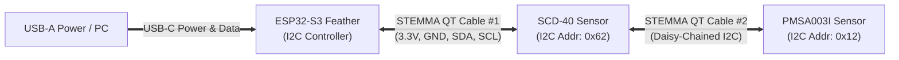
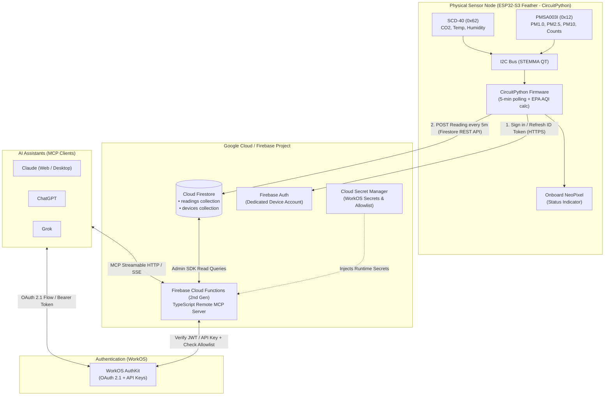

# Product Requirements Document (PRD): Custom ESP32-S3 Air Quality Sensor + Firebase + MCP Server

## 1. Executive Summary & Vision

This project builds an end-to-end, DIY smart indoor air quality (IAQ) monitoring system that bridges physical hardware with modern conversational AI assistants (**Claude**, **ChatGPT**, **Grok**, and any MCP-compatible client).

Using plug-and-play Adafruit hardware (**ESP32-S3 Feather**, **SCD-40 CO2/Temp/Humidity sensor**, and **PMSA003I laser particulate matter sensor** connected via solderless **STEMMA QT / I2C** cables), the device measures indoor air quality every **5 minutes** and publishes rich sensor telemetry directly to **Google Cloud Firestore**. A remote **Model Context Protocol (MCP) server** running on **Firebase Cloud Functions (2nd Gen / Cloud Run)** and secured with **WorkOS AuthKit (OAuth 2.1 + API Key support)** exposes these readings to AI assistants so the user can ask natural-language questions about their air quality, trends, and health/ventilation recommendations.

Because this repository is **public on GitHub** and serves as a **learning-by-doing educational project**, it places equal emphasis on:
1. **Zero Personal Information / Secret Leakage**: Multi-layer guardrails preventing credentials, emails, Wi-Fi SSIDs, or project identifiers from ever being committed.
2. **Educational Documentation ("Learn by Doing")**: Modular, beginner-friendly Markdown guides in `docs/` that teach the *why* and *how* behind I2C hardware chaining, CircuitPython, Firestore data modeling, OAuth 2.1 with WorkOS, and the Model Context Protocol.

---

## 2. Goals & Non-Goals

### Goals
- **Solderless Hardware Assembly**: Daisy-chain the ESP32-S3 Feather, SCD-40, and PMSA003I via STEMMA QT cables and power via USB-A to USB-C.
- **Accessible Firmware**: Run **CircuitPython** on the ESP32-S3 so code can be edited directly via USB drive (`CIRCUITPY`) with readable Python and clear NeoPixel visual status feedback.
- **Direct-to-Firestore Telemetry**: Authenticate the ESP32-S3 with Firebase Auth (REST API) and write rich 5-minute interval readings directly to Firestore without intermediate servers.
- **AI-Ready Remote MCP Server**: Host a TypeScript MCP Server on Firebase Cloud Functions (2nd Gen) supporting Streamable HTTP/SSE so cloud AI assistants (ChatGPT, Claude, Grok) and desktop/CLI clients can query live and historical air quality.
- **Enterprise-Grade Personal Auth**: Protect the MCP server with **WorkOS AuthKit (OAuth 2.1)** and an explicit user allowlist (plus fallback WorkOS API key verification for CLI tools) so only the owner can read their home sensor data.
- **Public-Repo Safety**: Enforce strict secret isolation using `.gitignore`, `.example` templates, Firebase Secret Manager, pre-commit hooks, and a GitHub Actions secret scanner (Gitleaks).
- **Rich Educational Markdown Docs**: Provide step-by-step guides in `docs/` that explain hardware, cloud, auth, and MCP concepts clearly for someone learning by doing.

### Non-Goals (Out of Scope for v1)
- Battery management or deep-sleep optimization (the device will remain plugged into continuous USB power).
- Custom mobile or web dashboard UI (AI clients via MCP and the Firebase Console serve as the primary interfaces in v1).
- Automated physical actuation (e.g., turning on smart plugs or HVAC fans automatically), though the architecture allows adding this later.
- Local offline flash/SD card buffering during power or Wi-Fi outages (the sensor will auto-retry Wi-Fi and drop missed intervals until reconnected).

---

## 3. Bill of Materials (Hardware Inventory)

| Component | Part / Model | Role & Interface | I2C Address |
| :--- | :--- | :--- | :--- |
| **Microcontroller** | Adafruit ESP32-S3 Feather | Wi-Fi 2.4GHz microcontroller running CircuitPython; hosts onboardSTEMMA QT port and NeoPixel status LED | Host (Controller) |
| **CO2 Sensor** | Adafruit SCD-40 (Sensirion) | Photoacoustic true $\text{CO}_2$ sensor (400–2000+ ppm) + ambient temperature & relative humidity | `0x62` |
| **Particulate Sensor** | Adafruit PMSA003I (Plantower) | Laser scattering particulate sensor measuring $\text{PM}_{1.0}$, $\text{PM}_{2.5}$, $\text{PM}_{10.0}$ concentration ($\mu\text{g/m}^3$) and particle counts by size | `0x12` |
| **Interconnects** | 2x STEMMA QT / Qwiic Cables (4-pin JST SH) | Daisy-chains 3.3V power (`VCC`), Ground (`GND`), Clock (`SCL`), and Data (`SDA`) between board and sensors | N/A |
| **Power & Data Cable** | USB-A to USB-C Cable | Connects ESP32-S3 Feather to a computer (for coding/serial console) or USB wall adapter (for 24/7 operation) | N/A |

### Hardware Wiring Topology


> [!NOTE]
> Both the SCD-40 and PMSA003I breakouts include two STEMMA QT ports on opposite sides, allowing you to plug Cable #1 from the ESP32-S3 into the first sensor, and Cable #2 from the first sensor's second port into the second sensor in any order.

---

## 4. System Architecture



---

## 5. Component Specifications

### 5.1 Firmware Specification (ESP32-S3 / CircuitPython)

- **Runtime Environment**: CircuitPython 9.x+ for Adafruit Feather ESP32-S3.
- **Required CircuitPython Libraries** (`lib/` on `CIRCUITPY`):
  - `adafruit_scd4x` (SCD-40 driver)
  - `adafruit_pm25` (PMSA003I I2C driver)
  - `adafruit_requests` & `adafruit_connection_manager` (HTTPS REST requests)
  - `neopixel` (Onboard status LED)
- **Configuration Isolation (`settings.toml`)**:
  - CircuitPython natively reads environment variables from `settings.toml` via `os.getenv()`.
  - Variables stored locally on the board (and **never** committed to Git):
    - `CIRCUITPY_WIFI_SSID`
    - `CIRCUITPY_WIFI_PASSWORD`
    - `FIREBASE_PROJECT_ID`
    - `FIREBASE_WEB_API_KEY`
    - `FIREBASE_DEVICE_EMAIL` & `FIREBASE_DEVICE_PASSWORD` (dedicated device user in Firebase Auth)
    - `SENSOR_DEVICE_ID` (e.g., `"feather-s3-01"`)
    - `SENSOR_LOCATION` (e.g., `"office"` or `"living-room"`)
- **Sampling & Publishing Loop (Every 5 Minutes / 300 Seconds)**:
  1. **Boot & Self-Test**: Initialize I2C bus (`board.STEMMA_I2C()`), verify `0x62` (SCD-40) and `0x12` (PMSA003I) are present, start SCD-40 periodic measurement, and wait 5–10 seconds for initial sensor stabilization.
  2. **Wi-Fi & Auth**: Connect to 2.4GHz Wi-Fi. Authenticate against Firebase Auth REST API (`accounts:signInWithPassword`) to obtain a short-lived `idToken` (valid for 1 hour) and `refreshToken`. Automatically refresh the token via `securetoken.googleapis.com/v1/token` before expiry.
  3. **Read Sensors**:
     - Query SCD-40 for `CO2` (ppm), `temperature` (°C and converted °F), and `relative_humidity` (%).
     - Query PMSA003I for standard and environmental $\text{PM}_{1.0}$, $\text{PM}_{2.5}$, $\text{PM}_{10.0}$ ($\mu\text{g/m}^3$), plus raw particle counts per $0.1\text{ L}$ of air ($>0.3\mu\text{m}$, $>0.5\mu\text{m}$, $>1.0\mu\text{m}$, $>2.5\mu\text{m}$, $>5.0\mu\text{m}$, $>10.0\mu\text{m}$).
  4. **Compute AQI**: Calculate the US EPA $\text{PM}_{2.5}$ and $\text{PM}_{10}$ Air Quality Index (0–500 scale) and category (`"Good"`, `"Moderate"`, `"Unhealthy for Sensitive Groups"`, etc.) on-device so every document has an immediate AQI score.
  5. **Publish to Firestore**:
     - `POST` a new document to `readings` collection via Firestore REST API.
     - `PATCH` the `devices/{SENSOR_DEVICE_ID}` document with `last_seen_at` and latest snapshot metrics.
- **Onboard NeoPixel Status Language**:
  - **Blue (Solid during boot)**: Initializing hardware and connecting to Wi-Fi.
  - **Green (Brief 1-second pulse, then OFF/dim)**: Reading succeeded and published to Firestore (keeps the LED dark 99% of the time so it isn't distracting in a room).
  - **Amber / Yellow (Slow blink)**: Wi-Fi disconnected or Firestore request failed; auto-retrying on next cycle without crashing.
  - **Red (Fast blink)**: I2C hardware error (e.g., a STEMMA QT cable came unplugged).
- **Resilience & Watchdog**:
  - Wrap the main loop in structured exception handling (`try/except`) and configure the microcontroller watchdog / supervisor reload so transient network errors or socket drops never leave the board stuck.

---

### 5.2 Database & Security Specification (Cloud Firestore)

#### Collection 1: `readings` (Time-Series Collection)
Every 5 minutes, a new document (auto-generated ID or `<device_id>_<epoch_ms>`) is created in `readings`:

```json
{
  "device_id": "feather-s3-01",
  "location": "home-office",
  "timestamp": "2026-11-21T21:50:00Z",
  "co2_ppm": 642,
  "temperature_c": 22.4,
  "temperature_f": 72.3,
  "humidity_percent": 44.8,
  "pm1_0_ug_m3": 3,
  "pm2_5_ug_m3": 6,
  "pm10_0_ug_m3": 11,
  "aqi_us": 25,
  "aqi_category": "Good",
  "particles_0_3um": 810,
  "particles_0_5um": 225,
  "particles_1_0um": 42,
  "particles_2_5um": 4,
  "particles_5_0um": 1,
  "particles_10_0um": 0
}
```

#### Collection 2: `devices` (Device Registry & Latest Status)
Document path: `devices/{device_id}`:

```json
{
  "device_id": "feather-s3-01",
  "location": "home-office",
  "last_seen_at": "2026-11-21T21:50:00Z",
  "firmware_version": "1.0.0",
  "sensors": ["SCD-40", "PMSA003I"],
  "reporting_interval_seconds": 300,
  "latest_reading": {
    "co2_ppm": 642,
    "temperature_f": 72.3,
    "humidity_percent": 44.8,
    "pm2_5_ug_m3": 6,
    "aqi_us": 25,
    "aqi_category": "Good"
  }
}
```

#### Composite Indexes (`firestore.indexes.json`)
- `readings`: Composite index on `(device_id ASC, timestamp DESC)` and `(location ASC, timestamp DESC)` for fast historical queries per sensor/room.

#### Firestore Security Rules (`firestore.rules`)
- **Zero Public Access**: Unauthenticated requests cannot read or write any document.
- **Sensor Write-Only Access**: The dedicated Firebase Auth `device_uid` (configured by the owner) is only allowed to `create` documents in `readings` (with schema/type validation ensuring valid numeric fields) and `write` its own document in `devices/{device_id}`.
- **MCP Server Read Access**: The Firebase Cloud Functions MCP server reads Firestore via `firebase-admin` (Admin SDK), bypassing client rules while enforcing WorkOS authentication at the MCP gateway layer.

---

### 5.3 Remote MCP Server & WorkOS Authentication Specification

- **Platform & Runtime**: Firebase Cloud Functions (2nd Gen, backed by Cloud Run) using **Node.js 22 + TypeScript**, `@modelcontextprotocol/sdk`, `firebase-admin`, and `@workos-inc/node`.
- **Transport Protocol**:
  - Supports **MCP Streamable HTTP** (`/mcp`) and **HTTP + SSE** (`/sse` and `/messages`) for full compatibility across **Claude**, **ChatGPT**, **Grok**, and desktop/CLI MCP clients.
- **WorkOS Authentication & Authorization Flow**:
  1. **OAuth 2.1 Discovery & Dynamic Auth**: Exposes standard OAuth metadata endpoints (`/.well-known/oauth-authorization-server` / `/.well-known/oauth-protected-resource`) delegating user sign-in to **WorkOS AuthKit**.
  2. **Strict Owner Allowlist**: After WorkOS authenticates a user token, the middleware checks the user's WorkOS `user.id` or verified `email` against the `ALLOWED_WORKOS_EMAILS` / `ALLOWED_WORKOS_USER_IDS` secret stored in **Google Cloud Secret Manager**. Any non-allowlisted user receives `403 Forbidden`.
  3. **API Key Fallback**: Also accepts a WorkOS API Key / static secret Bearer token header for MCP clients or local testing tools that prefer Bearer header configuration over interactive OAuth redirects.

#### MCP Tools Exposed to AI Assistants

| Tool Name | Input Parameters (Zod Schema) | Description & Returned Data |
| :--- | :--- | :--- |
| `get_latest_reading` | `device_id?: string`, `location?: string` | Fetches the most recent sensor reading and current `devices` status, including how many minutes ago the sensor reported, current $\text{CO}_2$, Temp, Humidity, $\text{PM}_{2.5}$, AQI, and qualitative health context. |
| `get_readings_history` | `hours?: number` (default `24`, max `168`), `start_time?: string`, `end_time?: string`, `location?: string`, `limit?: number` (default `100`) | Queries historical time-series readings from Firestore within the requested window. Supports downsampling if querying multi-day ranges so the LLM context window isn't flooded. |
| `get_air_quality_summary` | `period: "1h" \| "6h" \| "24h" \| "7d" \| "30d"`, `location?: string` | Computes statistical aggregations (min, max, average, 95th percentile) for $\text{CO}_2$, $\text{PM}_{2.5}$, $\text{PM}_{10}$, Temp, and Humidity over the period, plus automatically detects notable spikes (e.g., $\text{CO}_2 > 1000\text{ ppm}$ or $\text{PM}_{2.5} > 12\ \mu\text{g/m}^3$) with timestamps. |
| `get_sensor_status` | `device_id?: string` | Checks all registered sensors in `devices`, verifies whether `last_seen_at` is within the expected 5-minute window (or flags if offline/stale $>15\text{ min}$), and reports sensor metadata. |

#### MCP Prompts & Resources Exposed

| Prompt / Resource Name | Type | Purpose |
| :--- | :--- | :--- |
| `analyze_indoor_air` | MCP Prompt | Pre-built prompt instructing the AI assistant to pull the latest reading and 24-hour summary, evaluate cognitive impact of $\text{CO}_2$ levels, check particulate risks, and give actionable advice (e.g., "open a window for 15 minutes" or "run a HEPA purifier"). |
| `air-quality://thresholds/reference` | MCP Resource | Embedded reference guide of US EPA $\text{PM}_{2.5}$/$\text{PM}_{10}$ AQI breakpoints, ASHRAE / Harvard cognitive $\text{CO}_2$ thresholds ($400\text{–}800\text{ ppm}$ optimal, $1000\text{–}1400\text{ ppm}$ drowsy, $>1500\text{ ppm}$ poor ventilation), and ideal indoor humidity ranges ($30\%\text{–}50\%$). |

---

## 6. Privacy, Security & Public GitHub Guardrails

Because this repository is public, **no personal identifiers, Wi-Fi names, email addresses, Firebase project IDs, or API keys** may ever appear in tracked files or commit history.

### 4-Layer Secret Protection Strategy

1. **Strict `.gitignore` & Zero Hardcoded Configs**:
   - Ignore all real environment and credential files:
     - `firmware/settings.toml`
     - `.firebaserc`
     - `functions/.env*`
     - `functions/.secret*`
     - `*service-account*.json`, `*credentials*.json`
2. **Safe `.example` Template Files**:
   - Commit clearly documented template files with placeholder values:
     - `firmware/settings.toml.example`
     - `.firebaserc.example`
     - `functions/.env.example`
3. **Cloud Secret Manager for Production**:
   - The deployed MCP server uses `defineSecret()` from `firebase-functions/params` (backed by Google Cloud Secret Manager) for `WORKOS_API_KEY`, `WORKOS_CLIENT_ID`, `MCP_BEARER_FALLBACK_SECRET`, and `ALLOWED_USER_EMAILS`. Nothing sensitive sits in source code or `firebase.json`.
4. **Automated Pre-Commit & CI Secret Scanning**:
   - Include a `.gitleaks.toml` configuration and a GitHub Actions workflow (`.github/workflows/secret-scan.yml`) + local pre-commit check script (`scripts/check-secrets.sh`) that scans for accidental Wi-Fi credentials, API keys, emails, or project IDs before they can reach GitHub.

---

## 7. Repository Structure & Educational Documentation Plan

The repository will be organized cleanly into hardware firmware, Firebase/MCP backend, and a numbered **learning-by-doing curriculum** in `docs/`:

```text
mhusk-custom-air-sensor/
├── PRD.md                                  # This Product Requirements Document
├── README.md                               # Project overview, architecture diagram, and quickstart links
├── .gitignore                              # Strict ignore rules for CircuitPython, Firebase, Node, & secrets
├── .gitleaks.toml                          # Secret scanning rules for public repo protection
├── .firebaserc.example                     # Placeholder Firebase project alias config
├── firebase.json                           # Firestore rules/indexes & Cloud Functions configuration
├── firestore.rules                         # Strict Firestore security rules
├── firestore.indexes.json                  # Composite indexes for time-series queries
├── .github/
│   └── workflows/
│       └── secret-scan.yml                 # Automated Gitleaks & lint check on push/PR
├── docs/                                   # "Learn by Doing" Educational & Setup Curriculum
│   ├── 01-hardware-and-i2c.md              # How STEMMA QT & I2C work + step-by-step physical assembly
│   ├── 02-circuitpython-firmware.md        # Flashing CircuitPython, libraries, settings.toml, & how the loop works
│   ├── 03-firebase-and-firestore.md        # Setting up Firebase Auth, Firestore collections, indexes, & security rules
│   ├── 04-workos-and-mcp-server.md         # What MCP is, how WorkOS OAuth 2.1 works, and deploying Cloud Functions
│   ├── 05-connecting-ai-clients.md         # Step-by-step instructions to connect Claude, ChatGPT, and Grok
│   └── 06-security-and-privacy-checklist.md# How to keep your public GitHub repo 100% free of personal data
├── firmware/                               # Code that gets copied to the ESP32-S3 CIRCUITPY USB drive
│   ├── code.py                             # Main CircuitPython sensor & Firestore publishing loop
│   ├── aqi.py                              # US EPA PM2.5 / PM10 AQI calculation module
│   ├── firestore_client.py                 # Lightweight Firebase Auth + Firestore REST helper for CircuitPython
│   ├── settings.toml.example               # Template for Wi-Fi and Firebase credentials
│   └── requirements-circuitpython.txt      # List of Adafruit CircuitPython Bundle libraries needed in /lib
├── functions/                              # Firebase Cloud Functions (2nd Gen) TypeScript MCP Server
│   ├── package.json
│   ├── tsconfig.json
│   ├── .env.example
│   └── src/
│       ├── index.ts                        # Cloud Function HTTP entry point & OAuth / MCP routing
│       ├── auth/
│       │   └── workos.ts                   # WorkOS AuthKit OAuth 2.1 + allowlist + API key verification
│       ├── mcp/
│       │   ├── server.ts                   # MCP Server registration
│       │   ├── tools.ts                    # get_latest_reading, get_readings_history, get_air_quality_summary, get_sensor_status
│       │   └── prompts.ts                  # Built-in IAQ health prompts & threshold resources
│       └── services/
│           └── firestore.ts                # Typed Firestore queries & statistical summary calculators
└── scripts/
    └── check-secrets.sh                    # Local helper script to verify no personal data is staged in git
```

### Pedagogical Style of `docs/` ("Learn by Doing")
Each guide in `docs/` will follow a consistent educational template:
1. **Concept Briefing ("How It Works Under the Hood")**: Plain-English explanation of the technology (e.g., *What is an I2C bus and why can two sensors share one cable?*, *How does a laser count dust particles?*, *Why does the ESP32 exchange a password for a 1-hour JWT token?*, *What happens when Claude calls an MCP tool?*).
2. **Hands-On Step-by-Step Setup**: Exact commands, clicks, and file copies needed.
3. **Checkpoint / Verification ("How to Know It's Working")**: How to test that specific layer (e.g., viewing the serial console in Mu/Thonny/screen, checking a document appear in Firestore, testing the MCP server with the MCP Inspector) before moving to the next guide.
4. **Common Pitfalls & Troubleshooting**: Friendly explanations of common errors and how to fix them.

---

## 8. Implementation Milestones

- **Phase 1: Repository Scaffolding & Security Guardrails**
  - Set up `.gitignore`, `.gitleaks.toml`, `.example` files, `scripts/check-secrets.sh`, and GitHub Actions secret scanning.
- **Phase 2: CircuitPython Firmware (`firmware/`)**
  - Implement `aqi.py`, `firestore_client.py`, and `code.py` with NeoPixel status codes, SCD-40 + PMSA003I reading logic, and 5-minute Firestore REST publishing.
- **Phase 3: Firebase Configuration & Security Rules**
  - Author `firebase.json`, `firestore.indexes.json`, and hardened `firestore.rules`.
- **Phase 4: TypeScript Remote MCP Server + WorkOS (`functions/`)**
  - Implement the Firebase Cloud Function MCP server, Firestore query/aggregation service, MCP tools/prompts, and WorkOS OAuth 2.1 + allowlist middleware.
- **Phase 5: Educational Documentation (`docs/` & `README.md`)**
  - Write the 6 comprehensive "Learn by Doing" guides and main `README.md`.
- **Phase 6: Hardware Assembly & Live End-to-End Verification**
  - Walk through flashing the ESP32-S3, deploying Firestore & the MCP Cloud Function, and running the first live query from Claude / ChatGPT / Grok.
