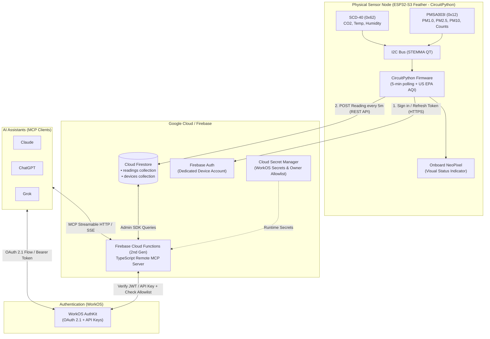

# Custom ESP32-S3 Air Quality Sensor + Firebase + Remote MCP Server

An end-to-end, DIY smart indoor air quality (IAQ) monitoring system that connects physical environmental sensors (**CO<sub>2</sub>**, **PM<sub>1.0</sub> / PM<sub>2.5</sub> / PM<sub>10</sub>**, **Temperature**, and **Humidity**) to **Google Cloud Firestore** and exposes live & historical telemetry to modern AI assistants (**Claude**, **ChatGPT**, **Grok**, and any MCP-compatible client) through a remote **Model Context Protocol (MCP)** server secured with **WorkOS AuthKit**.

---

## Why Build This? (The Backstory)

I was inspired to start this project after listening to a **Chris Williamson (*Modern Wisdom*) podcast episode featuring Michael Feldstein**, the founder of **Jaspr**. Hearing their deep dive into indoor air quality—how invisible spikes in CO<sub>2</sub> degrade sleep and cognitive focus, and how fine particulate matter (PM<sub>2.5</sub>) from cooking, wildfire smoke, or everyday dust lingers indoors—made me curious to measure the air in my own home.

When I looked at consumer air quality monitors, I realized something interesting: **most commercial smart air sensors cost roughly the same amount as buying these high-precision sensor breakouts yourself**. While buying an off-the-shelf unit gives you a plastic shell and a proprietary app, building one from scratch for a similar price is a much more rewarding way to learn by doing—exploring how I2C hardware buses, CircuitPython firmware, cloud time-series databases, OAuth 2.1, and the Model Context Protocol (MCP) all fit together.

Because this repository is **public on GitHub** and designed as a step-by-step learning project, every milestone is documented in [`docs/`](./docs/) along with real-world **"Good to Know & Troubleshooting"** notes captured as each layer is validated.

---

## Hardware Bill of Materials (Solderless STEMMA QT / I2C)

All components plug together using 4-pin **STEMMA QT (JST SH)** cables—no soldering required:

| Component | Part / Model | What It Measures / Does | I2C Address |
| :--- | :--- | :--- | :--- |
| **Microcontroller** | **Adafruit ESP32-S3 Feather** | 2.4GHz Wi-Fi board running CircuitPython; includes onboard STEMMA QT port & NeoPixel status LED | Host Controller |
| **CO<sub>2</sub> Sensor** | **Adafruit SCD-40** (Sensirion) | True photoacoustic CO<sub>2</sub> (400–2000+ ppm), ambient temperature, & relative humidity | `0x62` |
| **Particulate Sensor** | **Adafruit PMSA003I** (Plantower) | Laser particulate matter sensor measuring PM<sub>1.0</sub>, PM<sub>2.5</sub>, PM<sub>10.0</sub> (µg/m³) + raw particle counts by size (>0.3 µm to >10.0 µm) | `0x12` |
| **Interconnects** | **2x STEMMA QT Cables** | Daisy-chains `3.3V`, `GND`, `SDA`, and `SCL` across the ESP32-S3 and both sensors | N/A |
| **Power & Data** | **USB-A to USB-C Cable** | Powers the board continuously and mounts the `CIRCUITPY` USB drive when connected to a computer | N/A |

---

## System Architecture



---

## "Learn by Doing" Documentation Curriculum

Each guide in `docs/` explains how the underlying technology works, walks through setup step-by-step, provides a focused validation checkpoint, and records real-world troubleshooting tips discovered during development:

1. [**`docs/01-hardware-and-i2c.md`**](./docs/01-hardware-and-i2c.md) — How the I2C bus and STEMMA QT daisy-chaining work, physical assembly, and flashing CircuitPython.
2. [**`docs/02-circuitpython-firmware.md`**](./docs/02-circuitpython-firmware.md) — US EPA AQI math, Firebase REST authentication from a microcontroller, NeoPixel status codes, and the 5-minute sensor loop.
3. [**`docs/03-firebase-and-firestore.md`**](./docs/03-firebase-and-firestore.md) — Provisioning Firebase Auth, Cloud Firestore time-series collections, composite indexes, and hardened write-only security rules.
4. [**`docs/04-workos-and-mcp-server.md`**](./docs/04-workos-and-mcp-server.md) — Building the TypeScript Remote MCP Server on Firebase Cloud Functions (2nd Gen) and protecting it with WorkOS AuthKit OAuth 2.1 + an owner allowlist.
5. [**`docs/05-connecting-ai-clients.md`**](./docs/05-connecting-ai-clients.md) — Connecting Claude, ChatGPT, and Grok to query your indoor air quality in natural language.
6. [**`docs/06-security-and-privacy-checklist.md`**](./docs/06-security-and-privacy-checklist.md) — The 4-layer public-repo security strategy keeping Wi-Fi credentials, emails, project IDs, and API keys out of Git.

---

## Project Documents & Progress Tracking

- [**`PRD.md`**](./PRD.md) — Complete Product Requirements Document, data schemas, and component specifications.
- [**`IMPLEMENTATION_PLAN.md`**](./IMPLEMENTATION_PLAN.md) — Our 11-step commit & validation roadmap tracking each atomic build step.

---

## Keeping Your Fork Secret-Free

Before committing any changes, run the local secret scanner:

```bash
./scripts/check-secrets.sh
```

All personal configuration lives in gitignored files copied from safe `.example` templates:
- `firmware/settings.toml.example` → `firmware/settings.toml` (on your local machine / `CIRCUITPY` drive)
- `.firebaserc.example` → `.firebaserc`
- `functions/.env.example` → `functions/.env.local` (for local testing; production uses Google Cloud Secret Manager)
