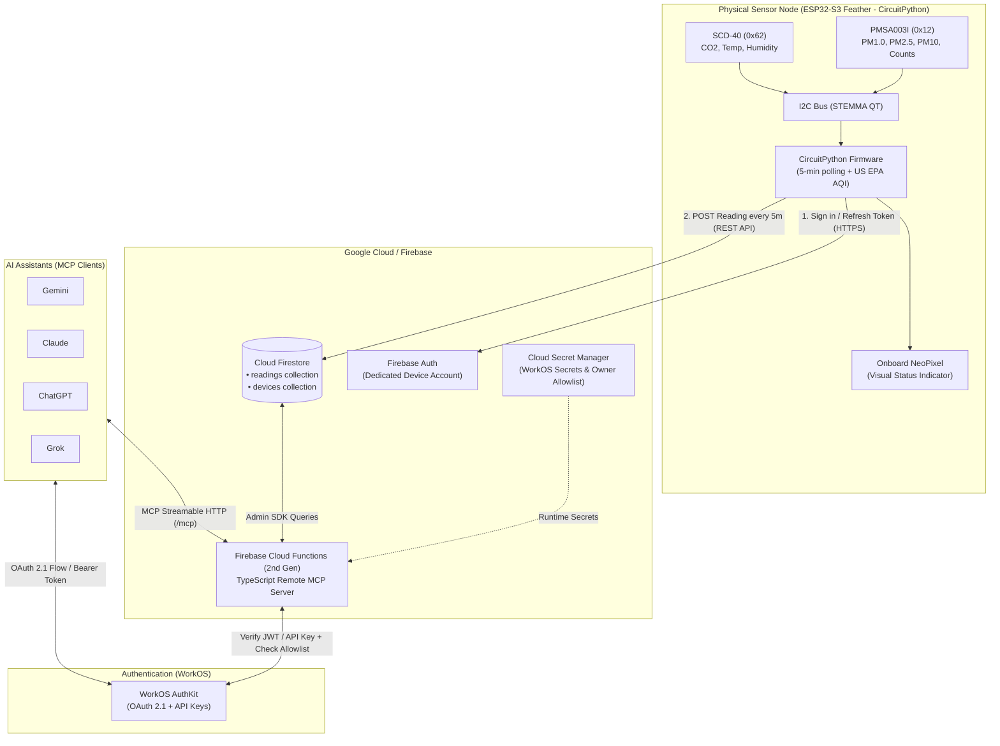

# Custom ESP32-S3 Air Quality Sensor + Firebase + Remote MCP Server

An end-to-end, DIY smart indoor air quality (IAQ) monitoring system that connects physical environmental sensors (**CO<sub>2</sub>**, **PM<sub>1.0</sub> / PM<sub>2.5</sub> / PM<sub>10</sub>**, **Temperature**, and **Humidity**) to **Google Cloud Firestore** and exposes live & historical telemetry to modern AI assistants (**Gemini**, **Claude**, **ChatGPT**, **Grok**, and any MCP-compatible client) through a remote **Model Context Protocol (MCP)** server secured with **WorkOS AuthKit**.

---

## Why Build This? (The Backstory)

I was inspired to start this project after listening to a **Chris Williamson (*Modern Wisdom*) podcast episode featuring Michael Feldstein**, the founder of **Jaspr**. Hearing their deep dive into indoor air quality—how invisible spikes in CO<sub>2</sub> degrade sleep and cognitive focus, and how fine particulate matter (PM<sub>2.5</sub>) from cooking, wildfire smoke, or everyday dust lingers indoors—made me curious to measure the air in my own home.

When I looked at consumer air quality monitors, I realized something interesting: **most commercial smart air sensors cost roughly the same amount as buying these high-precision sensor breakouts yourself**. While buying an off-the-shelf unit gives you a plastic shell and a proprietary app, building one from scratch for a similar price is a much more rewarding way to learn by doing—exploring how I2C hardware buses, CircuitPython firmware, cloud time-series databases, OAuth 2.1, and the Model Context Protocol (MCP) all fit together.

Because this repository is **public on GitHub** and designed as a step-by-step learning project, every milestone is documented in [`docs/`](./docs/) along with real-world **"Good to Know & Troubleshooting"** notes captured as each layer is validated.

---

## Where We Are Now & Next Steps

> **Current Snapshot:** **Phase 1 (v1) and Phase 2 (Remote Config + Web Dashboard) are live end-to-end**, streaming indoor air quality to Cloud Firestore, answering natural-language queries in **Gemini** and **Grok** via MCP, and providing a WorkOS-protected Firebase Hosting web dashboard with 6h/24h/7d interactive SVG charts and Layer 1 remote device settings.

| Phase / Layer | Status | Summary |
| :--- | :---: | :--- |
| **Phase 1 — Sensor Node & Firmware** | `Live` | ESP32-S3 Feather + SCD-40 + PMSA003I via STEMMA QT running CircuitPython `v1.2.0` (`boot.py` + immutable `code.py` auto-rollback bootloader + `app.py` with on-device US EPA AQI, remote config polling, RAM SCD-40 calibration, muteable NeoPixel, watchdog) |
| **Phase 1 — Cloud & Remote MCP** | `Live` | Hardened write-only Firestore rules, composite indexes, Cloud Functions (2nd Gen) MCP server, and WorkOS AuthKit OAuth 2.1 + owner allowlist |
| **Enclosure — 3D-Printed Hub** | `Printing` | Screwless, support-free, thermally baffled bedroom enclosure ([`docs/08-enclosure-hardware-plan.md`](./docs/08-enclosure-hardware-plan.md)) |
| **Phase 2 — Web Dashboard & Remote Config** *(Layer 1)* | `Live` | Zero-build Firebase Hosting dashboard (WorkOS AuthKit PKCE login, live °F cards, 6h/24h/7d interactive SVG charts, Device Settings drawer) + Firestore-backed `device_configs` remote tuning ([`docs/09-remote-config-and-dashboard.md`](./docs/09-remote-config-and-dashboard.md)) |
| **Phase 3 — Cloud OTA with A/B Rollback** *(Layer 2)* | `In Progress` | Steps 16–17 live-verified (`boot.py` + immutable `code.py` auto-rollback + SHA-256 `firmware_releases` pipeline & publish CLI in [`docs/10-cloud-ota-and-rollback.md`](./docs/10-cloud-ota-and-rollback.md)); next up: on-device pull-based OTA updater and Fleet rollout UI |
| **Phase 4 — Multi-Room Fleet & Proactive Alerts** | `Backlog` | Additional room nodes (`compare_rooms` MCP tool + per-device UID isolation), proactive CO<sub>2</sub>/PM<sub>2.5</sub> push alerts, outdoor AQI context for "should I open the window?" decisions, and optional smart-home actuation |

### What's Next (The 2-Layer Remote Update Plan)
1. **Finish enclosure commissioning & launch Phase 2 (Remote Config + Web Dashboard):** Dial in enclosed SCD-40 temperature offset and altitude compensation, then manage day-to-day settings and view 24h/7d room charts from a lightweight WorkOS-protected Firebase Hosting dashboard—with zero flash wear or brick risk.
2. **Build Phase 3 (Cloud Pull-Based OTA with A/B Rollback):** Refactor firmware into an immutable `code.py` bootloader + updatable `app.py` with SHA-256 checksum verification and one-click fleet rollouts from the dashboard so future updates never require unplugging a sensor.
3. **Scale to Phase 4 (Multi-Room & Proactive Intelligence):** Print additional enclosures for more rooms, add `compare_rooms` and outdoor AQI context to the MCP server, and trigger push alerts when CO<sub>2</sub> or PM<sub>2.5</sub> spikes.

Track every atomic step and validation checkpoint in [`IMPLEMENTATION_PLAN.md`](./IMPLEMENTATION_PLAN.md).

---

## Hardware Bill of Materials (Solderless STEMMA QT / I2C)

All components plug together using 4-pin **STEMMA QT (JST SH)** cables—no soldering required:

| Component | Part / Model | What It Measures / Does | I2C Address |
| :--- | :--- | :--- | :--- |
| **Microcontroller** | **Adafruit ESP32-S3 Feather** | 2.4GHz Wi-Fi board running CircuitPython; includes onboard STEMMA QT port & NeoPixel status LED | Host Controller |
| **CO<sub>2</sub> Sensor** | **Adafruit SCD-40** (Sensirion) | True photoacoustic CO<sub>2</sub> (400–2000+ ppm), ambient temperature, & relative humidity | `0x62` |
| **Particulate Sensor** | **Adafruit PMSA003I** (Plantower) | Laser particulate matter sensor measuring PM<sub>1.0</sub>, PM<sub>2.5</sub>, PM<sub>10.0</sub> (µg/m³) + raw particle counts by size (>0.3 µm to >10.0 µm) | `0x12` |
| **Interconnects** | **2x STEMMA QT Cables** | Daisy-chains `3.3V`, `GND`, `SDA`, and `SCL` across the ESP32-S3 and both sensors | N/A |
| **Power & Data** | **USB-A to USB-C Cable** | Powers the board continuously and mounts the `CIRCUITPY` USB drive when connected to a computer | N/A |

---

## System Architecture



---

## "Learn by Doing" Documentation Curriculum

Each guide in `docs/` explains how the underlying technology works, walks through setup step-by-step, provides a focused validation checkpoint, and records real-world troubleshooting tips discovered during development:

1. [**`docs/01-hardware-and-i2c.md`**](./docs/01-hardware-and-i2c.md) — How the I2C bus and STEMMA QT daisy-chaining work, physical assembly, and flashing CircuitPython.
2. [**`docs/02-circuitpython-firmware.md`**](./docs/02-circuitpython-firmware.md) — US EPA AQI math, Firebase REST authentication from a microcontroller, NeoPixel status codes, and the 5-minute sensor loop.
3. [**`docs/03-firebase-and-firestore.md`**](./docs/03-firebase-and-firestore.md) — Provisioning Firebase Auth, Cloud Firestore time-series collections, composite indexes, and hardened write-only security rules.
4. [**`docs/04-workos-and-mcp-server.md`**](./docs/04-workos-and-mcp-server.md) — Building the TypeScript Remote MCP Server on Firebase Cloud Functions (2nd Gen) and protecting it with WorkOS AuthKit OAuth 2.1 + an owner allowlist.
5. [**`docs/05-connecting-ai-clients.md`**](./docs/05-connecting-ai-clients.md) — Connecting Gemini, Claude, ChatGPT, and Grok to query your indoor air quality in natural language.
6. [**`docs/06-security-and-privacy-checklist.md`**](./docs/06-security-and-privacy-checklist.md) — The 4-layer public-repo security strategy keeping Wi-Fi credentials, emails, project IDs, and API keys out of Git.
7. [**`docs/07-understanding-your-readings.md`**](./docs/07-understanding-your-readings.md) — Plain-English guide to every sensor metric (CO<sub>2</sub>, PM<sub>1.0</sub>/PM<sub>2.5</sub>/PM<sub>10</sub>, US EPA AQI, humidity, temperature), health thresholds, and how to improve them.
8. [**`docs/08-enclosure-hardware-plan.md`**](./docs/08-enclosure-hardware-plan.md) — Screwless, support-free 3D-printed enclosure design (Bambu Lab X1 Carbon) with a ready-to-paste SpeakCAD prompt in [`enclosure/speakcad-prompt.txt`](./enclosure/speakcad-prompt.txt).
9. [**`docs/09-remote-config-and-dashboard.md`**](./docs/09-remote-config-and-dashboard.md) — Device Shadow remote config (`device_configs`), live firmware polling & SCD-40 RAM calibration, WorkOS-protected Dashboard API, and zero-build Firebase Hosting web UI.
10. [**`docs/10-cloud-ota-and-rollback.md`**](./docs/10-cloud-ota-and-rollback.md) — USB-aware `boot.py` NVM handoff, minimal immutable `code.py` auto-rollback bootloader, SHA-256 `firmware_releases` manifest/publish CLI, and Layer 2 cloud OTA architecture.

---

## Project Documents & Progress Tracking

- [**`PRD.md`**](./PRD.md) — Complete Product Requirements Document, data schemas, and component specifications.
- [**`IMPLEMENTATION_PLAN.md`**](./IMPLEMENTATION_PLAN.md) — Our phased, step-by-step commit & validation roadmap (Phase 1 completed; Phases 2–4 queued).

---

## Built-In Verification Scripts

Every layer can be validated independently before deploying or flashing hardware:

```bash
# 1. Secret & privacy guardrails (always run before committing)
./scripts/check-secrets.sh

# 2. Firmware EPA AQI math & Firestore REST encoding (add --publish for a live test write)
python3 scripts/test_firmware_local.py

# 3. Cloud Functions TypeScript build + Firestore stats, MCP protocol, WorkOS OAuth, and Dashboard API checks
npm --prefix functions run verify:firestore
npm --prefix functions run verify:mcp
npm --prefix functions run verify:auth
npm --prefix functions run verify:api

# 4. Lightweight Web Dashboard (PKCE, SVG charts, HTML semantics, Firebase Hosting rewrites)
node scripts/verify_web_dashboard.mjs
```

---

## Keeping Your Fork Secret-Free

Before committing any changes, run the local secret scanner:

```bash
./scripts/check-secrets.sh
```

All personal configuration lives in gitignored files copied from safe `.example` templates:
- `firmware/settings.toml.example` → `firmware/settings.toml` (on your local machine / `CIRCUITPY` drive)
- `.firebaserc.example` → `.firebaserc`
- `functions/.env.example` → `functions/.env.local` (for local testing via `npm --prefix functions run mcp:local`; production injects all 5 secrets via Google Cloud Secret Manager)
