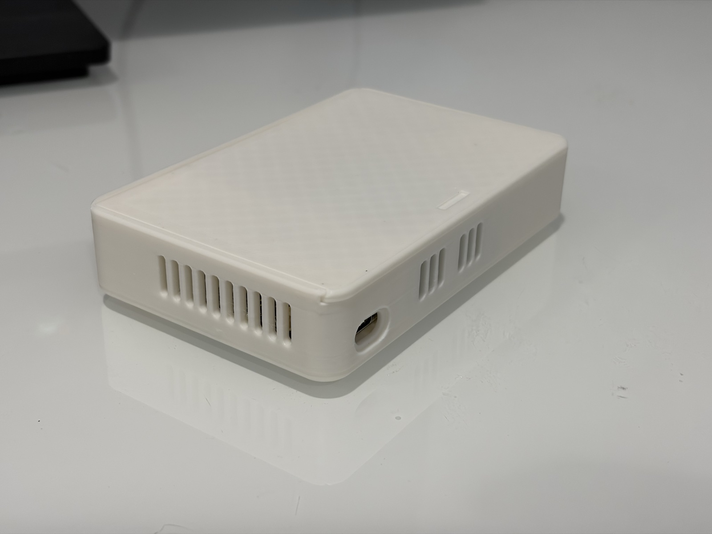
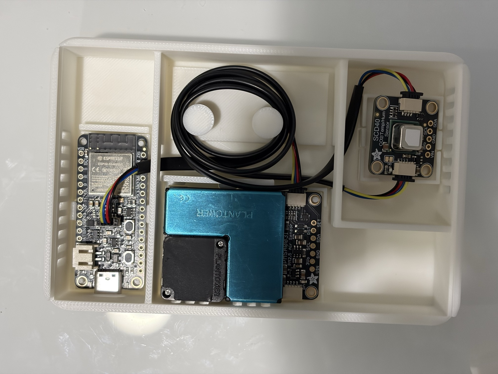
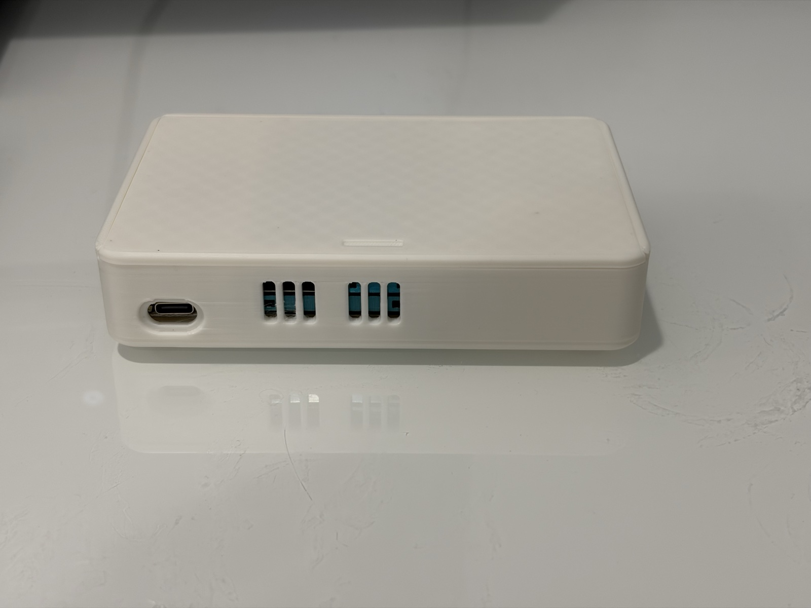
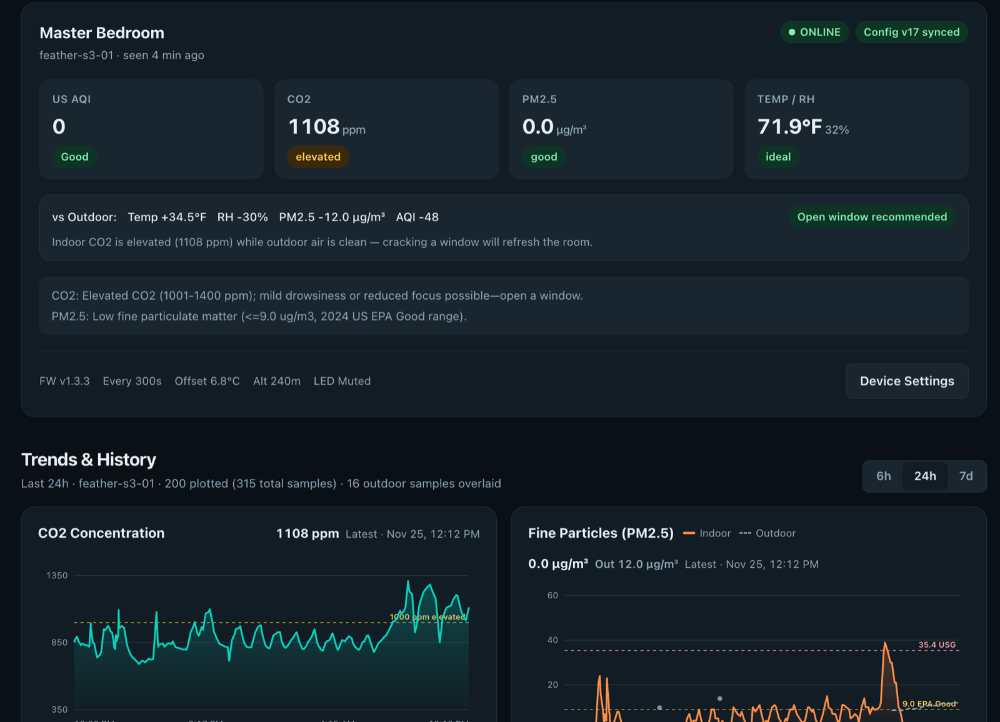
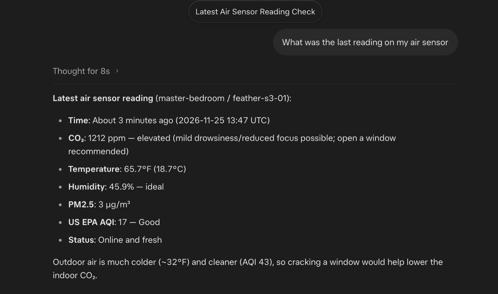
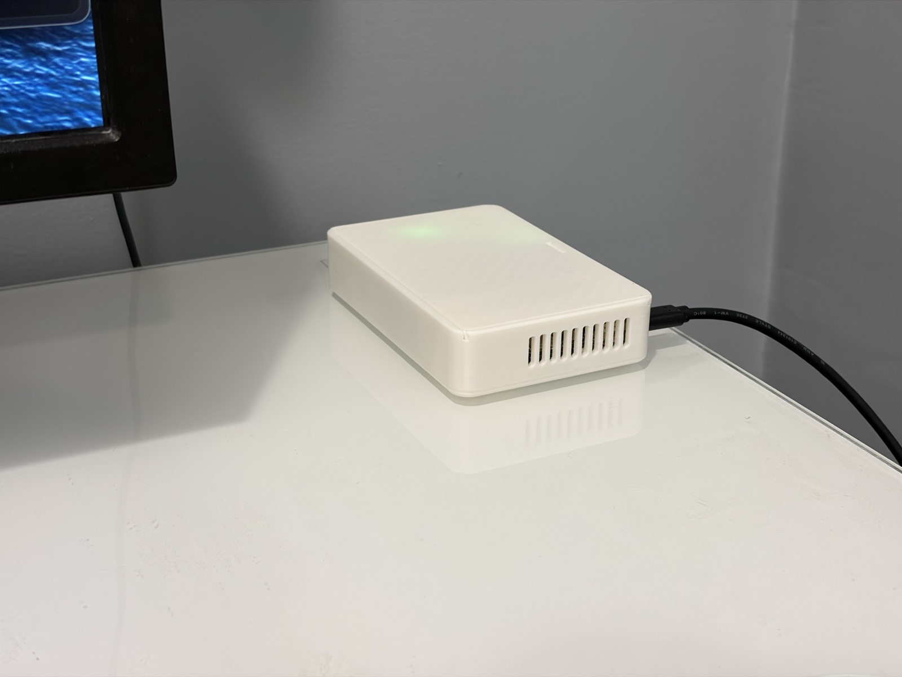
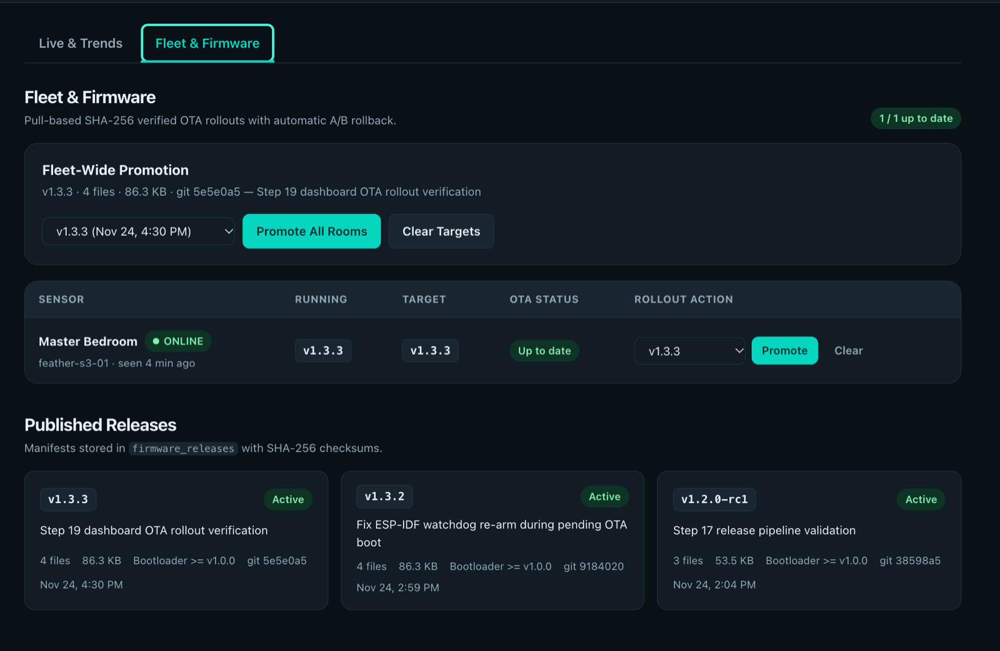
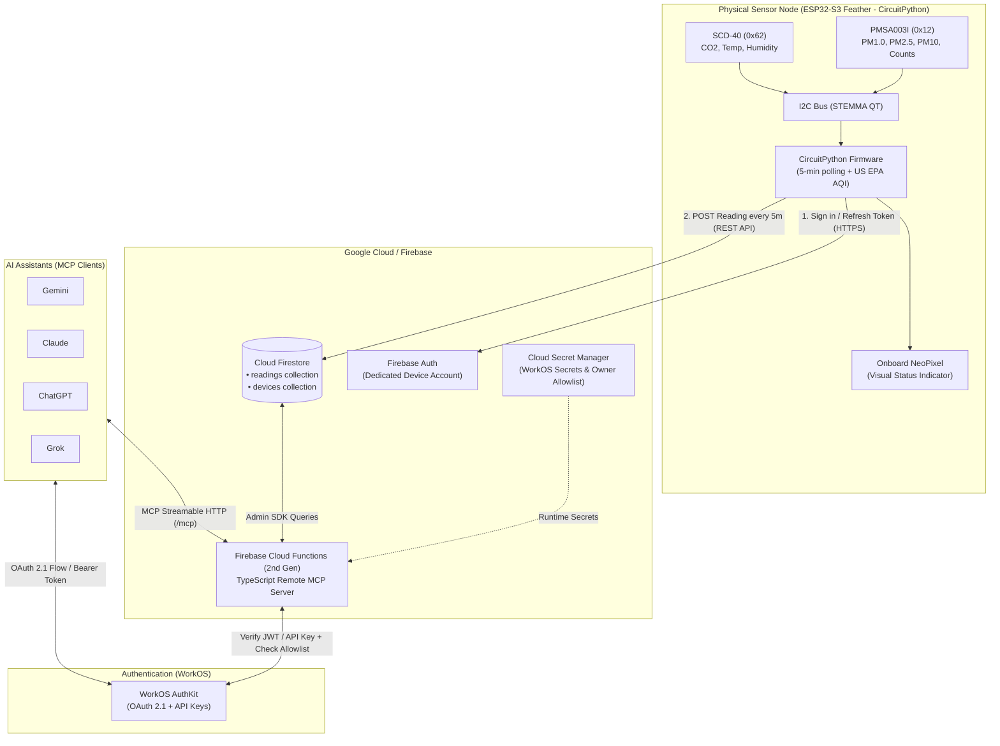

# Custom ESP32-S3 Air Quality Sensor + Firebase + Remote MCP Server


An end-to-end, DIY smart indoor air quality (IAQ) monitoring system that connects physical environmental sensors (**CO<sub>2</sub>**, **PM<sub>1.0</sub> / PM<sub>2.5</sub> / PM<sub>10</sub>**, **Temperature**, and **Humidity**) to **Google Cloud Firestore**, compares indoor readings against live outdoor weather & AQI, provides a **WorkOS-protected Web Dashboard** with **SHA-256 Cloud OTA rollouts**, and exposes live & historical telemetry to modern AI assistants (**Gemini**, **Claude**, **ChatGPT**, **Grok**, and any MCP-compatible client) through a remote **Model Context Protocol (MCP)** server.

<p align="center">
  
  <br />
  <em>100% screwless, support-free, thermally baffled 3D-printed enclosure (128 × 84 × 26 mm) housing the ESP32-S3 Feather, SCD-40, and PMSA003I.</em>
</p>

| Inside the Screwless Hub | Split Airflow Grilles & USB-C |
| :---: | :---: |
|  |  |
| *Solderless STEMMA QT daisy-chain with internal thermal baffles & cable spool posts* | *Recessed USB-C + split PMSA003I intake/exhaust grilles + solid rear LED shield* |

| Live Web Dashboard & Outdoor Deltas | Ask Your Room Anything (MCP) |
| :---: | :---: |
|  |  |
| *Live room telemetry, Open-Meteo indoor-vs-outdoor deltas, window advice & 24h SVG charts* | *Natural-language air quality queries via WorkOS-authenticated Remote MCP* |

<details>
<summary><strong>More Photos: Nightstand Footprint & One-Click Cloud OTA Fleet Panel</strong></summary>
<br />

| Nightstand Footprint (USB-C Powered) | Fleet & Firmware OTA Rollout Panel |
| :---: | :---: |
|  |  |
| *Inaudible micro-fan acoustics with remotely muteable status LED* | *Pull-based SHA-256 Cloud OTA with immutable A/B auto-rollback* |

</details>

> [!TIP]
> **Hype Video & Media Production Guide:** See [`docs/12-showcase-and-hype-video.md`](./docs/12-showcase-and-hype-video.md) for the EXIF-stripped photo workflow and the 5-scene **Google Flow (Veo)** storyboard & copy-paste prompt pack built from the real photos above. *(Drop the final rendered video link here once published!)*

### Highlights at a Glance
- **100% Solderless & Screwless Hardware:** Adafruit ESP32-S3 Feather + Sensirion SCD-40 (true photoacoustic CO<sub>2</sub>) + Plantower PMSA003I (laser PM<sub>1.0</sub>/PM<sub>2.5</sub>/PM<sub>10</sub>) snapped into a custom 3D-printed thermally baffled hub.
- **Remote Config & Calibration (Layer 1):** Tune temperature offset, altitude, polling interval, room name, and bedroom LED mute straight from the Web Dashboard without touching USB.
- **Cloud Pull-Based OTA with A/B Rollback (Layer 2):** Promote SHA-256 verified firmware releases from the dashboard; an immutable `code.py` bootloader automatically restores `.bak` files if a bad push fails to boot.
- **Outdoor Weather & AQI Context:** Keyless Open-Meteo sync computes live indoor-vs-outdoor deltas and tells you when cracking a window will actually help.
- **AI-Native via Remote MCP:** Secured with WorkOS AuthKit OAuth 2.1 + strict owner email allowlist so Gemini, Claude, ChatGPT, and Grok can query your air quality safely.

---

## Why Build This? (The Backstory)

I was inspired to start this project after listening to a **Chris Williamson (*Modern Wisdom*) podcast episode featuring Michael Feldstein**, the founder of **Jaspr**. Hearing their deep dive into indoor air quality—how invisible spikes in CO<sub>2</sub> degrade sleep and cognitive focus, and how fine particulate matter (PM<sub>2.5</sub>) from cooking, wildfire smoke, or everyday dust lingers indoors—made me curious to measure the air in my own home.

When I looked at consumer air quality monitors, I realized something interesting: **most commercial smart air sensors cost roughly the same amount as buying these high-precision sensor breakouts yourself**. While buying an off-the-shelf unit gives you a plastic shell and a proprietary app, building one from scratch for a similar price is a much more rewarding way to learn by doing—exploring how I2C hardware buses, CircuitPython firmware, cloud time-series databases, OAuth 2.1, and the Model Context Protocol (MCP) all fit together.

Because this repository is **public on GitHub** and designed as a step-by-step learning project, every milestone is documented in [`docs/`](./docs/) along with real-world **"Good to Know & Troubleshooting"** notes captured as each layer is validated.

---

## Where We Are Now & Next Steps

> **Current Snapshot:** **Phases 1, 2, and 3 are live end-to-end**, streaming indoor air quality to Cloud Firestore, answering natural-language queries in **Gemini** and **Grok** via MCP, and providing a WorkOS-protected Firebase Hosting web dashboard with 6h/24h/7d interactive SVG charts, Layer 1 remote device settings, and Layer 2 one-click SHA-256 Cloud OTA rollouts with A/B rollback.

| Phase / Layer | Status | Summary |
| :--- | :---: | :--- |
| **Phase 1 — Sensor Node & Firmware** | `Live` | ESP32-S3 Feather + SCD-40 + PMSA003I via STEMMA QT running CircuitPython `v1.3.3` (`boot.py` + immutable `code.py` auto-rollback bootloader + `app.py` + `ota_updater.py` with on-device US EPA AQI, remote config polling, RAM SCD-40 calibration, SHA-256 pull-based OTA, muteable NeoPixel, watchdog) |
| **Phase 1 — Cloud & Remote MCP** | `Live` | Hardened write-only Firestore rules, composite indexes, Cloud Functions (2nd Gen) MCP server, and WorkOS AuthKit OAuth 2.1 + owner allowlist |
| **Enclosure — 3D-Printed Hub** | `Live` | Screwless, support-free, thermally baffled bedroom enclosure — printed, thermally calibrated, and inaudible ([`docs/08-enclosure-hardware-plan.md`](./docs/08-enclosure-hardware-plan.md)) |
| **Phase 2 — Web Dashboard & Remote Config** *(Layer 1)* | `Live` | Zero-build Firebase Hosting dashboard (WorkOS AuthKit PKCE login, live °F cards, 6h/24h/7d interactive SVG charts, Device Settings drawer) + Firestore-backed `device_configs` remote tuning ([`docs/09-remote-config-and-dashboard.md`](./docs/09-remote-config-and-dashboard.md)) |
| **Phase 3 — Cloud OTA with A/B Rollback** *(Layer 2)* | `Live` | Steps 16–19 live-verified on wall power (`boot.py` + immutable `code.py` auto-rollback + SHA-256 `firmware_releases` pipeline + on-device `ota_updater.py` + Web Dashboard **Fleet & Firmware** one-click rollout UI in [`docs/10-cloud-ota-and-rollback.md`](./docs/10-cloud-ota-and-rollback.md)) |
| **Phase 4A — Outdoor Weather & AQI Context** | `Live` | Keyless Open-Meteo Weather & Air Quality sync via `syncOutdoorOnReading` Firestore trigger, private `site_configs/home` setup, dashboard outdoor card + indoor-vs-outdoor deltas + dashed chart overlays, and `get_outdoor_air_quality` MCP tool ([`docs/11-outdoor-weather-and-aqi.md`](./docs/11-outdoor-weather-and-aqi.md)) |
| **Phase 4B — Multi-Room Fleet & Proactive Alerts** | `Backlog` | Additional room nodes (`compare_rooms` MCP tool + per-device UID isolation), proactive CO<sub>2</sub>/PM<sub>2.5</sub> push alerts, and optional smart-home actuation |

### What's Next (Phase 4B)
1. **Render & Link the Hype Video:** Paste the 5-scene prompts from [`docs/12-showcase-and-hype-video.md`](./docs/12-showcase-and-hype-video.md) into Google Flow using the `docs/images/` `@Ingredients` and link the finished clip above.
2. **Scale to Multi-Room & Proactive Alerts:** Print additional enclosures for more rooms, add `compare_rooms` + per-device UID isolation, and trigger push alerts when CO<sub>2</sub> or PM<sub>2.5</sub> spikes.

Track every atomic step and validation checkpoint in [`IMPLEMENTATION_PLAN.md`](./IMPLEMENTATION_PLAN.md).

---

## Hardware Bill of Materials (Solderless STEMMA QT / I2C)

All components plug together using 4-pin **STEMMA QT (JST SH)** cables—no soldering required:

| Component | Part / Model | What It Measures / Does | I2C Address |
| :--- | :--- | :--- | :--- |
| **Microcontroller** | **Adafruit ESP32-S3 Feather** | 2.4GHz Wi-Fi board running CircuitPython; includes onboard STEMMA QT port & NeoPixel status LED | Host Controller |
| **CO<sub>2</sub> Sensor** | **Adafruit SCD-40** (Sensirion) | True photoacoustic CO<sub>2</sub> (400–2000+ ppm), ambient temperature, & relative humidity | `0x62` |
| **Particulate Sensor** | **Adafruit PMSA003I** (Plantower) | Laser particulate matter sensor measuring PM<sub>1.0</sub>, PM<sub>2.5</sub>, PM<sub>10.0</sub> (µg/m³) + raw particle counts by size (>0.3 µm to >10.0 µm) | `0x12` |
| **Interconnects** | **2x STEMMA QT Cables** | Daisy-chains `3.3V`, `GND`, `SDA`, and `SCL` across the ESP32-S3 and both sensors | N/A |
| **Power & Data** | **USB-A to USB-C Cable** | Powers the board continuously and mounts the `CIRCUITPY` USB drive when connected to a computer | N/A |

---

## System Architecture



---

## "Learn by Doing" Documentation Curriculum

Each guide in `docs/` explains how the underlying technology works, walks through setup step-by-step, provides a focused validation checkpoint, and records real-world troubleshooting tips discovered during development:

1. [**`docs/01-hardware-and-i2c.md`**](./docs/01-hardware-and-i2c.md) — How the I2C bus and STEMMA QT daisy-chaining work, physical assembly, and flashing CircuitPython.
2. [**`docs/02-circuitpython-firmware.md`**](./docs/02-circuitpython-firmware.md) — US EPA AQI math, Firebase REST authentication from a microcontroller, NeoPixel status codes, and the 5-minute sensor loop.
3. [**`docs/03-firebase-and-firestore.md`**](./docs/03-firebase-and-firestore.md) — Provisioning Firebase Auth, Cloud Firestore time-series collections, composite indexes, and hardened write-only security rules.
4. [**`docs/04-workos-and-mcp-server.md`**](./docs/04-workos-and-mcp-server.md) — Building the TypeScript Remote MCP Server on Firebase Cloud Functions (2nd Gen) and protecting it with WorkOS AuthKit OAuth 2.1 + an owner allowlist.
5. [**`docs/05-connecting-ai-clients.md`**](./docs/05-connecting-ai-clients.md) — Connecting Gemini, Claude, ChatGPT, and Grok to query your indoor air quality in natural language.
6. [**`docs/06-security-and-privacy-checklist.md`**](./docs/06-security-and-privacy-checklist.md) — The 4-layer public-repo security strategy keeping Wi-Fi credentials, emails, project IDs, and API keys out of Git.
7. [**`docs/07-understanding-your-readings.md`**](./docs/07-understanding-your-readings.md) — Plain-English guide to every sensor metric (CO<sub>2</sub>, PM<sub>1.0</sub>/PM<sub>2.5</sub>/PM<sub>10</sub>, US EPA AQI, humidity, temperature), health thresholds, and how to improve them.
8. [**`docs/08-enclosure-hardware-plan.md`**](./docs/08-enclosure-hardware-plan.md) — Screwless, support-free 3D-printed enclosure design (Bambu Lab X1 Carbon) with a ready-to-paste SpeakCAD prompt in [`enclosure/speakcad-prompt.txt`](./enclosure/speakcad-prompt.txt).
9. [**`docs/09-remote-config-and-dashboard.md`**](./docs/09-remote-config-and-dashboard.md) — Device Shadow remote config (`device_configs`), live firmware polling & SCD-40 RAM calibration, WorkOS-protected Dashboard API, and zero-build Firebase Hosting web UI.
10. [**`docs/10-cloud-ota-and-rollback.md`**](./docs/10-cloud-ota-and-rollback.md) — USB-aware `boot.py` NVM handoff, minimal immutable `code.py` auto-rollback bootloader, SHA-256 `firmware_releases` manifest/publish CLI, and on-device pull-based OTA updater (`ota_updater.py`).
11. [**`docs/11-outdoor-weather-and-aqi.md`**](./docs/11-outdoor-weather-and-aqi.md) — Keyless Open-Meteo outdoor weather & US EPA AQI sync on incoming sensor readings, private `site_configs/home` location setup, indoor-vs-outdoor deltas, dashed chart overlays, and `get_outdoor_air_quality` MCP integration.
12. [**`docs/12-showcase-and-hype-video.md`**](./docs/12-showcase-and-hype-video.md) — Hardware & UI shot list, EXIF/GPS-stripping media pipeline (`scripts/prepare_media.sh`), and 5-scene Google Flow (Veo) hype video storyboard & copy-paste prompt pack.
12. [**`docs/13-firestore-read-optimization-and-rollups.md`**](./docs/13-firestore-read-optimization-and-rollups.md) — Cutting Firestore reads by >99% using UTC-day `daily_rollups` / `outdoor_daily_rollups`, unindexed `fieldOverrides`, multi-layer browser & Cloud Function caching, and historical backfill.

---

## Project Documents & Progress Tracking

- [**`PRD.md`**](./PRD.md) — Complete Product Requirements Document, data schemas, and component specifications.
- [**`IMPLEMENTATION_PLAN.md`**](./IMPLEMENTATION_PLAN.md) — Our phased, step-by-step commit & validation roadmap (Phases 1–3 completed; Phase 4 up next).

---

## Built-In Verification Scripts

Every layer can be validated independently before deploying or flashing hardware:

```bash
# 1. Secret & privacy guardrails (always run before committing)
./scripts/check-secrets.sh

# 2. Firmware EPA AQI math, bootloader rollback, OTA staging & Firestore REST encoding
python3 scripts/test_firmware_local.py
python3 scripts/verify_device_configs_rules.py

# 3. Cloud Functions TypeScript typecheck + build + all 7 offline backend suites (also run in GitHub Actions Backend CI)
npm --prefix functions test

# Or run individual backend verification suites:
npm --prefix functions run verify:firestore
npm --prefix functions run verify:mcp
npm --prefix functions run verify:auth
npm --prefix functions run verify:api
npm --prefix functions run verify:outdoor
npm --prefix functions run verify:release
npm --prefix functions run verify:rollups

# Backfill UTC-day rollups from existing raw readings (dry-run or live)
npm --prefix functions run backfill:rollups -- --days 30 --dry-run

# 4. Lightweight Web Dashboard (PKCE, SVG charts, HTML semantics, Firebase Hosting rewrites)
node scripts/verify_web_dashboard.mjs

# 5. Public Showcase Media (zero EXIF/GPS/XMP metadata + <= 600 KB budget)
./scripts/prepare_media.sh --verify
```

---

## Keeping Your Fork Secret-Free

Before committing any changes, run the local secret scanner:

```bash
./scripts/check-secrets.sh
```

All personal configuration lives in gitignored files copied from safe `.example` templates:
- `firmware/settings.toml.example` → `firmware/settings.toml` (on your local machine / `CIRCUITPY` drive)
- `.firebaserc.example` → `.firebaserc`
- `functions/.env.example` → `functions/.env.local` (for local testing via `npm --prefix functions run mcp:local`; production injects all 5 secrets via Google Cloud Secret Manager)
