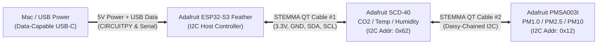

# Guide 01: Hardware Assembly, I2C Daisy-Chaining & CircuitPython Setup

> **Built in Step 9 of [`IMPLEMENTATION_PLAN.md`](../IMPLEMENTATION_PLAN.md)** — Assembles the Adafruit ESP32-S3 Feather, SCD-40 CO<sub>2</sub> sensor, and PMSA003I particulate matter sensor with solderless STEMMA QT cables, flashes CircuitPython, installs required libraries onto `CIRCUITPY/lib`, and verifies both sensors appear on the I2C bus.

---

## 1. Concept Briefing ("How It Works Under the Hood")

### Hardware Bill of Materials & Topology

All three boards snap together using 4-pin **STEMMA QT (JST SH)** cables—zero soldering required:



| Component | Part / Model | What It Does | I2C Address |
| :--- | :--- | :--- | :--- |
| **Microcontroller** | Adafruit ESP32-S3 Feather | 2.4 GHz Wi-Fi MCU running CircuitPython; onboard STEMMA QT port & RGB NeoPixel | Host Controller |
| **CO<sub>2</sub> Sensor** | Adafruit SCD-40 (Sensirion) | True photoacoustic CO<sub>2</sub> (400–2000+ ppm), temperature, and relative humidity | `0x62` |
| **Particulate Sensor** | Adafruit PMSA003I (Plantower) | Laser scattering PM<sub>1.0</sub>, PM<sub>2.5</sub>, PM<sub>10.0</sub> (&mu;g/m<sup>3</sup>) + particle counts across 6 size bins | `0x12` |
| **Interconnects** | 2x STEMMA QT / Qwiic Cables | 4-wire JST SH cables carrying `3.3V`, `GND`, `SDA`, and `SCL` | N/A |
| **Power & Data Cable** | Data-Capable USB-A to USB-C (or USB-C to USB-C) | Powers the Feather and exposes the `CIRCUITPY` USB drive and serial console | N/A |

### How Does I2C Daisy-Chaining Work?

**I2C (Inter-Integrated Circuit)** is a shared two-wire serial bus:
- **SDA** (*Serial Data*) carries data bits back and forth.
- **SCL** (*Serial Clock*) keeps every device synchronized to the microcontroller's clock pulses.
- **3.3V & GND** supply power alongside the two signal wires inside every STEMMA QT cable.

Because I2C is a **shared bus with unique 7-bit addresses**, multiple sensors can sit on the exact same two wires without colliding. When the ESP32-S3 wants a CO<sub>2</sub> reading, it broadcasts *"Hey `0x62`, send me your data"*—the PMSA003I (`0x12`) ignores that packet, and only the SCD-40 responds. Both Adafruit breakouts include **two** STEMMA QT ports wired directly in parallel, so you can plug the ESP32-S3 into either sensor first and chain the second sensor off the opposite port in any order.

### How Do These Two Sensors Actually Measure Air?

1. **SCD-40 (Photoacoustic CO<sub>2</sub> Sensing)**:
   - Unlike cheap "eCO<sub>2</sub>" VOC estimators, the Sensirion SCD-40 measures **true CO<sub>2</sub>**.
   - Inside its miniature chamber, an infrared light pulses at the exact wavelength CO<sub>2</sub> molecules absorb. Absorbing that energy causes CO<sub>2</sub> molecules to vibrate slightly, generating tiny acoustic pressure waves. A built-in MEMS microphone measures the sound amplitude—more CO<sub>2</sub> means a louder acoustic signal.
   - Because temperature and humidity affect gas density, the SCD-40 also integrates a precision temperature/humidity sensor to compensate its readings (and exposes those measurements to our firmware).
2. **PMSA003I (Laser Scattering Particulate Sensing)**:
   - A miniature internal fan pulls room air across a focused laser beam.
   - As microscopic particles (dust, cooking aerosols, wildfire smoke, pollen) cross the beam, they scatter light onto a photodiode. The sensor measures the intensity and frequency of those light flashes to classify particles into 6 diameter bins (`>0.3 µm` through `>10.0 µm`) and compute PM<sub>1.0</sub>, PM<sub>2.5</sub>, and PM<sub>10.0</sub> concentrations in &mu;g/m<sup>3</sup>.
   - Even though the Plantower fan/laser module runs on 5V internally, the Adafruit breakout includes an **onboard 3.3V-to-5V mini boost converter**, so it powers safely off the Feather's 3.3V STEMMA QT cable while keeping I2C logic at safe 3.3V levels.

### Why CircuitPython?

With CircuitPython installed, the ESP32-S3 shows up on your Mac like a small USB flash drive named **`CIRCUITPY`**. Editing firmware is as simple as copying Python files (`code.py`, `aqi.py`, `firestore_client.py`, `settings.toml`) onto that drive—no C++ toolchains or slow compile cycles—and you get an interactive Python REPL over USB serial to test sensors live.

---

## 2. Hands-On Setup

### Step 9A: Assemble the Hardware (Power Off First)

1. Make sure the **USB cable is unplugged** from the ESP32-S3 Feather before connecting STEMMA QT cables.
2. Plug **STEMMA QT Cable #1** into the **STEMMA QT port** on the ESP32-S3 Feather and into either STEMMA QT port on the **SCD-40**.
3. Plug **STEMMA QT Cable #2** into the **other** STEMMA QT port on the SCD-40 and into either STEMMA QT port on the **PMSA003I**.
   - *Order doesn't matter*: Feather → PMSA003I → SCD-40 works identically.
   - *Keyed connectors*: JST SH plugs only fit one way. Press gently and evenly until seated; never force a plug upside down.
4. **Placement Tip**: Keep the **PMSA003I** air intake/exhaust vents unobstructed, and try not to rest the **SCD-40** directly on top of the ESP32-S3 board so the microcontroller's warmth doesn't skew ambient temperature readings.

### Step 9B: Identify Your Exact ESP32-S3 Feather Variant

Adafruit sells several ESP32-S3 Feather variants with different flash/PSRAM sizes and displays. Check the silkscreen text printed on the back of your board (or your order receipt) so you download the matching CircuitPython build:
- **Adafruit Feather ESP32-S3 (4MB Flash, 2MB PSRAM)** — most common standard Feather ESP32-S3 (Product ID 5477)
- **Adafruit Feather ESP32-S3 No PSRAM (8MB Flash)** — Product ID 5323
- **Adafruit Feather ESP32-S3 TFT** or **Reverse TFT** — variants with an onboard color screen

### Step 9C: Flash CircuitPython onto the ESP32-S3 Feather

1. Plug the ESP32-S3 Feather into your Mac using a **data-capable USB cable**.
2. Go to [circuitpython.org/downloads](https://circuitpython.org/downloads) and open the page for your exact Feather ESP32-S3 variant (for example, *Feather ESP32-S3 4MB Flash 2MB PSRAM*).
3. **Recommended for brand-new boards or upgrading to CircuitPython 10.x — use the browser `OPEN INSTALLER`**:
   - Boards manufactured before CircuitPython 10 often ship with an older factory TinyUF2 bootloader (e.g., `0.10.2` from 2022) whose 4MB flash partition table is too small for CircuitPython 10.x. Using **Open Installer** upgrades the bootloader, partition table, and CircuitPython in one step:
   - Open your board's download page in **Chrome** or **Edge** (WebSerial is required) and click **`OPEN INSTALLER`**.
   - Select **`Full CircuitPython 10.x Install`**.
   - Put the Feather into **ROM Bootloader mode**: press and **hold `BOOT`**, tap and release **`RESET`**, then release **`BOOT`** (the NeoPixel turns off).
   - Select the **USB JTAG/serial debug unit** port when prompted.
   - Click **`Continue`** on the **Erase Flash** step so the new 4MB partition layout is written cleanly.
   - When the final **"Fill in settings.toml"** dialog appears, click **`X`** to close/skip it (we will copy our own gitignored `firmware/settings.toml` in Step 10).
   - Tap **`RESET`** once if needed — a USB drive named **`CIRCUITPY`** will mount in Finder.
4. **Alternative for boards already on TinyUF2 `v0.33.0+` — drag-and-drop `.uf2` via `FTHRS3BOOT`**:
   - Enter **UF2 Bootloader Mode** using the *"slow double-click"* rhythm on **RESET**: press **RESET** once, wait ~0.5 seconds for the NeoPixel to turn **purple**, and press **RESET** a second time while purple is lit so **`FTHRS3BOOT`** mounts.
   - Check `/Volumes/FTHRS3BOOT/INFO_UF2.TXT` to confirm TinyUF2 is `v0.33.0` or newer (if it's older, use Step 3's **Open Installer** instead).
   - Copy the downloaded `.uf2` onto `FTHRS3BOOT` (or via Terminal with `-X` to avoid macOS Finder extended-attribute issues):

     ```bash
     cp -X ~/Downloads/adafruit-circuitpython-adafruit_feather_esp32s3*.uf2 /Volumes/FTHRS3BOOT/
     ```

   - Wait ~10–15 seconds for the board to reboot into **`CIRCUITPY`** (ignore macOS's *"Disk Not Ejected Properly"* notification).

### Step 9D: Install Required CircuitPython Libraries into `CIRCUITPY/lib`

All required libraries are tracked in [`firmware/requirements-circuitpython.txt`](../firmware/requirements-circuitpython.txt):
- `adafruit_scd4x` & `adafruit_pm25` (sensor drivers)
- `adafruit_bus_device` (I2C bus helper used by both sensor drivers)
- `adafruit_requests` & `adafruit_connection_manager` (HTTPS client for Firebase/Firestore)
- `adafruit_ntp` (UTC clock sync so timestamps satisfy `firestore.rules`)
- `neopixel` (onboard RGB status LED; `circup` also pulls in its `adafruit_pixelbuf` dependency)

#### Option 1: Automatic Install with `circup` (Recommended)
With `CIRCUITPY` mounted on your Mac, install all libraries in one command using [`uv`](https://docs.astral.sh/uv/) (pinning Python 3.12+ because `circup` requires Python 3.10+):

```bash
uvx --python 3.12 circup install -r firmware/requirements-circuitpython.txt
```

*(Or, if you prefer `pip` on Python 3.10+: `pip3 install --user circup && circup install -r firmware/requirements-circuitpython.txt`.)*

`circup` automatically inspects `CIRCUITPY/boot_out.txt`, downloads the matching CircuitPython major-version bundle (e.g., `10.x`), and copies the right `.mpy` files into `/Volumes/CIRCUITPY/lib/`.

#### Option 2: Manual Bundle Copy (No `pip` Required)
1. Check your installed CircuitPython version by viewing `/Volumes/CIRCUITPY/boot_out.txt`.
2. Download the matching **Adafruit CircuitPython Library Bundle** ZIP (e.g., `Bundle for Version 9.x` or `10.x`) from [circuitpython.org/libraries](https://circuitpython.org/libraries).
3. Unzip it and copy these files/folders from the bundle's `lib/` directory into `/Volumes/CIRCUITPY/lib/`:
   - `adafruit_scd4x.mpy`
   - `adafruit_pm25/` (folder)
   - `adafruit_bus_device/` (folder)
   - `adafruit_requests.mpy`
   - `adafruit_connection_manager.mpy`
   - `adafruit_ntp.mpy`
   - `neopixel.mpy`

### Step 9E: Connect to the Serial Console on macOS

Find your ESP32-S3's USB serial port:

```bash
ls /dev/cu.usbmodem*
```

Open a serial terminal to it at `115200` baud (using macOS's built-in `screen`, or `tio` if installed via Homebrew):

```bash
screen /dev/cu.usbmodem* 115200
```

- Press **`Ctrl+C`** to pause any running `code.py`, then press **any key** to enter the `>>>` CircuitPython REPL.
- To exit `screen` cleanly when finished: press **`Ctrl+A`**, release, press **`K`**, then press **`Y`** to confirm.

---

## 3. Single Focused Validation Checkpoint

With the ESP32-S3 plugged into your Mac and both sensors daisy-chained via STEMMA QT, run this quick I2C bus scan in the CircuitPython REPL (press **`Ctrl+E`** to enter Paste Mode, paste the snippet below, then press **`Ctrl+D`** to execute):

```python
import time
import board

i2c = board.STEMMA_I2C()
time.sleep(2)  # Give PMSA003I fan/MCU a moment after power-up

while not i2c.try_lock():
    pass

try:
    addresses = [hex(addr) for addr in i2c.scan()]
    print("Detected I2C addresses:", addresses)
    print("SCD-40 (0x62) found:", "0x62" in addresses)
    print("PMSA003I (0x12) found:", "0x12" in addresses)
finally:
    i2c.unlock()
```

### Confirm All Three Checks Succeed
1. **`CIRCUITPY` Mounted**: `/Volumes/CIRCUITPY` is visible and `/Volumes/CIRCUITPY/lib/` contains all libraries from [`firmware/requirements-circuitpython.txt`](../firmware/requirements-circuitpython.txt).
2. **Both Sensors Detected**: The serial console prints:
   - `SCD-40 (0x62) found: True`
   - `PMSA003I (0x12) found: True`
   - *(Note: Seeing an extra address like `0x36` or `0x0b` is completely normal—the Feather ESP32-S3 has an onboard battery fuel gauge IC on the same I2C bus.)*
3. **Secret Guardrail Clean**: Run `./scripts/check-secrets.sh` in your repository directory and confirm it passes with zero findings.

---

## 4. Good to Know & Real-World Troubleshooting

- **Old Factory TinyUF2 Bootloader (`0.10.2`) Bounces Back to `FTHRS3BOOT` on CircuitPython 10.x**:
  - Many Feather ESP32-S3 boards ship with a 2022 factory bootloader (`TinyUF2 Bootloader 0.10.2`, checkable in `/Volumes/FTHRS3BOOT/INFO_UF2.TXT`). CircuitPython 10.x changed the 4MB flash partition table (merging dual OTA partitions into a single larger firmware partition) and requires **TinyUF2 `v0.33.0` or newer**.
  - **Symptom**: Copying a CircuitPython 10.x `.uf2` in Finder pops *"The operation can't be completed because the device disappeared"* and *"Disk Not Ejected Properly"*, and then **`FTHRS3BOOT` reappears instead of `CIRCUITPY`**.
  - **Fix**: Use **`OPEN INSTALLER` → `Full CircuitPython 10.x Install`** (with **Erase Flash → Continue**) in Chrome/Edge while the board is in ROM bootloader mode (**hold `BOOT` → tap `RESET` → release `BOOT`**). That updates the bootloader, partition table, and CircuitPython together.
- **`uvx circup` Fails with `TypeError: unsupported operand type(s) for |` on Python 3.9**:
  - Recent releases of `circup` use Python 3.10+ union type annotations (`dict[str, Any] | None`). If macOS or Conda defaults `uvx` to Python 3.9, `circup` crashes on import.
  - **Fix**: Explicitly pass Python 3.12: `uvx --python 3.12 circup install -r firmware/requirements-circuitpython.txt`.
- **Always Use `board.STEMMA_I2C()`, Not `busio.I2C(board.SCL, board.SDA)`**: On the Adafruit Feather ESP32-S3, the STEMMA QT port's 3.3V power rail is gated by a dedicated `I2C_POWER` transistor (whose polarity even changed between board revisions). Calling `board.STEMMA_I2C()` automatically enables that power pin properly and reuses CircuitPython's singleton I2C bus.
- **Charge-Only USB Cables Are the #1 Gotcha**: Many USB-A to USB-C cables included with phone chargers or accessories only wire the power pins. If the Feather's LEDs light up when plugged in, but neither `FTHRS3BOOT`, `CIRCUITPY`, nor `/dev/cu.usbmodem*` appears on your Mac, swap to a known data-capable USB cable.
- **"Slow Double-Click" RESET Timing**: Rapidly double-clicking RESET like a mouse button often fails on ESP32-S3 boards. Press RESET once, wait ~0.5 seconds for the NeoPixel to flash **purple**, then press RESET a second time while purple is lit.
- **macOS *"The operation can't be completed because the device disappeared"* & *"Disk Not Ejected Properly"* Notifications**:
  - When a `.uf2` finishes flashing onto an up-to-date bootloader, the board reboots immediately—before Finder finishes writing macOS metadata—causing Finder to report *"The operation can't be completed because the device disappeared"* alongside *"Disk Not Ejected Properly"*. Wait ~10–15 seconds: if **`CIRCUITPY`** mounts, the flash succeeded! If **`FTHRS3BOOT`** stays/reappears instead, check `INFO_UF2.TXT` for an older bootloader (see above) or retry from Terminal with `cp -X <file>.uf2 /Volumes/FTHRS3BOOT/`.
- **Extra I2C Address (`0x36` or `0x0b`) in `i2c.scan()`**: Adafruit Feather ESP32-S3 boards include a built-in battery monitor chip (MAX17048 at `0x36` on newer revisions, LC709203F at `0x0b` on earlier revisions) connected to the same I2C bus. Seeing `['0x12', '0x36', '0x62']` is healthy and expected (confirmed on Feather ESP32-S3 4MB Flash 2MB PSRAM running CircuitPython 10.3.2).
- **Only One Sensor (or Neither) Shows Up in `i2c.scan()`**:
  1. Unplug USB, firmly reseat both ends of both STEMMA QT cables, and plug USB back in.
  2. Wait 2 seconds after power-up before scanning—the PMSA003I takes ~1–2 seconds to spin up its fan and initialize its I2C interface.
  3. Test one sensor at a time plugged directly into the Feather to isolate whether a specific STEMMA QT cable is faulty.
- **`ValueError: Incompatible .mpy file`**: This means a library in `CIRCUITPY/lib/` was compiled for a different CircuitPython major version (e.g., an `8.x` or `9.x` `.mpy` file on CircuitPython `10.x`). Re-run `circup install -r firmware/requirements-circuitpython.txt --upgrade` or download the bundle matching `boot_out.txt`.
- **`screen` Says *"Resource busy"* on `/dev/cu.usbmodem*`**: Another terminal window, Mu Editor, Thonny, or detached `screen` session is still holding the serial port open. Run `screen -ls` to find and close old sessions, or close other editors.
