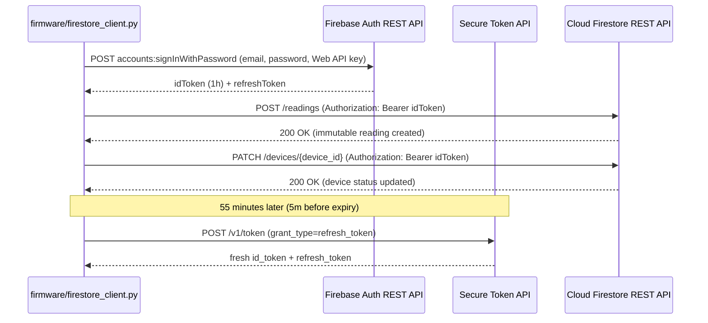
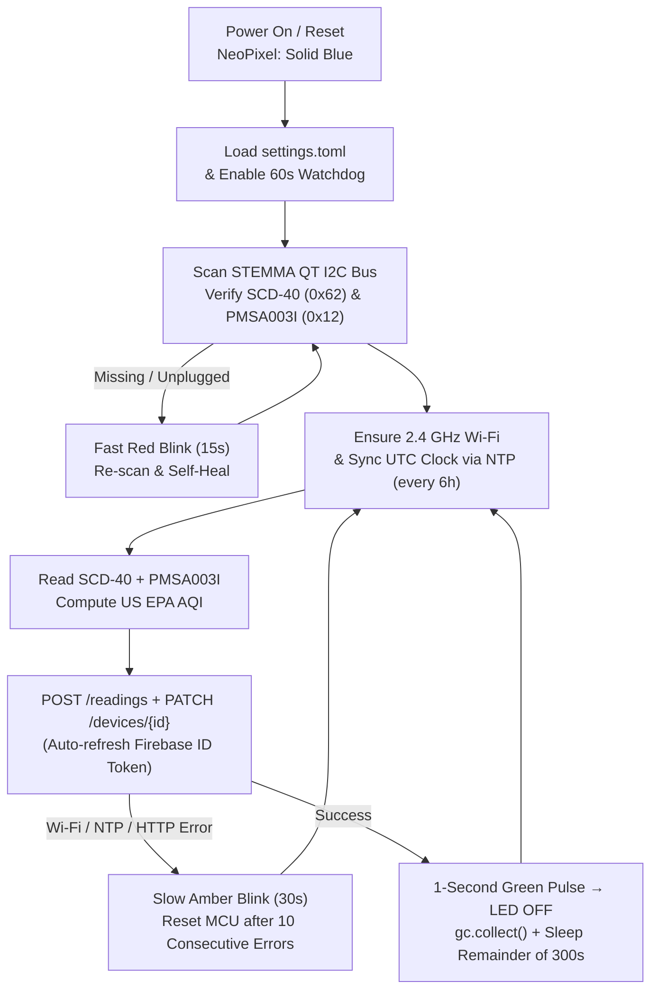

# Guide 02: CircuitPython Firmware — AQI Math, Firestore REST & Sensor Loop

> **Built in Step 4 (Part 1) & Step 10 (Part 2) of [`IMPLEMENTATION_PLAN.md`](../IMPLEMENTATION_PLAN.md)** — Part 1 implements and validates the pure-Python US EPA AQI calculator ([`firmware/aqi.py`](../firmware/aqi.py)) and Firebase Auth + Firestore REST client ([`firmware/firestore_client.py`](../firmware/firestore_client.py)) on macOS before touching microcontroller hardware. Part 2 wires both modules into the main ESP32-S3 sensor loop ([`firmware/code.py`](../firmware/code.py)) with NeoPixel status feedback, NTP UTC time sync, and hardware watchdog resilience.

---

## 1. Concept Briefing ("How It Works Under the Hood")

### Why Test Firmware Modules on macOS First?
Microcontrollers are great at reading physical sensors, but slow to debug when you are simultaneously troubleshooting Wi-Fi, TLS certificates, REST JSON formatting, and Firestore Security Rules. Because **CircuitPython is Python**, we can write [`firmware/aqi.py`](../firmware/aqi.py) and [`firmware/firestore_client.py`](../firmware/firestore_client.py) using only standard, lightweight Python constructs that run identically on your Mac and on the ESP32-S3:

- On the **ESP32-S3**, `FirestoreClient` receives an `adafruit_requests.Session` backed by the ESP32 Wi-Fi socket pool.
- On **macOS**, passing `session=None` automatically uses a tiny built-in `urllib.request` adapter with zero `pip` dependencies.

That lets us verify the math, Firebase Auth token lifecycle, and strict `firestore.rules` schema validation right from a terminal before ever plugging in a board.

### How the US EPA AQI Calculation Works (`firmware/aqi.py`)
The **Air Quality Index (AQI)** converts raw particulate concentrations (&mu;g/m<sup>3</sup>) into a normalized **0–500** health scale using piecewise linear interpolation between official US EPA breakpoint tables:

```text
AQI = round( ((I_high - I_low) / (C_high - C_low)) * (C - C_low) + I_low )
```

Key EPA rules implemented in [`firmware/aqi.py`](../firmware/aqi.py):
1. **Revised 2024 PM<sub>2.5</sub> Breakpoints**: Uses the updated US EPA PM<sub>2.5</sub> table (effective May 6, 2024), where **"Good" (0–50)** ends at **9.0 &mu;g/m<sup>3</sup>** (lowered from the older 12.0 &mu;g/m<sup>3</sup> threshold).
2. **EPA Truncation Before Lookup**: Per EPA guidance, PM<sub>2.5</sub> is truncated to **1 decimal place** (e.g., `9.09` becomes `9.0`) and PM<sub>10</sub> is truncated to an **integer** (`54.9` becomes `54`) before matching a breakpoint band.
3. **Worst Sub-Index Wins**: `calculate_aqi(pm25, pm10)` calculates both the PM<sub>2.5</sub> and PM<sub>10</sub> AQI values and returns the higher of the two along with its category (`Good`, `Moderate`, `Unhealthy for Sensitive Groups`, `Unhealthy`, `Very Unhealthy`, or `Hazardous`).
4. **Clamped to `[0, 500]`**: Extreme spikes above the top breakpoint clamp to `500` so they always pass the `inRange(data.aqi_us, 0, 500)` check in [`firestore.rules`](../firestore.rules).

### How Firebase Auth & Firestore REST Work (`firmware/firestore_client.py`)
There is no official Firebase Python SDK for CircuitPython, so the device talks directly to Google's HTTPS REST APIs:



#### Why Firestore REST JSON Looks Verbose
Unlike the Firebase Web/Admin SDKs, the raw Firestore REST API requires explicit **type wrappers** on every field so Firestore knows whether a value is an integer, double, string, or native `Timestamp`:

| Python Value | Firestore REST JSON |
| :--- | :--- |
| `"feather-s3-01"` | `{"stringValue": "feather-s3-01"}` |
| `642` (int) | `{"integerValue": "642"}` |
| `72.3` (float) | `{"doubleValue": 72.3}` |
| `"2026-11-22T19:45:00Z"` (timestamp field) | `{"timestampValue": "2026-11-22T19:45:00Z"}` |
| `["SCD-40", "PMSA003I"]` | `{"arrayValue": {"values": [{"stringValue": "SCD-40"}, {"stringValue": "PMSA003I"}]}}` |

Encoding `timestamp` and `last_seen_at` as `timestampValue` (rather than `stringValue`) is mandatory—[`firestore.rules`](../firestore.rules) enforces `value is timestamp` and rejects stale or future-dated clocks outside `[-15m, +5m]` of server time.

---

## 2. Hands-On Setup (Part 1: Local Mac Testing)

### Step 4A: Create Your Local `firmware/settings.toml` (Gitignored)
Copy the committed template to a local, gitignored `firmware/settings.toml`:

```bash
cp firmware/settings.toml.example firmware/settings.toml
```

Open `firmware/settings.toml` and fill in your Firebase values from Step 2 (leave Wi-Fi placeholders as-is for now; macOS uses your Mac's network):

- `FIREBASE_PROJECT_ID` — your Firebase project ID (same as `.firebaserc`).
- `FIREBASE_WEB_API_KEY` — found in **Firebase Console → Project Settings → General → Web API Key** (if you haven't registered a Web app yet, register one or check **Authentication → Settings**—creating a Web app automatically provisions the Web API Key).
- `FIREBASE_DEVICE_EMAIL` & `FIREBASE_DEVICE_PASSWORD` — the dedicated sensor user created in Step 2E whose UID is listed in `authorized_devices/{uid}`.
- `SENSOR_DEVICE_ID` — e.g., `"feather-s3-01"`.
- `SENSOR_LOCATION` — e.g., `"home-office"`.

Verify `firmware/settings.toml` is ignored by Git:

```bash
git status --short
```

### Step 4B: Run the Offline Math & Payload Tests
Run [`scripts/test_firmware_local.py`](../scripts/test_firmware_local.py) without `--publish` to verify all 34 EPA AQI reference cases and Firestore REST payload encoding offline:

```bash
python3 scripts/test_firmware_local.py
```

---

## 3. Single Focused Validation Checkpoint (Part 1)

Run the live publish check on macOS to authenticate as the dedicated sensor user, test token refresh, and write 1 synthetic sensor reading to Firestore:

```bash
python3 scripts/test_firmware_local.py --publish
```

Confirm all four checks succeed:
1. **EPA AQI & Encoding**: Prints `[PASS]` for all PM<sub>2.5</sub>, PM<sub>10</sub>, combined AQI, and Firestore REST encoding tests.
2. **Auth & Token Refresh**: Prints `[PASS]` for both Firebase Auth `signInWithPassword` and `securetoken.googleapis.com` token refresh.
3. **Live Firestore Writes**: Prints `[PASS]` for creating a document in `readings/{device_id}_{epoch}` and updating `devices/{device_id}`.
4. **Firebase Console Verification**: Open **Firebase Console → Firestore Database → Data** and confirm:
   - `readings/` contains the new synthetic document with `timestamp` stored as a native Firestore **timestamp** type.
   - `devices/{SENSOR_DEVICE_ID}` exists with `last_seen_at` and the nested `latest_reading` map.
5. **Secret Guardrail Check**: Run `./scripts/check-secrets.sh` and confirm `firmware/settings.toml` stays untracked.

---

## 4. Good to Know & Real-World Troubleshooting

- **`idToken` vs. `id_token` (CamelCase vs. SnakeCase)**: Firebase's `accounts:signInWithPassword` endpoint returns camelCase keys (`idToken`, `refreshToken`, `expiresIn`), whereas `securetoken.googleapis.com/v1/token` returns snake_case keys (`id_token`, `refresh_token`, `expires_in`). `FirestoreClient` handles both explicitly so token refreshes don't fail with `KeyError` after the first hour.
- **Always Close HTTP Responses on CircuitPython**: On an ESP32-S3, `adafruit_requests` uses a small fixed socket pool. Failing to call `response.close()` in a `try/finally` block leaks sockets and crashes the board after ~4–6 requests. Every HTTP call in `firmware/firestore_client.py` closes its response in `finally:`.
- **Boolean vs. Integer Encoding in Python**: In Python, `isinstance(True, int)` is `True`. `encode_firestore_value()` checks `isinstance(value, bool)` *before* `isinstance(value, int)` so booleans are never accidentally serialized as `integerValue`.
- **`HTTP 403 PERMISSION_DENIED` on Live Publish**:
  - Verify your device user's UID exists as a document ID under `authorized_devices/{uid}` in Firestore (from Step 3).
  - Verify your Mac's system clock is accurate—`firestore.rules` rejects timestamps older than 15 minutes or more than 5 minutes in the future.
  - Verify `SENSOR_DEVICE_ID` and `SENSOR_LOCATION` only contain letters, numbers, hyphens, or underscores (no spaces).
- **`HTTP 400 INVALID_LOGIN_CREDENTIALS` or `API_KEY_INVALID`**: Double-check `FIREBASE_WEB_API_KEY`, `FIREBASE_DEVICE_EMAIL`, and `FIREBASE_DEVICE_PASSWORD` in `firmware/settings.toml`.
- **Rotating or Replacing Device Credentials**: If you ever lose the device password or want to rotate credentials, create a new Email/Password user in **Firebase Console → Authentication → Users**, add its UID as a document ID in `authorized_devices/{new_uid}` (deleting the old UID document), and update `firmware/settings.toml`. Because `firestore.rules` checks `authorized_devices` dynamically, no rules redeployment or Git changes are needed.
- **macOS `python3` vs. Homebrew Python**: If `/usr/bin/python3` prompts to install Xcode Command Line Tools, run `/opt/homebrew/bin/python3.11 scripts/test_firmware_local.py --publish` (or whichever Homebrew Python 3 binary is installed).

---

## 5. Part 2: Main ESP32-S3 Sensor Loop (`firmware/code.py`)

### How the On-Device Loop Works Under the Hood

[`firmware/code.py`](../firmware/code.py) runs automatically whenever the Adafruit Feather ESP32-S3 powers on or resets. Each 5-minute cycle follows a fault-tolerant state machine:



Key firmware design details in [`firmware/code.py`](../firmware/code.py):

1. **Mandatory NTP UTC Clock Sync (`adafruit_ntp` + `rtc`)**:
   - The ESP32-S3 has no coin-cell backup battery, so its clock resets to year `2000` on every power loss.
   - [`firestore.rules`](../firestore.rules) enforces `isFreshTimestamp()` (`-15m` to `+5m` of Google server time), so syncing `rtc.RTC().datetime` with `adafruit_ntp.NTP(pool, tz_offset=0)` on boot—and re-syncing every **6 hours** to prevent oscillator drift—keeps every timestamp valid.
2. **SCD-40 Periodic Measurement & PMSA003I Retry Protection**:
   - On boot (or soft reload), `code.py` calls `stop_periodic_measurement()`, waits `0.5s` per the Sensirion datasheet, and starts periodic 5-second background sampling. It waits for `scd4x.data_ready` and a non-zero CO<sub>2</sub> value before publishing so cold-boot readings are never `0 ppm`.
   - For the PMSA003I, `code.py` reads the ambient atmospheric (`env`) channels (`pm10 env` = PM<sub>1.0</sub>, `pm25 env` = PM<sub>2.5</sub>, `pm100 env` = PM<sub>10.0</sub>) and retries up to 5 times if a transient I2C checksum hiccup occurs mid-frame.
3. **Onboard NeoPixel Status Language**:
   - Designed so the board stays **dark 99% of the time** in a bedroom or office while still giving instant at-a-glance health feedback:

   | NeoPixel Pattern | Meaning | What the Firmware Does |
   | :--- | :--- | :--- |
   | **Solid Blue** | Booting & initializing | Scanning I2C, connecting Wi-Fi, syncing NTP, waiting for first SCD-40 reading |
   | **1-Second Green Pulse → OFF** | Publish succeeded | Telemetry written to `readings` and `devices/{id}`; LED turns dark for the 5-minute sleep |
   | **Slow Amber Blink** (`0.8s` on/off) | Network / Auth / Firestore error | Retries every 30s; closes stale sockets and resets the MCU after 10 consecutive failures |
   | **Fast Red Blink** (`0.2s` on/off) | I2C hardware / sensor error | Retries I2C bus scan and sensor re-init every 15s (self-recovers if a cable is replugged) |

4. **24/7 Watchdog & Heap Resilience**:
   - The ESP32-S3 hardware watchdog (`microcontroller.watchdog`) is configured for **60 seconds** in `WatchDogMode.RESET`. If a TLS socket or I2C call ever hangs indefinitely, the chip automatically reboots cleanly.
   - During the 5-minute wait between readings, `sleep_with_watchdog()` sleeps in 1-second slices and calls `wdt.feed()` on each tick, while `gc.collect()` frees temporary JSON/TLS buffers after every cycle.
   - Pressing `Ctrl+C` in the serial console cleanly disables the watchdog (`wdt.mode = None`) so you can debug in the REPL without unexpected reboots.

---

### Hands-On Setup (Part 2: Deploying Firmware to `CIRCUITPY`)

#### Step 10A: Add Your 2.4 GHz Wi-Fi Credentials to Local `firmware/settings.toml`
Open your gitignored local [`firmware/settings.toml`](../firmware/settings.toml) (created in Step 4) and replace the Wi-Fi placeholders with your real **2.4 GHz** network name and password:

```toml
CIRCUITPY_WIFI_SSID = "your-2.4ghz-wifi-ssid"
CIRCUITPY_WIFI_PASSWORD = "your-wifi-password"
```

> [!IMPORTANT]
> The ESP32-S3 radio only supports **2.4 GHz Wi-Fi** (802.11 b/g/n)—it cannot join 5 GHz-only networks. Also keep `SENSOR_INTERVAL_SECONDS` between `60` and `3600` (default `300`) to match `firestore.rules`.

#### Step 10B: Copy the 4 Firmware Files to `CIRCUITPY`
Plug the assembled ESP32-S3 (with SCD-40 and PMSA003I daisy-chained via STEMMA QT) into your Mac via your data-capable USB-C cable so `/Volumes/CIRCUITPY` mounts.

Copy `aqi.py`, `firestore_client.py`, `settings.toml`, and `code.py` (copy `code.py` **last** so CircuitPython auto-reloads only after all dependencies and settings are already in place—use `-X` on macOS to skip Finder extended attributes):

```bash
cp -X firmware/aqi.py /Volumes/CIRCUITPY/
cp -X firmware/firestore_client.py /Volumes/CIRCUITPY/
cp -X firmware/settings.toml /Volumes/CIRCUITPY/
cp -X firmware/code.py /Volumes/CIRCUITPY/
sync
```

As soon as `code.py` finishes copying, CircuitPython automatically restarts and begins running the sensor loop!

#### Step 10C: Watch Live Telemetry on the USB Serial Console
Open the serial console in a terminal window:

```bash
screen /dev/cu.usbmodem* 115200
```

*(If `code.py` already booted before you attached `screen`, press **`Ctrl+C`** then **`Ctrl+D`** to trigger a clean soft reload and watch the full boot sequence from the start. Exit `screen` anytime with **`Ctrl+A`**, then **`K`**, then **`Y`**.)*

You should see output similar to:

```text
=== Custom ESP32-S3 Air Quality Sensor (v1.0.0) ===
[Config] device_id=feather-s3-01, location=home-office, interval=300s
[I2C] SCD-40 (0x62) and PMSA003I (0x12) initialized.
[NTP] Clock synced to UTC: 2026-11-22T22:10:05Z
[OK 2026-11-22T22:10:11Z] CO2=684 ppm | Temp=72.1F (22.3C) | RH=43.5% | PM1.0=2 PM2.5=4 PM10=5 ug/m3 | AQI=22 (Good)
```

---

### Single Focused Validation Checkpoint (Part 2)

Confirm all four checks succeed:
1. **NeoPixel Sequence**: On boot/reload, the Feather's onboard NeoPixel lights **solid blue** while initializing I2C, Wi-Fi, NTP, and the first sensor sample, pulses **green for 1 second** when the first Firestore publish succeeds, and then turns **completely OFF**.
2. **Real Hardware Serial Output**: The serial console prints `[OK <UTC timestamp>]` with live room CO<sub>2</sub>, temperature, humidity, PM<sub>1.0</sub>/PM<sub>2.5</sub>/PM<sub>10</sub>, and US EPA AQI.
3. **Live Firestore Verification**: Open **Firebase Console → Firestore Database → Data**:
   - Under **`readings`**, confirm a brand-new document (`feather-s3-01_<epoch>`) matches the exact readings printed in the serial console with a native Firestore `timestamp`.
   - Under **`devices/feather-s3-01`**, confirm `last_seen_at` and `latest_reading` updated to match the live hardware values.
4. **Secret Guardrail Check**: Run `./scripts/check-secrets.sh` in your repository and confirm zero findings and that `firmware/settings.toml` remains untracked by Git.

---

### Good to Know & Real-World Troubleshooting (Part 2)

- **`(-12288, 'MBEDTLS_ERR_X509_FATAL_ERROR')` When Connecting to Google / Firebase APIs**:
  - **Why it happens**: Google's `*.googleapis.com` endpoints serve certificates chained through `WE2` → `GTS Root R4` cross-signed by `GlobalSign Root CA`. ESP-IDF's slim built-in mbedTLS root bundle inside CircuitPython 10.x can reject that cross-signed chain with `MBEDTLS_ERR_X509_FATAL_ERROR` (`-12288`) even when your NTP UTC clock is perfectly accurate.
  - **How `firmware/code.py` fixes it**: `_build_google_ssl_context()` creates an `ssl.create_default_context()` and loads Google Trust Services' official self-signed **`GTS Root R4`** (ECDSA) and **`GTS Root R1`** (RSA) public root certificates (valid through **June 22, 2036**) via `ssl_context.load_verify_locations(cadata=...)`, bypassing the GlobalSign cross-sign path cleanly.
- **`screen` Says `Sorry, could not find a PTY.` (and `code.py` Doesn't Start After Copying)**:
  - If you left a detached `screen` session running from Step 9 (`screen -ls` shows `(Detached)`), macOS won't open a second connection to `/dev/cu.usbmodem*`, and if the board was still sitting at the `>>>` REPL prompt, copying `code.py` won't trigger auto-reload.
  - **Fix**: Run `killall screen`, reconnect with `screen /dev/cu.usbmodem* 115200`, and press **`Ctrl+C`** then **`Ctrl+D`** to exit the REPL and boot `code.py`.
- **CircuitPython Has `time.localtime()`, Not `time.gmtime()`**: Unlike desktop CPython, CircuitPython's `time` module omits `time.gmtime()`. Because `code.py` syncs the hardware RTC with `adafruit_ntp.NTP(pool, tz_offset=0)`, `time.localtime()` is already UTC, and `firestore_client.format_utc_timestamp()` checks `hasattr(time, "gmtime")` so it works seamlessly on both macOS and ESP32-S3.
- **Plantower PMSA003I Key Naming (`pm10 env` vs. `pm100 env`)**: In `adafruit_pm25`, the dictionary omits decimal points: `"pm10 env"` is **PM<sub>1.0</sub>**, `"pm25 env"` is **PM<sub>2.5</sub>**, and `"pm100 env"` is **PM<sub>10.0</sub>**. We use the `"env"` (atmospheric environment) fields rather than `"standard"` (factory CF=1 calibration) for real indoor room air.
- **Why `code.py` Does Not Force-Reconnect Wi-Fi If Already Connected**: When `CIRCUITPY_WIFI_SSID` and `CIRCUITPY_WIFI_PASSWORD` are set in `settings.toml`, CircuitPython 9.x/10.x automatically connects to Wi-Fi *before* `code.py` starts. Checking `wifi.radio.connected and wifi.radio.ipv4_address is not None` first avoids tearing down a healthy connection on boot.
- **Do Not Claim `board.NEOPIXEL_POWER` Manually on Feather ESP32-S3**: CircuitPython already powers and manages `NEOPIXEL_POWER` internally on boot; attempting to initialize it manually with `digitalio.DigitalInOut(board.NEOPIXEL_POWER)` raises `ValueError: NEOPIXEL_POWER in use`.
- **SCD-40 Self-Heating & First-Minute Stabilization**: Give the SCD-40 ~1–2 minutes after cold power-on to settle thermally, and keep it positioned a few inches away from the warm ESP32-S3 board so ambient temperature readings stay accurate.
- **Moving to Standalone Wall Power**: Once validated via USB on your Mac, unplug the Feather and plug it into any standard 5V USB wall adapter—`code.py` starts automatically, turns solid blue briefly, pulses green once connected, and quietly logs air quality every 5 minutes 24/7.
- **Slow Amber Blink (`HTTP 403 PERMISSION_DENIED` or `ETIMEDOUT`)**:
  - If the error is `ETIMEDOUT` during `[NTP]` or `[Wi-Fi]`, verify your router's **2.4 GHz** SSID/password in `CIRCUITPY/settings.toml` and that UDP port 123 (NTP) isn't blocked on your network.
  - If the error is `HTTP 403` from Firestore, verify the UTC timestamp printed by `[NTP]` is within 5 minutes of current UTC time and that `SENSOR_INTERVAL_SECONDS` is between `60` and `3600`.
- **Fast Red Blink (`Missing I2C sensor(s)` or `PMSA003I read failed`)**: Unplug USB power, firmly reseat both STEMMA QT cables, and plug back in. Because `code.py` re-scans the I2C bus every 15 seconds, replugging a loose sensor cable self-heals automatically.
