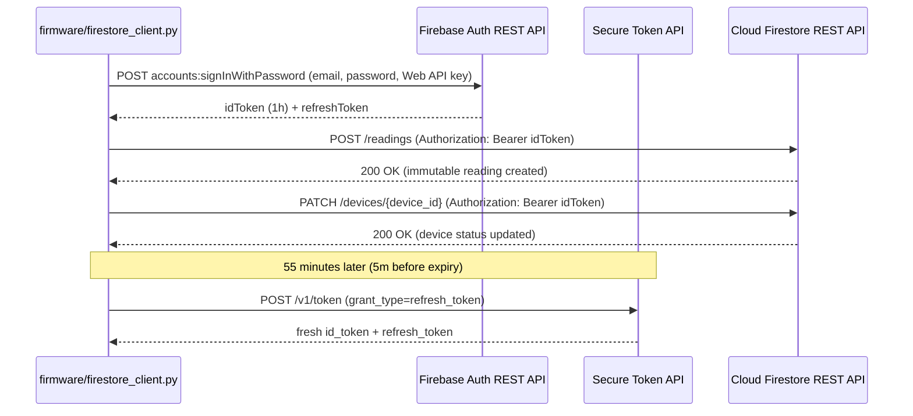

# Guide 02: CircuitPython Firmware — EPA AQI Math & Firestore REST Client

> **Built in Step 4 (Part 1) & Step 10 (Part 2) of [`IMPLEMENTATION_PLAN.md`](../IMPLEMENTATION_PLAN.md)** — Part 1 implements and validates the pure-Python US EPA AQI calculator ([`firmware/aqi.py`](../firmware/aqi.py)) and Firebase Auth + Firestore REST client ([`firmware/firestore_client.py`](../firmware/firestore_client.py)) on macOS before touching microcontroller hardware. Part 2 (Step 10) wires both modules into the main ESP32-S3 sensor loop (`firmware/code.py`).

---

## 1. Concept Briefing ("How It Works Under the Hood")

### Why Test Firmware Modules on macOS First?
Microcontrollers are great at reading physical sensors, but slow to debug when you are simultaneously troubleshooting Wi-Fi, TLS certificates, REST JSON formatting, and Firestore Security Rules. Because **CircuitPython is Python**, we can write [`firmware/aqi.py`](../firmware/aqi.py) and [`firmware/firestore_client.py`](../firmware/firestore_client.py) using only standard, lightweight Python constructs that run identically on your Mac and on the ESP32-S3:

- On the **ESP32-S3**, `FirestoreClient` receives an `adafruit_requests.Session` backed by the ESP32 Wi-Fi socket pool.
- On **macOS**, passing `session=None` automatically uses a tiny built-in `urllib.request` adapter with zero `pip` dependencies.

That lets us verify the math, Firebase Auth token lifecycle, and strict `firestore.rules` schema validation right from a terminal before ever plugging in a board.

### How the US EPA AQI Calculation Works (`firmware/aqi.py`)
The **Air Quality Index (AQI)** converts raw particulate concentrations (&mu;g/m<sup>3</sup>) into a normalized **0–500** health scale using piecewise linear interpolation between official US EPA breakpoint tables:

```text
AQI = round( ((I_high - I_low) / (C_high - C_low)) * (C - C_low) + I_low )
```

Key EPA rules implemented in [`firmware/aqi.py`](../firmware/aqi.py):
1. **Revised 2024 PM<sub>2.5</sub> Breakpoints**: Uses the updated US EPA PM<sub>2.5</sub> table (effective May 6, 2024), where **"Good" (0–50)** ends at **9.0 &mu;g/m<sup>3</sup>** (lowered from the older 12.0 &mu;g/m<sup>3</sup> threshold).
2. **EPA Truncation Before Lookup**: Per EPA guidance, PM<sub>2.5</sub> is truncated to **1 decimal place** (e.g., `9.09` becomes `9.0`) and PM<sub>10</sub> is truncated to an **integer** (`54.9` becomes `54`) before matching a breakpoint band.
3. **Worst Sub-Index Wins**: `calculate_aqi(pm25, pm10)` calculates both the PM<sub>2.5</sub> and PM<sub>10</sub> AQI values and returns the higher of the two along with its category (`Good`, `Moderate`, `Unhealthy for Sensitive Groups`, `Unhealthy`, `Very Unhealthy`, or `Hazardous`).
4. **Clamped to `[0, 500]`**: Extreme spikes above the top breakpoint clamp to `500` so they always pass the `inRange(data.aqi_us, 0, 500)` check in [`firestore.rules`](../firestore.rules).

### How Firebase Auth & Firestore REST Work (`firmware/firestore_client.py`)
There is no official Firebase Python SDK for CircuitPython, so the device talks directly to Google's HTTPS REST APIs:



#### Why Firestore REST JSON Looks Verbose
Unlike the Firebase Web/Admin SDKs, the raw Firestore REST API requires explicit **type wrappers** on every field so Firestore knows whether a value is an integer, double, string, or native `Timestamp`:

| Python Value | Firestore REST JSON |
| :--- | :--- |
| `"feather-s3-01"` | `{"stringValue": "feather-s3-01"}` |
| `642` (int) | `{"integerValue": "642"}` |
| `72.3` (float) | `{"doubleValue": 72.3}` |
| `"2026-11-22T19:45:00Z"` (timestamp field) | `{"timestampValue": "2026-11-22T19:45:00Z"}` |
| `["SCD-40", "PMSA003I"]` | `{"arrayValue": {"values": [{"stringValue": "SCD-40"}, {"stringValue": "PMSA003I"}]}}` |

Encoding `timestamp` and `last_seen_at` as `timestampValue` (rather than `stringValue`) is mandatory—[`firestore.rules`](../firestore.rules) enforces `value is timestamp` and rejects stale or future-dated clocks outside `[-15m, +5m]` of server time.

---

## 2. Hands-On Setup (Part 1: Local Mac Testing)

### Step 4A: Create Your Local `firmware/settings.toml` (Gitignored)
Copy the committed template to a local, gitignored `firmware/settings.toml`:

```bash
cp firmware/settings.toml.example firmware/settings.toml
```

Open `firmware/settings.toml` and fill in your Firebase values from Step 2 (leave Wi-Fi placeholders as-is for now; macOS uses your Mac's network):

- `FIREBASE_PROJECT_ID` — your Firebase project ID (same as `.firebaserc`).
- `FIREBASE_WEB_API_KEY` — found in **Firebase Console → Project Settings → General → Web API Key** (if you haven't registered a Web app yet, register one or check **Authentication → Settings**—creating a Web app automatically provisions the Web API Key).
- `FIREBASE_DEVICE_EMAIL` & `FIREBASE_DEVICE_PASSWORD` — the dedicated sensor user created in Step 2E whose UID is listed in `authorized_devices/{uid}`.
- `SENSOR_DEVICE_ID` — e.g., `"feather-s3-01"`.
- `SENSOR_LOCATION` — e.g., `"home-office"`.

Verify `firmware/settings.toml` is ignored by Git:

```bash
git status --short
```

### Step 4B: Run the Offline Math & Payload Tests
Run [`scripts/test_firmware_local.py`](../scripts/test_firmware_local.py) without `--publish` to verify all 34 EPA AQI reference cases and Firestore REST payload encoding offline:

```bash
python3 scripts/test_firmware_local.py
```

---

## 3. Single Focused Validation Checkpoint (Part 1)

Run the live publish check on macOS to authenticate as the dedicated sensor user, test token refresh, and write 1 synthetic sensor reading to Firestore:

```bash
python3 scripts/test_firmware_local.py --publish
```

Confirm all four checks succeed:
1. **EPA AQI & Encoding**: Prints `[PASS]` for all PM<sub>2.5</sub>, PM<sub>10</sub>, combined AQI, and Firestore REST encoding tests.
2. **Auth & Token Refresh**: Prints `[PASS]` for both Firebase Auth `signInWithPassword` and `securetoken.googleapis.com` token refresh.
3. **Live Firestore Writes**: Prints `[PASS]` for creating a document in `readings/{device_id}_{epoch}` and updating `devices/{device_id}`.
4. **Firebase Console Verification**: Open **Firebase Console → Firestore Database → Data** and confirm:
   - `readings/` contains the new synthetic document with `timestamp` stored as a native Firestore **timestamp** type.
   - `devices/{SENSOR_DEVICE_ID}` exists with `last_seen_at` and the nested `latest_reading` map.
5. **Secret Guardrail Check**: Run `./scripts/check-secrets.sh` and confirm `firmware/settings.toml` stays untracked.

---

## 4. Good to Know & Real-World Troubleshooting

- **`idToken` vs. `id_token` (CamelCase vs. SnakeCase)**: Firebase's `accounts:signInWithPassword` endpoint returns camelCase keys (`idToken`, `refreshToken`, `expiresIn`), whereas `securetoken.googleapis.com/v1/token` returns snake_case keys (`id_token`, `refresh_token`, `expires_in`). `FirestoreClient` handles both explicitly so token refreshes don't fail with `KeyError` after the first hour.
- **Always Close HTTP Responses on CircuitPython**: On an ESP32-S3, `adafruit_requests` uses a small fixed socket pool. Failing to call `response.close()` in a `try/finally` block leaks sockets and crashes the board after ~4–6 requests. Every HTTP call in `firmware/firestore_client.py` closes its response in `finally:`.
- **Boolean vs. Integer Encoding in Python**: In Python, `isinstance(True, int)` is `True`. `encode_firestore_value()` checks `isinstance(value, bool)` *before* `isinstance(value, int)` so booleans are never accidentally serialized as `integerValue`.
- **`HTTP 403 PERMISSION_DENIED` on Live Publish**:
  - Verify your device user's UID exists as a document ID under `authorized_devices/{uid}` in Firestore (from Step 3).
  - Verify your Mac's system clock is accurate—`firestore.rules` rejects timestamps older than 15 minutes or more than 5 minutes in the future.
  - Verify `SENSOR_DEVICE_ID` and `SENSOR_LOCATION` only contain letters, numbers, hyphens, or underscores (no spaces).
- **`HTTP 400 INVALID_LOGIN_CREDENTIALS` or `API_KEY_INVALID`**: Double-check `FIREBASE_WEB_API_KEY`, `FIREBASE_DEVICE_EMAIL`, and `FIREBASE_DEVICE_PASSWORD` in `firmware/settings.toml`.
- **Rotating or Replacing Device Credentials**: If you ever lose the device password or want to rotate credentials, create a new Email/Password user in **Firebase Console → Authentication → Users**, add its UID as a document ID in `authorized_devices/{new_uid}` (deleting the old UID document), and update `firmware/settings.toml`. Because `firestore.rules` checks `authorized_devices` dynamically, no rules redeployment or Git changes are needed.
- **macOS `python3` vs. Homebrew Python**: If `/usr/bin/python3` prompts to install Xcode Command Line Tools, run `/opt/homebrew/bin/python3.11 scripts/test_firmware_local.py --publish` (or whichever Homebrew Python 3 binary is installed).

---

*Part 2 (Step 10) will add the main CircuitPython sensor loop (`firmware/code.py`), NeoPixel status codes, and instructions for copying files onto the `CIRCUITPY` drive.*
