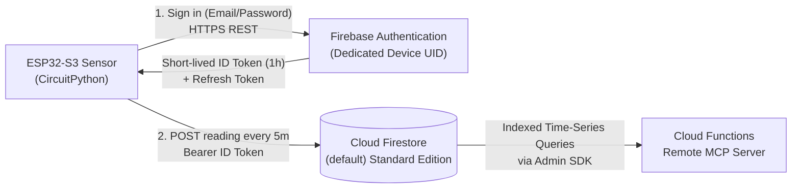

# Guide 03: Firebase Project, Authentication & Cloud Firestore

> **Built in Steps 2 & 3 of [`IMPLEMENTATION_PLAN.md`](../IMPLEMENTATION_PLAN.md)** — Part 1 (this step) provisions the Firebase project, Cloud Firestore database, composite indexes, and the dedicated device Auth account. Part 2 (Step 3) locks the database down with hardened write-only Security Rules.

---

## 1. Concept Briefing ("How It Works Under the Hood")

Instead of running a home server or managing a PostgreSQL database yourself, this project uses **Firebase** (Google Cloud) as a zero-maintenance cloud backend:



### Why Two Firestore Collections? (`readings` + `devices`)
1. **`readings` (Append-Only Time-Series Collection)**:
   - Every 5 minutes (288 readings/day), the ESP32-S3 writes one immutable document containing CO<sub>2</sub>, temperature, humidity, PM<sub>1.0</sub>/PM<sub>2.5</sub>/PM<sub>10</sub>, raw particle counts, and the computed US EPA AQI.
   - Keeping each sample as its own small document makes range queries (`"last 24 hours"`, `"past 7 days"`) fast and cheap, and stays well inside Firestore's free tier (~288 writes/day vs. 20,000 free writes/day).
2. **`devices` (Device Registry & Latest Status)**:
   - One document per physical sensor (`devices/{device_id}`), updated on every publish with `last_seen_at`, firmware metadata, and a snapshot of the `latest_reading`.
   - When an AI assistant asks *"Is my office sensor online?"*, the MCP server reads a single tiny document instead of scanning historical readings.

### Why Do We Need Composite Indexes (`firestore.indexes.json`)?
Firestore automatically indexes every single field on its own, which handles simple queries like `WHERE device_id == "feather-s3-01"`. However, as soon as you combine a **filter on one field** with an **order or range on a second field**—such as:

- `WHERE device_id == "feather-s3-01" ORDER BY timestamp DESC`
- `WHERE location == "home-office" ORDER BY timestamp DESC`

Firestore requires a **composite index** declared in [`firestore.indexes.json`](../firestore.indexes.json). Pre-declaring these indexes in Git means any clone of this repo gets fast, predictable time-series queries from day one without hitting `FAILED_PRECONDITION: The query requires an index` errors at runtime.

### Why a Dedicated Firebase Auth Account for the Sensor?
Microcontrollers shouldn't hold unrestricted Google Cloud Admin service account keys—if someone ever pulls the USB drive off the board, you don't want them holding root access to your cloud project. Instead:
- We enable **Email/Password** sign-in in Firebase Authentication.
- We create **one dedicated user account** exclusively for the sensor (it doesn't even need a real email inbox).
- In Step 3, Firestore Security Rules will grant that specific `request.auth.uid` **write-only** permission to append valid sensor readings—it cannot read other data, delete history, or access any other GCP service.

---

## 2. Hands-On Setup (Part 1: Project, Database, Indexes & Auth)

### Step 2A: Authenticate the Firebase CLI
Always run the Firebase CLI via `npx -y firebase-tools@latest` so you stay on the current release:

```bash
npx -y firebase-tools@latest --version
npx -y firebase-tools@latest login
```

### Step 2B: Create (or Select) Your Firebase Project
Create a new globally unique Firebase project (6–30 lowercase letters, digits, and hyphens):

```bash
npx -y firebase-tools@latest projects:create <your-firebase-project-id> --display-name "Custom Air Quality Sensor"
```

Then bind this local repository to your project (this writes `.firebaserc`, which is **gitignored** so your real project ID never reaches GitHub):

```bash
cp .firebaserc.example .firebaserc
npx -y firebase-tools@latest use <your-firebase-project-id>
```

### Step 2C: Provision the Cloud Firestore Database
Create the `(default)` Firestore database in **Standard Edition** (Native mode) in a region near you (for example, `us-east1` on the US East Coast or `us-central1` in the US Midwest):

```bash
npx -y firebase-tools@latest firestore:databases:create "(default)" --location="us-east1"
```

> [!TIP]
> Colocate your Firestore database and Cloud Functions in the same region (e.g., both in `us-east1` or `us-central1`) to minimize latency when your MCP server queries historical readings.

### Step 2D: Review `firebase.json` & `firestore.indexes.json`
This repository commits two safe, project-agnostic Firebase config files:
- [`firebase.json`](../firebase.json) — declares the `(default)` Firestore database, region, rules file path, indexes file path, and Email/Password Auth provider.
- [`firestore.indexes.json`](../firestore.indexes.json) — declares the two composite indexes on `readings`:
  1. `device_id` (`ASCENDING`) + `timestamp` (`DESCENDING`)
  2. `location` (`ASCENDING`) + `timestamp` (`DESCENDING`)

Deploy the indexes to your Firebase project:

```bash
npx -y firebase-tools@latest deploy --only firestore:indexes
```

### Step 2E: Enable Email/Password Auth & Create the Dedicated Device User
1. Open the **Firebase Console** for your project → **Build → Authentication**.
2. Click **Get started** (if not already enabled) → **Sign-in method** → enable **Email/Password** (leave "Email link (passwordless)" off) → **Save**.
3. Go to the **Users** tab → **Add user**:
   - **Email**: a dedicated identifier such as `sensor-01@your-domain.example` (it does not need to be a real email inbox).
   - **Password**: a strong, unique password generated by your password manager.
4. Copy and save the new user's **User UID** locally (you will need it in Step 3 when locking down `firestore.rules`, and the email/password + Web API Key in Step 4 for `firmware/settings.toml`).

---

## 3. Single Focused Validation Checkpoint (Part 1)

Run these three quick checks to confirm Step 2 is solid before moving to Step 3:

1. **Confirm Composite Indexes Deployed Cleanly**:
   ```bash
   npx -y firebase-tools@latest deploy --only firestore:indexes
   ```
   Verify in the Firebase Console under **Firestore Database → Indexes → Composite** that both `readings` indexes (`device_id + timestamp` and `location + timestamp`) show status **Enabled** (or **Building** right after creation).
2. **Confirm `.firebaserc` Is Untracked**:
   ```bash
   git status --short
   ```
   `.firebaserc` must **not** appear in `git status`.
3. **Run the Secret Scanner**:
   ```bash
   ./scripts/check-secrets.sh
   ```
   Confirm all guardrail checks pass with zero warnings.

---

## 4. Good to Know & Real-World Troubleshooting

> [!NOTE]
> **New projects don't have the Cloud Firestore API enabled until initialized.**
> If you create a brand-new Firebase project via CLI/API and immediately call the Firestore Admin API to create a database, Google Cloud returns:
> `Cloud Firestore API has not been used in project ... before or it is disabled.`
> Running Firebase initialization (`firebase init` / enabling Firestore in the Console) enables `firestore.googleapis.com` first, after which database creation succeeds immediately.

> [!TIP]
> **Standard Edition `(default)` vs. Enterprise Edition for IoT REST Clients:**
> This project uses **Firestore Standard Edition** (`databaseEdition: "STANDARD"`, database ID `(default)`) because:
> 1. It is eligible for the **Firestore Free Tier** (`freeTier: true`), easily covering 288 sensor writes/day.
> 2. It enables the **Firestore REST API** (`firestore.googleapis.com/v1/projects/.../databases/(default)/documents/...`) and **Firebase Security Rules** out of the box—exactly what our lightweight CircuitPython firmware needs.

> [!NOTE]
> **Why does Firestore add `__name__` to composite indexes?**
> After deploying `firestore.indexes.json`, you will notice Firestore appends a third field (`__name__ DESCENDING`) to each composite index in the Console and API output. This is normal—Firestore automatically uses the document ID (`__name__`) as a deterministic tie-breaker when two documents have the exact same timestamp.

> [!TIP]
> **Spark (Free) vs. Blaze (Pay-as-you-go) Plan Timing:**
> Everything in Steps 2–4 (Firebase Auth, Firestore database, Security Rules, and direct ESP32-S3 publishing) works on the free **Spark** plan. You will only need to upgrade the project to **Blaze** in Step 7 when deploying Firebase Cloud Functions (2nd Gen) and Cloud Secret Manager.

---

## 5. Part 2: Hardened Firestore Security Rules *(Coming in Step 3)*

In **Step 3**, we will author `firestore.rules` to enforce zero public access and strict write-only schema validation for the dedicated sensor device UID, then validate it with a live unauthenticated `curl` check (`403 PERMISSION_DENIED`).
