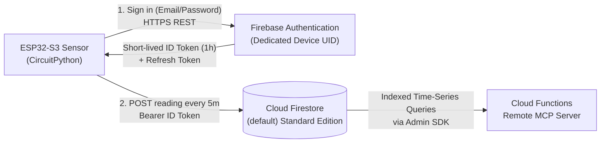
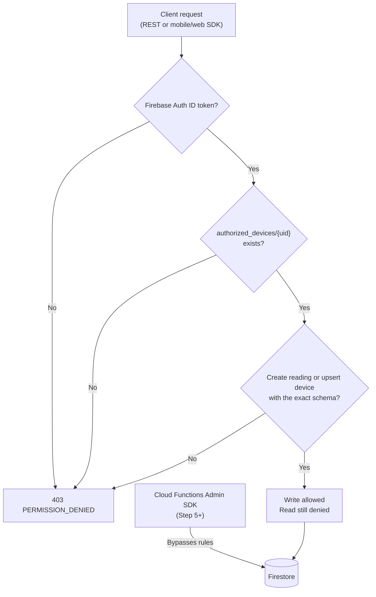

# Guide 03: Firebase Project, Authentication & Cloud Firestore

> **Built in Steps 2 & 3 of [`IMPLEMENTATION_PLAN.md`](../IMPLEMENTATION_PLAN.md)** — Part 1 provisions the Firebase project, Cloud Firestore database, composite indexes, and the dedicated device Auth account. Part 2 locks that database down with hardened write-only Security Rules.

---

## 1. Concept Briefing ("How It Works Under the Hood")

Instead of running a home server or managing a PostgreSQL database yourself, this project uses **Firebase** (Google Cloud) as a zero-maintenance cloud backend:



### Why Two Firestore Collections? (`readings` + `devices`) — Plus Daily Rollups
1. **`readings` (Append-Only Time-Series Collection)**:
   - Every 5 minutes (288 readings/day), the ESP32-S3 writes one immutable document containing CO<sub>2</sub>, temperature, humidity, PM<sub>1.0</sub>/PM<sub>2.5</sub>/PM<sub>10</sub>, raw particle counts, and the computed US EPA AQI.
   - Keeping each sample as its own small document keeps sensor writes simple and write-only via `firestore.rules`, and stays well inside Firestore's free tier (~288 writes/day vs. 20,000 free writes/day).
2. **`devices` (Device Registry & Latest Status)**:
   - One document per physical sensor (`devices/{device_id}`), updated on every publish with `last_seen_at`, firmware metadata, and a snapshot of the `latest_reading`.
   - When an AI assistant asks *"Is my office sensor online?"*, the MCP server reads a single tiny document instead of scanning historical readings.
3. **`daily_rollups` & `outdoor_daily_rollups` (UTC-Day Read Optimization — [Guide 13](./13-firestore-read-optimization-and-rollups.md))**:
   - Maintained server-side via Admin SDK (`syncOutdoorOnReading` + [`backfillRollups.ts`](../functions/src/scripts/backfillRollups.ts)), storing compact lossless per-reading maps per UTC day (`daily_rollups/{device_id}_{YYYY-MM-DD}` and `outdoor_daily_rollups/{YYYY-MM-DD}`).
   - [`firestore.indexes.json`](../firestore.indexes.json) includes `fieldOverrides` disabling automatic indexing on both `samples` maps so dense days never approach Firestore's 40,000 index-entries-per-document limit. This cuts 24h/7d dashboard and MCP history queries by **>99%** with automatic raw fallback for any missing day.

### Why Do We Need Composite Indexes (`firestore.indexes.json`)?
Firestore automatically indexes every single field on its own, which handles simple queries like `WHERE device_id == "feather-s3-01"`. However, as soon as you combine a **filter on one field** with an **order or range on a second field**—such as:

- `WHERE device_id == "feather-s3-01" ORDER BY timestamp DESC`
- `WHERE location == "home-office" ORDER BY timestamp DESC`

Firestore requires a **composite index** declared in [`firestore.indexes.json`](../firestore.indexes.json). Pre-declaring these indexes in Git means any clone of this repo gets fast, predictable time-series queries from day one without hitting `FAILED_PRECONDITION: The query requires an index` errors at runtime.

### Why a Dedicated Firebase Auth Account for the Sensor?
Microcontrollers shouldn't hold unrestricted Google Cloud Admin service account keys—if someone ever pulls the USB drive off the board, you don't want them holding root access to your cloud project. Instead:
- We enable **Email/Password** sign-in in Firebase Authentication.
- We create **one dedicated user account** exclusively for the sensor (it doesn't even need a real email inbox).
- In Step 3, Firestore Security Rules will grant that specific `request.auth.uid` **write-only** permission to append valid sensor readings—it cannot read other data, delete history, or access any other GCP service.

---

## 2. Hands-On Setup (Part 1: Project, Database, Indexes & Auth)

### Step 2A: Authenticate the Firebase CLI
Always run the Firebase CLI via `npx -y firebase-tools@latest` so you stay on the current release:

```bash
npx -y firebase-tools@latest --version
npx -y firebase-tools@latest login
```

### Step 2B: Create (or Select) Your Firebase Project
Create a new globally unique Firebase project (6–30 lowercase letters, digits, and hyphens):

```bash
npx -y firebase-tools@latest projects:create <your-firebase-project-id> --display-name "Custom Air Quality Sensor"
```

Then bind this local repository to your project. On Firebase CLI 15, `firebase use <project-id>` only stores the active project in your user-level CLI config. `--alias default` is what writes the gitignored `.firebaserc`, which is how the project id stays off GitHub and still available to local scripts:

```bash
npx -y firebase-tools@latest use <your-firebase-project-id> --alias default
```

### Step 2C: Provision the Cloud Firestore Database
Create the `(default)` Firestore database in **Standard Edition** (Native mode) in a region near you (for example, `us-east1` on the US East Coast or `us-central1` in the US Midwest):

```bash
npx -y firebase-tools@latest firestore:databases:create "(default)" --location="us-east1"
```

> [!TIP]
> Colocate your Firestore database and Cloud Functions in the same region (e.g., both in `us-east1` or `us-central1`) to minimize latency when your MCP server queries historical readings.

### Step 2D: Review `firebase.json` & `firestore.indexes.json`
This repository commits two safe, project-agnostic Firebase config files:
- [`firebase.json`](../firebase.json) — declares the `(default)` Firestore database, region, rules file path, indexes file path, and Email/Password Auth provider.
- [`firestore.indexes.json`](../firestore.indexes.json) — declares the two composite indexes on `readings`:
  1. `device_id` (`ASCENDING`) + `timestamp` (`DESCENDING`)
  2. `location` (`ASCENDING`) + `timestamp` (`DESCENDING`)

Deploy the indexes to your Firebase project:

```bash
npx -y firebase-tools@latest deploy --only firestore:indexes
```

### Step 2E: Enable Email/Password Auth & Create the Dedicated Device User
1. Open the **Firebase Console** for your project → **Build → Authentication**.
2. Click **Get started** (if not already enabled) → **Sign-in method** → enable **Email/Password** (leave "Email link (passwordless)" off) → **Save**.
3. Go to the **Users** tab → **Add user**:
   - **Email**: a dedicated identifier such as `sensor-01@your-domain.example` (it does not need to be a real email inbox).
   - **Password**: a strong, unique password generated by your password manager.
4. Copy and save the new user's **User UID** locally. Step 3 uses that UID as the document ID of `authorized_devices/{uid}` (the rules file stays free of your UID). Step 4 uses the email, password, and Web API Key in `firmware/settings.toml`.

---

## 3. Single Focused Validation Checkpoint (Part 1)

Run these three quick checks to confirm Step 2 is solid before moving to Step 3:

1. **Confirm Composite Indexes Deployed Cleanly**:
   ```bash
   npx -y firebase-tools@latest deploy --only firestore:indexes
   ```
   Verify in the Firebase Console under **Firestore Database → Indexes → Composite** that both `readings` indexes (`device_id + timestamp` and `location + timestamp`) show status **Enabled** (or **Building** right after creation).
2. **Confirm `.firebaserc` Is Untracked**:
   ```bash
   git status --short
   ```
   `.firebaserc` must **not** appear in `git status`.
3. **Run the Secret Scanner**:
   ```bash
   ./scripts/check-secrets.sh
   ```
   Confirm all guardrail checks pass with zero warnings.

---

## 4. Good to Know & Real-World Troubleshooting

> [!NOTE]
> **New projects don't have the Cloud Firestore API enabled until initialized.**
> If you create a brand-new Firebase project via CLI/API and immediately call the Firestore Admin API to create a database, Google Cloud returns:
> `Cloud Firestore API has not been used in project ... before or it is disabled.`
> Running Firebase initialization (`firebase init` / enabling Firestore in the Console) enables `firestore.googleapis.com` first, after which database creation succeeds immediately.

> [!TIP]
> **Standard Edition `(default)` vs. Enterprise Edition for IoT REST Clients:**
> This project uses **Firestore Standard Edition** (`databaseEdition: "STANDARD"`, database ID `(default)`) because:
> 1. It is eligible for the **Firestore Free Tier** (`freeTier: true`), easily covering 288 sensor writes/day.
> 2. It enables the **Firestore REST API** (`firestore.googleapis.com/v1/projects/.../databases/(default)/documents/...`) and **Firebase Security Rules** out of the box—exactly what our lightweight CircuitPython firmware needs.

> [!NOTE]
> **Why does Firestore add `__name__` to composite indexes?**
> After deploying `firestore.indexes.json`, you will notice Firestore appends a third field (`__name__ DESCENDING`) to each composite index in the Console and API output. This is normal—Firestore automatically uses the document ID (`__name__`) as a deterministic tie-breaker when two documents have the exact same timestamp.

> [!TIP]
> **Spark (Free) vs. Blaze (Pay-as-you-go) Plan Timing:**
> Everything in Steps 2–4 (Firebase Auth, Firestore database, Security Rules, and direct ESP32-S3 publishing) works on the free **Spark** plan. You will only need to upgrade the project to **Blaze** in Step 7 when deploying Firebase Cloud Functions (2nd Gen) and Cloud Secret Manager.

---

## 5. Part 2: Hardened Firestore Security Rules (Step 3)

[`firestore.rules`](../firestore.rules) is the only gate on the Firestore REST API. The ESP32-S3 will authenticate as the dedicated device user and write through that API. Anyone who can reach the API without a valid Firebase Auth ID token, or with a token for some other user, gets nothing.



### Why the device UID stays out of the rules file (and Optional Per-Device Isolation)
This repository is public, and a fork should deploy the same rules without inheriting someone else's device. The rules first check whether a document exists at `authorized_devices/{request.auth.uid}` (`isSensorDevice()`). The Firebase Console writes that document with Admin privileges. Client calls cannot create it, read it, or change it, while the rules engine reads it server-side without exposing it to the caller.

For multi-room fleets (Phase 4B), `canActAsDevice(deviceId)` also supports an optional `device_id` string field on `authorized_devices/{uid}`:
- **When `device_id` is set** (for example, `"feather-s3-01"`), that Firebase Auth UID can only write `readings` with that exact `device_id`, write `devices/{device_id}`, and `get` `device_configs/{device_id}`—preventing one compromised node from spoofing or reading another room's config.
- **When `device_id` is omitted or `null`** (legacy single-sensor allowlist doc), any valid `device_id` is permitted for zero-downtime migration until you stamp `device_id` in Firebase Console (with zero firmware changes).

### What the device account is allowed to do
| Path | Create | Update | Delete | Read |
| :--- | :--- | :--- | :--- | :--- |
| `readings/{id}` | Yes, full schema, fresh timestamp | No | No | No |
| `devices/{device_id}` | Yes, when the path equals the `device_id` field | Yes, same check on the merged document | No | No |
| `device_configs/{device_id}` *(added in Step 12)* | No | No | No | `get` only (no `list`) — see [Guide 09](./09-remote-config-and-dashboard.md) |
| `authorized_devices/{uid}` | No | No | No | No |
| Every other path | No | No | No | No |

Reads stay closed on purpose. A copy of `settings.toml` pulled off the USB drive can publish samples, and it cannot download the history already stored. The MCP server in later steps reads through the Admin SDK, which does not consult these rules.

### Schema the write must match
`readings` documents must contain exactly the fields from the PRD, with no extras:

| Field | Rule |
| :--- | :--- |
| `device_id`, `location` | 1–64 characters, letters, digits, `_`, `-` |
| `timestamp` | Firestore **timestamp**, no older than 15 minutes and no more than 5 minutes ahead of server time |
| `co2_ppm` | Number, 0–40000 |
| `temperature_c` | Number, −40–85 |
| `temperature_f` | Number, −40–185 |
| `humidity_percent` | Number, 0–100 |
| `pm1_0_ug_m3`, `pm2_5_ug_m3`, `pm10_0_ug_m3` | Number 0–1000, or `null` when the node has no PMSA003I |
| `aqi_us` | Number 0–500, or `null` on an SCD-40-only satellite |
| `aqi_category` | One of `Good`, `Moderate`, `Unhealthy for Sensitive Groups`, `Unhealthy`, `Very Unhealthy`, `Hazardous`, or `null` |
| `particles_*um` | Number 0–65535, or `null` on an SCD-40-only satellite |

The keys still have to be present. Omitting `pm2_5_ug_m3`, sending a negative number, or sending `1001` is rejected. `sensors` must be exactly `["SCD-40"]` or `["SCD-40", "PMSA003I"]` in that order.

`devices/{device_id}` must contain exactly `device_id`, `location`, `last_seen_at`, `firmware_version` (`MAJOR.MINOR.PATCH`), `sensors` (the same two lists), `reporting_interval_seconds` (60–3600; production firmware uses 300), and `latest_reading`. The `latest_reading` map is exactly `co2_ppm`, `temperature_f`, `humidity_percent`, `pm2_5_ug_m3`, `aqi_us`, and `aqi_category`, and the PM/AQI fields in that map may be `null`. The `device_id` field has to equal the document path, so the account cannot overwrite `devices/some-other-board` while claiming a different id inside the body.

`device_configs/{device_id}` may also store an admin-written `floor` slug (`null` or 1–32 characters of letters, digits, `_`, and `-`, such as `main`, `upstairs`, or `basement`). Sensors can read a valid floor and cannot write the document. A malformed `floor` fails the `get`.

The mixed-fleet payload checks run against the local Firestore emulator, without deploying:

```bash
firebase emulators:exec --only firestore --project demo-custom-air-sensor \
  "python3 scripts/verify_device_configs_rules.py --emulator"
```

Numbers are checked with `is number`, which accepts both integers and doubles. Firestore keeps those as different wire types (`integerValue` vs `doubleValue`). Requiring `is int` would reject a perfectly valid `25.0` from CircuitPython.

The Cloud Functions parsers keep a missing or null PM, AQI, or particle field as `null`. They do not turn it into `0`, and they do not label a missing AQI category as `Good`. House PM₂.₅ and AQI averages use only the samples that actually measured those fields. A node with no PMSA003I reports PM health as `unavailable`. `device_configs.floor` is optional on `PUT /api/devices/:deviceId/config`.

---

## 6. Hands-On Setup (Part 2: Rules & Device Allowlist)

### Step 3A: Create the allowlist document
1. Open **Firebase Console → Firestore Database → Data**.
2. Start a collection named `authorized_devices`.
3. Set the **Document ID** to the device user's **User UID** from Authentication (the UID, not the email).
4. Add one field: `role` (string) = `sensor`. Optionally add `device_id` (string, e.g., `feather-s3-01`) to strictly bind this Auth UID to a single sensor node across `readings`, `devices`, and `device_configs`.
5. Save.

Do this from the Console. After the rules below are deployed, the REST API and client SDKs are locked out of `authorized_devices`, while the Console still writes with Admin privileges.

### Step 3B: Deploy the rules
`firebase.json` already points Firestore at [`firestore.rules`](../firestore.rules):

```bash
npx -y firebase-tools@latest deploy --only firestore:rules
```

The compile-and-release output should finish with no warnings.

---

## 7. Single Focused Validation Checkpoint (Part 2)

Two checks, and nothing else:

1. **Rules compile and deploy cleanly** (the command in Step 3B).
2. **An unauthenticated read is rejected.** Load the project id from the `default` alias in the gitignored `.firebaserc` (Step 2B) so it never has to be pasted into the shell history by hand:

```bash
PROJECT_ID=$(python3 -c 'import json; print(json.load(open(".firebaserc"))["projects"]["default"])')
curl -sS "https://firestore.googleapis.com/v1/projects/${PROJECT_ID}/databases/(default)/documents/readings"
```

**Expected:** HTTP 403 and a Firestore error body whose `status` is `PERMISSION_DENIED`. A successful deploy that still returned a list of documents would mean the rules were not the active release.

---

## 8. Good to Know & Real-World Troubleshooting (Part 2)

> [!NOTE]
> **The unauthenticated REST check returns 403 from Security Rules, with no API key on the URL.**
> `GET https://firestore.googleapis.com/v1/projects/<project>/databases/(default)/documents/readings` with no `Authorization` header and no `?key=` still reaches the Firestore rules engine. On this project the body was:
> `{"error": {"code": 403, "message": "Missing or insufficient permissions.", "status": "PERMISSION_DENIED"}}`
> Quote the URL in the shell. The parentheses in `(default)` are part of the database id.

> [!IMPORTANT]
> **Step 4 has to send a Firestore timestamp, and the board clock has to be close to real time.**
> `timestamp` and `last_seen_at` must be the Firestore `timestamp` type (`timestampValue` on the REST API), within 15 minutes behind server time and 5 minutes ahead of it. An ISO string in `stringValue` is rejected. So is a timestamp from an ESP32 that has not synced NTP yet (those boards often boot in 2000). Sync the clock before the first publish.

> [!TIP]
> **`exists()` on `authorized_devices` is not a client read.**
> Denying `read` on that collection does not hide it from the rules language. The rules engine resolves `exists()` on its own, then throws the document away. The device token still cannot `GET` the allowlist, so the UID list is not exposed through the same credentials that sit on the microcontroller.

> [!NOTE]
> **`firebase use <project-id>` does not fill in `.firebaserc` on CLI 15.**
> During this step, `.firebaserc` existed and was gitignored, but `projects` was `{}`. `firebase deploy` still succeeded because the CLI keeps the active project in `~/.config/configstore/firebase-tools.json`. Reading `.firebaserc` for the `curl` check then failed with a missing `default` alias. `firebase use <project-id> --alias default` writes that alias into the gitignored file. Confirm `git status` still does not list `.firebaserc`.

> [!NOTE]
> **The Node `punycode` deprecation is not a rules warning.**
> `npx firebase-tools` on Node 22 prints `DeprecationWarning: The punycode module is deprecated` before the deploy banner. The rules compile line itself was `rules file firestore.rules compiled successfully`, and the release finished with `Deploy complete!` and no Firestore warnings.
