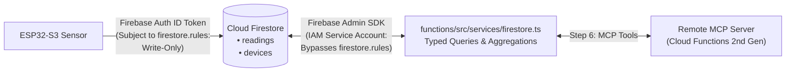
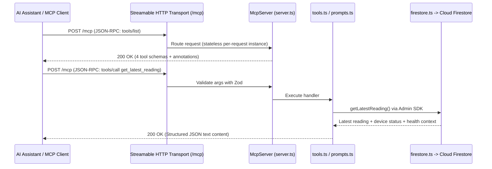
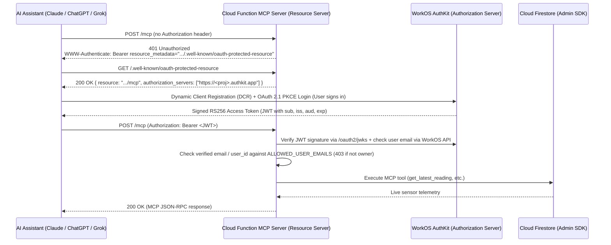

# Guide 04: Cloud Functions (2nd Gen), Firestore Query Service & Remote MCP Server

> **Built across Steps 5, 6, and 7 of [`IMPLEMENTATION_PLAN.md`](../IMPLEMENTATION_PLAN.md)** — Part 1 (Step 5) scaffolds the Node.js 22 + TypeScript Cloud Functions project and implements the typed Cloud Firestore data access & statistical aggregation layer ([`functions/src/services/firestore.ts`](../functions/src/services/firestore.ts)). Part 2 (Step 6) adds the MCP Server tools, prompts, and resources. Part 3 (Step 7) wires up WorkOS AuthKit OAuth 2.1, the owner allowlist, and deploys to Cloud Functions (2nd Gen).

---

## 1. Concept Briefing ("How It Works Under the Hood")

### Why Does the Sensor Write via REST While the Backend Reads via Admin SDK?
In Steps 3 and 4, we locked `firestore.rules` down with `allow read: if false;` on both `readings` and `devices`. That means **zero** client SDKs, browsers, or even the ESP32-S3 itself can read your home's historical air quality data.

So how does our Cloud Function read Firestore?



- **Firebase Admin SDK (`firebase-admin`)** authenticates with Google Cloud **IAM Service Account** credentials instead of an end-user Firebase Auth token.
- Because IAM service accounts are trusted server-side identities, Admin SDK reads bypass client `firestore.rules` automatically.
- Security for reads moves up one layer to our Cloud Function HTTP gateway (Step 7), where **WorkOS AuthKit OAuth 2.1** and an explicit owner allowlist verify *you* before any tool can invoke `firestore.ts`.

### Why Cloud Functions 2nd Gen Requires the Blaze Plan
Firebase's **Spark (free)** plan covers Firestore and Authentication, but deploying **Cloud Functions (2nd Gen)** requires upgrading the project to **Blaze (Pay-as-You-Go)** because 2nd Gen functions build container images via **Cloud Build**, store them in **Artifact Registry**, and run on **Cloud Run**.

For a personal air quality sensor queried by one user, usage stays well inside Google Cloud's generous monthly free tier (2 million Cloud Functions/Cloud Run invocations, 400,000 GB-seconds, and 1 GiB Firestore storage free per month), so your typical monthly bill is **\$0.00–\$0.10** (mostly tiny Artifact Registry image storage if old build images aren't pruned).

### How `functions/src/services/firestore.ts` Keeps Queries Fast & LLM-Friendly
Raw time-series data from a 5-minute sensor produces **288 readings per day** (~2,016 per week, ~8,640 per month). Dumping 2,000 raw JSON documents directly into an AI assistant's context window is slow, expensive, and inaccurate. Our Firestore service solves this with four design patterns:

1. **Composite Index Alignment**: Every query on `readings` uses the exact composite indexes we deployed in [`firestore.indexes.json`](../firestore.indexes.json):
   - `(device_id ASC, timestamp DESC)`
   - `(location ASC, timestamp DESC)`
   If a caller supplies *both* `device_id` and `location`, the service queries Firestore by `device_id` and filters `location` in memory so it never hits a missing 3-field composite index error.
2. **Evenly Spaced Downsampling (`downsampleReadings`)**: `getReadingsHistory()` fetches the time window chronologically and, if more readings match than the requested `limit` (default `100`), samples evenly across the timeline while always preserving the **first** and **last** observations.
3. **Server-Side Statistical Aggregation (`computeMetricStats`)**: `getAirQualitySummary()` computes `min`, `max`, `avg`, and **95th percentile (`p95`)** for CO<sub>2</sub>, PM<sub>2.5</sub>, PM<sub>10</sub>, temperature, humidity, and AQI in TypeScript so the AI assistant receives accurate math instead of guessing averages from raw samples.
4. **Spike Episode Grouping (`detectNotableSpikes`)**: Instead of returning dozens of repetitive timestamps when CO<sub>2</sub> stays above 1,000 ppm for two hours, contiguous elevated readings (CO<sub>2</sub> > 1,000 ppm or PM<sub>2.5</sub> > 9.0 &mu;g/m<sup>3</sup>) are grouped into concise episodes with `started_at`, `peak_timestamp`, `ended_at`, `peak_value`, and `reading_count`.

### Exported Service Functions
| Function | Backing Collection(s) | Purpose |
| :--- | :--- | :--- |
| `getLatestReading(options)` | `readings`, `devices` | Fetches the newest reading (optionally filtered by `device_id` or `location`), attaches device metadata, calculates `minutes_ago` / `is_stale`, and returns qualitative health context. |
| `getReadingsHistory(options)` | `readings` | Fetches chronological time-series readings over `hours` (1–168, default 24) or explicit `start_time`/`end_time` ISO timestamps, with automatic downsampling. |
| `getAirQualitySummary(options)` | `readings` | Aggregates `min`/`max`/`avg`/`p95`, threshold exceedance counts, and grouped spike episodes over `1h`, `6h`, `24h`, `7d`, or `30d`. |
| `getSensorStatus(options)` | `devices` | Lists registered sensors and flags each as `online` (&le;15 min), `stale` (16–60 min), or `offline` (&gt;60 min). |

---

## 2. Hands-On Setup (Part 1: Cloud Functions Scaffolding)

### Step 5A: Confirm Node.js 22 & Install Dependencies
Verify you are running **Node.js 22** (matching `"engines": { "node": "22" }` in [`functions/package.json`](../functions/package.json)):

```bash
node -v
```

Install the Cloud Functions dependencies inside `functions/`:

```bash
npm --prefix functions install
```

### Step 5B: Review `firebase.json` Functions Configuration
[`firebase.json`](../firebase.json) now includes a `functions` block pointing to `functions/` with a `predeploy` hook that compiles TypeScript automatically before deployment:

```json
"functions": [
  {
    "source": "functions",
    "codebase": "default",
    "ignore": [
      "node_modules",
      ".git",
      "firebase-debug.log",
      "firebase-debug.*.log",
      "*.local"
    ],
    "predeploy": [
      "npm --prefix \"$RESOURCE_DIR\" run build"
    ]
  }
]
```

### Step 5C: Compile TypeScript
Run the TypeScript compiler to verify strict type-checking and emit JavaScript to `functions/lib/` (which is gitignored):

```bash
npm --prefix functions run build
```

---

## 3. Single Focused Validation Checkpoint (Part 1)

### 1. Offline TypeScript Build & Unit Verification
Run the build + offline statistical/helper checks (tests `computeMetricStats`, `downsampleReadings`, `assessReadingHealth`, and `detectNotableSpikes`):

```bash
npm --prefix functions run verify:firestore
```

### 2. Live Firestore Query Verification
Run the live read verification against the synthetic reading you published in Step 4. Because `firebase-admin` uses Google Application Default Credentials (ADC) when running outside Cloud Functions, authenticate locally using one of two options:

- **Option A (Recommended if you have Google Cloud CLI installed)**:
  ```bash
  gcloud auth application-default login
  npm --prefix functions run verify:firestore -- --live
  ```
- **Option B (No `gcloud` required — temporary gitignored service account key)**:
  1. In **Firebase Console → Project Settings → Service accounts**, click **Generate new private key**.
  2. Save the file inside the repo root as `firebase-adminsdk.json` (or anywhere outside the repo—`*firebase-adminsdk*.json` and `*service-account*.json` are strictly ignored by [`.gitignore`](../.gitignore)).
  3. Run:
     ```bash
     GOOGLE_APPLICATION_CREDENTIALS=./firebase-adminsdk.json npm --prefix functions run verify:firestore -- --live
     ```
  4. Delete the local JSON key file when finished if you no longer need local live-DB testing.

Confirm all four live queries print `[PASS]`:
1. `getLatestReading()` returns your Step 4 synthetic reading (`CO2=642 ppm`, `PM2.5=6 ug/m3`, `AQI=33`).
2. `getReadingsHistory(24h)` returns at least 1 reading in chronological order.
3. `getAirQualitySummary(24h)` computes `min`/`max`/`avg`/`p95` across the window.
4. `getSensorStatus()` returns your `feather-s3-01` device document with its online/stale/offline status.

Finally, run the public-repo secret check:

```bash
./scripts/check-secrets.sh
```

---

## 4. Good to Know & Real-World Troubleshooting

- **ESM (`"type": "module"`) + `NodeNext` Imports**: `functions/package.json` uses native ES Modules (`"type": "module"`) with `"module": "NodeNext"` in `tsconfig.json`. Local relative imports in TypeScript files must use the `.js` extension (e.g., `import { ... } from "../services/firestore.js"`) because Node.js resolves the compiled `.js` output at runtime.
- **No `GOOGLE_APPLICATION_CREDENTIALS` Needed in Production**: When deployed to Firebase Cloud Functions (2nd Gen), Google Cloud automatically injects the runtime service account credentials and project ID into `initializeApp()`. You should **never** bundle or commit a service account JSON key for production.
- **Why `PM2_5_ELEVATED_UG_M3 = 9.0` Instead of `12.0`**: Consistent with [`firmware/aqi.py`](../firmware/aqi.py) from Step 4, spike detection uses the **revised May 2024 US EPA PM<sub>2.5</sub>** threshold where the "Good" band ends at `9.0` &mu;g/m<sup>3</sup> (formerly `12.0` &mu;g/m<sup>3</sup>).
- **`Could not load the default credentials` Locally**: Running `firebase login` authenticates the *Firebase CLI*, not the Node.js `firebase-admin` SDK. Locally, `firebase-admin` specifically looks for `gcloud` Application Default Credentials (`~/.config/gcloud/application_default_credentials.json`) or the `GOOGLE_APPLICATION_CREDENTIALS` environment variable.
- **`7 PERMISSION_DENIED` Locally When Working Across Multiple GCP Projects**: If `GOOGLE_APPLICATION_CREDENTIALS` is exported in your shell profile (`~/.zshrc` / `~/.bashrc`) for a *different* Google Cloud project, `firebase-admin` prioritizes that key file over your default ADC and fails with `7 PERMISSION_DENIED: Missing or insufficient permissions`. Clear it inline to use default ADC:
  ```bash
  GOOGLE_APPLICATION_CREDENTIALS= npm --prefix functions run verify:firestore -- --live
  ```
- **Benign `[DEP0040] punycode` Warning on Node.js 22**: You may see `DeprecationWarning: The 'punycode' module is deprecated` when running local Node 22 scripts that import `firebase-admin`. This comes from an upstream transitive dependency and does not affect compilation or runtime queries.
- **Keep Cloud Costs Near Zero on Blaze**: Set a \$1–\$5 monthly billing budget alert in **Google Cloud Console → Billing → Budgets & alerts** so you are notified immediately of any unexpected spikes.

---

## 5. Part 2 (Step 6): Core MCP Server Tools, Prompts & Resources

### Concept Briefing: How the Model Context Protocol (MCP) Works
The **Model Context Protocol (MCP)** is an open JSON-RPC 2.0 protocol that standardizes how AI assistants (Claude, ChatGPT, Grok, and local developer tools) discover and invoke external capabilities. An MCP server exposes three core primitives:

| MCP Primitive | Who Controls It | What It Does in This Project |
| :--- | :--- | :--- |
| **Tools** (`tools/list`, `tools/call`) | **Model-controlled** (the AI decides when to call them) | Query live and historical Firestore sensor data (`get_latest_reading`, `get_readings_history`, `get_air_quality_summary`, `get_sensor_status`). |
| **Prompts** (`prompts/list`, `prompts/get`) | **User-controlled** (invoked as a slash command / reusable template) | `analyze_indoor_air` — gives the AI a structured workflow to inspect current readings, review 24-hour spikes, and provide actionable ventilation/filtration advice. |
| **Resources** (`resources/list`, `resources/read`) | **Application/Model-readable** (static or dynamic reference documents) | `air-quality://thresholds/reference` — embeds the exact revised 2024 US EPA PM<sub>2.5</sub>/PM<sub>10</sub> AQI tables, ASHRAE/Harvard CO<sub>2</sub> cognitive bands, and humidity ranges. |



### Architecture of `functions/src/mcp/`
1. **[`functions/src/mcp/tools.ts`](../functions/src/mcp/tools.ts)**:
   - Registers all four read-only tools with `server.registerTool(...)`, Zod input schemas, and `ToolAnnotations` (`readOnlyHint: true`, `destructiveHint: false`, `idempotentHint: true`, `openWorldHint: false`).
   - Uses an injectable `AirQualityDataService` interface so the exact same MCP server runs against **live Cloud Firestore** in production and deterministic **mock data** during offline tests.
   - Wraps tool execution in `try/catch` so invalid input (e.g., malformed ISO timestamps) returns a clean MCP `{ isError: true }` tool response instead of crashing the HTTP handler.
2. **[`functions/src/mcp/prompts.ts`](../functions/src/mcp/prompts.ts)**:
   - Registers the `analyze_indoor_air` prompt (accepting optional `location`, `device_id`, and `period` arguments).
   - Registers the `air-quality://thresholds/reference` Markdown resource, kept 100% aligned with [`firmware/aqi.py`](../firmware/aqi.py) and [`functions/src/services/firestore.ts`](../functions/src/services/firestore.ts).
3. **[`functions/src/mcp/server.ts`](../functions/src/mcp/server.ts)**:
   - Exports `createAirQualityMcpServer()` to instantiate a configured `McpServer`.
   - Exports `handleStatelessMcpHttpRequest()` using `StreamableHTTPServerTransport` in **stateless mode** (`sessionIdGenerator: undefined`, `enableJsonResponse: true`). Each incoming HTTP request gets an isolated `McpServer` + transport that closes automatically when the HTTP response finishes—ideal for serverless Cloud Functions (2nd Gen) / Cloud Run.

### Hands-On Setup (Part 2)
Install the MCP TypeScript SDK and Zod inside `functions/` (already recorded in [`functions/package.json`](../functions/package.json)):

```bash
npm --prefix functions install @modelcontextprotocol/sdk zod
npm --prefix functions run build
```

### Single Focused Validation Checkpoint (Part 2)

#### 1. Automated MCP JSON-RPC Protocol Suite (Offline & Live Firestore)
Run the automated verification suite ([`functions/src/scripts/verifyMcp.ts`](../functions/src/scripts/verifyMcp.ts)), which starts a localhost HTTP server on an ephemeral port and verifies `401` Bearer rejection, `initialize`, `tools/list`, all 4 `tools/call` invocations, `prompts/list` + `prompts/get`, and `resources/list` + `resources/read`:

```bash
# Offline check using deterministic in-memory sensor data
npm --prefix functions run verify:mcp

# Live check reading the Step 4 synthetic reading from Cloud Firestore
GOOGLE_APPLICATION_CREDENTIALS= npm --prefix functions run verify:mcp -- --live
```

#### 2. Interactive Local Testing with `curl` or MCP Inspector
Start the localhost-only MCP dev server ([`functions/src/scripts/localMcpServer.ts`](../functions/src/scripts/localMcpServer.ts)) in Terminal 1:

```bash
# Live Firestore mode (optional: prefix with MCP_BEARER_FALLBACK_SECRET="your-local-test-token")
GOOGLE_APPLICATION_CREDENTIALS= npm --prefix functions run mcp:local

# Or offline mock mode (no GCP credentials required)
npm --prefix functions run mcp:local -- --mock
```

In Terminal 2, invoke `tools/list` and `tools/call` directly with `curl`:

```bash
# List all registered MCP tools
curl -sS -X POST http://127.0.0.1:8787/mcp \
  -H "Content-Type: application/json" \
  -H "Accept: application/json, text/event-stream" \
  -d '{"jsonrpc":"2.0","id":1,"method":"tools/list","params":{}}' | jq .

# Call get_latest_reading
curl -sS -X POST http://127.0.0.1:8787/mcp \
  -H "Content-Type: application/json" \
  -H "Accept: application/json, text/event-stream" \
  -d '{"jsonrpc":"2.0","id":2,"method":"tools/call","params":{"name":"get_latest_reading","arguments":{}}}' | jq .
```

You can also inspect tools, prompts, and resources visually with the official MCP Inspector (`npx @modelcontextprotocol/inspector`) pointed at Streamable HTTP URL `http://127.0.0.1:8787/mcp`.

### Good to Know & Real-World Troubleshooting (Part 2)
- **`406 Not Acceptable` When Testing with `curl`**: The MCP Streamable HTTP transport (`StreamableHTTPServerTransport`) strictly requires the `Accept` header to include **both** `application/json` and `text/event-stream` (`-H "Accept: application/json, text/event-stream"`). Omitting `text/event-stream` triggers `406 Not Acceptable`, even when `enableJsonResponse: true` is enabled on the server.
- **Why Create a Fresh `McpServer` Per HTTP Request?**: In `@modelcontextprotocol/sdk`, a single `McpServer` instance binds 1:1 to a transport. Reusing one global `McpServer` across concurrent HTTP requests causes transport conflicts or cross-request leaks. Creating a fresh `McpServer` + `StreamableHTTPServerTransport({ sessionIdGenerator: undefined })` per request is lightweight (microseconds) and completely safe on serverless Cloud Run.
- **Why `enableJsonResponse: true` for Cloud Functions**: By default, `StreamableHTTPServerTransport` wraps POST responses in an SSE stream (`text/event-stream`). Setting `enableJsonResponse: true` returns standard `application/json` responses for request/response tool calls, which works smoothly with `curl`, Firebase Cloud Functions buffering, and all Streamable HTTP MCP clients.
- **Local Dev Server Binds to `127.0.0.1` Only**: `localMcpServer.ts` intentionally binds exclusively to loopback (`127.0.0.1`), never `0.0.0.0`, so unauthenticated local testing is never exposed to your LAN. Production authentication (WorkOS AuthKit OAuth 2.1 + owner allowlist) is added in Step 7.

---

## 6. Part 3 (Step 7): WorkOS AuthKit OAuth 2.1, Owner Allowlist & Cloud Functions Deployment

### Concept Briefing: How OAuth 2.1 Protects a Remote MCP Server
In Part 2, our MCP server ran locally on `127.0.0.1`. Once deployed to **Firebase Cloud Functions (2nd Gen / Cloud Run)**, the HTTPS endpoint must be reachable from the internet so cloud AI assistants (**Claude**, **ChatGPT**, **Grok**) can talk to it—yet **only you** should be able to query your home's air quality data.

Under the **MCP Authorization Specification (OAuth 2.1 + RFC 9728)**, your Cloud Function acts as an **OAuth Resource Server** while **WorkOS AuthKit** acts as the **OAuth Authorization Server**:



#### Two-Layer Defense in `functions/src/auth/workos.ts`
1. **Authentication (Who are you?)**:
   - **WorkOS AuthKit OAuth 2.1 JWT**: Verified cryptographically with [`jose`](https://github.com/panva/jose) against `${WORKOS_AUTHKIT_DOMAIN}/oauth2/jwks`, checking signature, `exp`, `iss` (`WORKOS_AUTHKIT_DOMAIN`), and `aud` (your MCP server's `/mcp` resource URL, origin, or `WORKOS_CLIENT_ID`).
   - **Fallback Bearer Secret (`MCP_BEARER_FALLBACK_SECRET`)**: A dedicated, high-entropy static Bearer token compared via SHA-256 + `crypto.timingSafeEqual` (so neither token bytes nor token length leak via timing). This makes `curl` smoke tests, CI checks, and CLI MCP clients effortless without ever exposing `WORKOS_API_KEY`.
2. **Authorization (Are you the owner?)**:
   - WorkOS Connect OAuth access tokens identify the user via `sub` (`user_01...`) and may not embed `email` by default. Rather than trusting unverified claims, [`functions/src/auth/workos.ts`](../functions/src/auth/workos.ts) resolves the authoritative user record from WorkOS (`workos.userManagement.getUser(sub)`, cached in memory for 5 minutes) and verifies **both** `emailVerified === true` and membership in `ALLOWED_USER_EMAILS` (which accepts comma-separated emails and/or `user_...` IDs).
   - **Fail-Closed by Default**: If `ALLOWED_USER_EMAILS` is empty or misconfigured, all OAuth requests are denied with `403 Forbidden`—never allowed through.

### Architecture of `functions/src/index.ts`
[`functions/src/index.ts`](../functions/src/index.ts) exports a single **2nd Gen** `onRequest` Cloud Function named `mcp` deployed in **`us-east1`** (co-located with Firestore for minimal latency) with `invoker: "public"`, `memory: "256MiB"`, `maxInstances: 5`, and five Google Cloud Secret Manager bindings via `defineSecret()`:

| Endpoint | Auth Required? | Purpose |
| :--- | :--- | :--- |
| `GET /health` | No | Lightweight liveness probe reporting whether WorkOS OAuth and Bearer fallback are configured (exposes zero secrets or user info). |
| `GET /.well-known/oauth-protected-resource`<br/>`GET /.well-known/oauth-protected-resource/mcp` | No | **RFC 9728** Protected Resource Metadata pointing MCP clients to your `WORKOS_AUTHKIT_DOMAIN`. |
| `GET /.well-known/oauth-authorization-server` | No | Cached proxy of `${WORKOS_AUTHKIT_DOMAIN}/.well-known/oauth-authorization-server` for legacy MCP (2025-03-26) clients. |
| `POST /mcp` (plus `GET`/`DELETE /mcp`) | **Yes (`401`/`403`)** | Protected MCP Streamable HTTP endpoint serving all 4 tools, the `analyze_indoor_air` prompt, and the `air-quality://thresholds/reference` resource. |

---

### Hands-On Setup (Part 3)

#### Step 7A: Configure WorkOS AuthKit (Free Tier)
1. Sign in to the [WorkOS Dashboard](https://dashboard.workos.com/) and stay in the **Staging** environment (it includes a free `https://<your-subdomain>.authkit.app` domain with zero custom DNS setup; Production requires configuring your own custom domain).
2. Enable sign-in methods:
   - Navigate to **Authentication → Methods** and ensure at least one sign-in method you use is enabled (e.g., **Email + Password** or **Magic Auth**; optionally enable Google/GitHub under **Authentication → Providers**).
3. Copy your **AuthKit Domain**:
   - Navigate to **Developer → Domains** (or **Authentication → Related → Domains**) and copy your AuthKit domain (`https://<your-subdomain>.authkit.app`).
4. Enable **Dynamic Client Registration (DCR)** for MCP clients:
   - Navigate to **Products → Connect → Configuration** and enable **Dynamic Client Registration (DCR)** (and **Client ID Metadata Documents / CIMD** if shown). This allows Claude, ChatGPT, Grok, and MCP Inspector to register automatically via OAuth 2.1 PKCE without hardcoding client secrets.
5. Copy your API credentials:
   - Under **Developer → API Keys**, click **Create key** (e.g., name it `custom-air-sensor-mcp`) and copy your **Secret API Key** (`sk_test_...` or `sk_live_...`).
   - Under **Overview** (top of the left sidebar) or **Applications**, copy your **Client ID** (`client_01...`).
6. Note your personal login email address (the human account you'll sign in with through WorkOS AuthKit—*not* the ESP32-S3's Firebase Auth device email) for `ALLOWED_USER_EMAILS`.

#### Step 7B: Store the 5 Secrets in Google Cloud Secret Manager
> [!IMPORTANT]
> Deploying 2nd Gen Cloud Functions with secrets requires your Firebase project to be on the **Blaze (Pay-as-You-Go)** plan and have the **Secret Manager API** enabled (the Firebase CLI will prompt to enable it automatically on your first `secrets:set`).

First, generate a strong random fallback Bearer secret on your Mac (save it temporarily in a password manager so you can test with `curl` or CLI MCP clients):

```bash
openssl rand -hex 32
```

Now store all 5 runtime secrets in Google Cloud Secret Manager via the Firebase CLI (none of these values are ever written to Git):

```bash
firebase functions:secrets:set WORKOS_API_KEY
firebase functions:secrets:set WORKOS_CLIENT_ID
firebase functions:secrets:set WORKOS_AUTHKIT_DOMAIN
firebase functions:secrets:set ALLOWED_USER_EMAILS
firebase functions:secrets:set MCP_BEARER_FALLBACK_SECRET
```

When prompted for each secret:
- `WORKOS_API_KEY`: paste your WorkOS secret key (`sk_...`)
- `WORKOS_CLIENT_ID`: paste your WorkOS Client ID (`client_01...`)
- `WORKOS_AUTHKIT_DOMAIN`: paste `https://<your-subdomain>.authkit.app`
- `ALLOWED_USER_EMAILS`: paste your email address (comma-separated if allowing multiple, e.g., `you@example.com`; WorkOS `user_01...` IDs are also accepted)
- `MCP_BEARER_FALLBACK_SECRET`: paste the 64-character hex string generated by `openssl rand -hex 32`

#### Step 7C: Deploy the Cloud Function (2nd Gen)
Install the new dependencies (`@workos-inc/node` and `jose`), compile TypeScript, and deploy:

```bash
npm --prefix functions install
firebase deploy --only functions
```

When deployment finishes, Firebase prints your **Cloud Run Service URL** (for example, `https://mcp-<hash>-ue.a.run.app`). Save that base URL—your canonical remote MCP URL is:

```text
https://mcp-<hash>-ue.a.run.app/mcp
```

Finally, register that exact URL (`https://mcp-<hash>-ue.a.run.app/mcp`, with no trailing slash) under **WorkOS Dashboard → Products → Connect → Configuration → Resource Indicators** so WorkOS AuthKit accepts the RFC 8707 `resource` parameter sent by Gemini, Claude, ChatGPT, and Grok (otherwise `/oauth2/authorize` rejects requests with `error=invalid_target`).

---

### Single Focused Validation Checkpoint (Part 3)

#### 1. Offline Automated Auth & Discovery Suite
Verify all 13 offline checks (domain normalization, allowlist parsing, `/.well-known/*` discovery, `401` + `WWW-Authenticate`, RS256 WorkOS JWT signature/audience verification, verified-email allowlist, `403` for strangers/unverified users, and fail-closed empty allowlist):

```bash
npm --prefix functions run verify:auth
```

#### 2. Live Deployed Cloud Function Validation
Replace `<CLOUD_RUN_BASE_URL>` with your deployed `https://mcp-...a.run.app` URL (without a trailing slash):

1. **Confirm unauthenticated `/mcp` returns `401 Unauthorized` with RFC 9728 `WWW-Authenticate` header**:
   ```bash
   curl -i -sS -X POST "<CLOUD_RUN_BASE_URL>/mcp" \
     -H "Content-Type: application/json" \
     -H "Accept: application/json, text/event-stream" \
     -d '{"jsonrpc":"2.0","id":1,"method":"tools/list","params":{}}'
   ```
   Confirm HTTP `401` and a `WWW-Authenticate: Bearer realm="custom-air-sensor-mcp", resource_metadata="https://.../\.well-known/oauth-protected-resource"` response header.

2. **Confirm OAuth 2.1 Protected Resource Metadata discovery returns `200 OK`**:
   ```bash
   curl -sS "<CLOUD_RUN_BASE_URL>/.well-known/oauth-protected-resource" | jq .
   ```
   Confirm `"resource"` equals `<CLOUD_RUN_BASE_URL>/mcp` and `"authorization_servers"` contains your `https://<subdomain>.authkit.app` domain.

3. **Confirm an authenticated request returns `200 OK` with live Firestore MCP tool output**:
   ```bash
   # Read your fallback Bearer secret directly into a shell variable (never commit it)
   curl -sS -X POST "<CLOUD_RUN_BASE_URL>/mcp" \
     -H "Authorization: Bearer <YOUR_MCP_BEARER_FALLBACK_SECRET>" \
     -H "Content-Type: application/json" \
     -H "Accept: application/json, text/event-stream" \
     -d '{"jsonrpc":"2.0","id":2,"method":"tools/call","params":{"name":"get_latest_reading","arguments":{}}}' | jq .
   ```
   Confirm HTTP `200` and that the JSON-RPC `result` contains your live Firestore sensor reading from Step 4!

4. **Run the public-repo secret guardrail check**:
   ```bash
   ./scripts/check-secrets.sh
   ```

---

### Good to Know & Real-World Troubleshooting (Part 3)
- **Use the Cloud Run `*.a.run.app/mcp` URL (or `cloudfunctions.net/mcp` for RFC 9728 Clients)**: Firebase Cloud Functions (2nd Gen) exposes both `https://us-east1-<project>.cloudfunctions.net/mcp` and an underlying Cloud Run URL `https://mcp-<hash>-ue.a.run.app`. When invoked via `cloudfunctions.net`, [`functions/src/index.ts`](../functions/src/index.ts) automatically sets `WWW-Authenticate: ... resource_metadata="https://<region>-<project>.cloudfunctions.net/mcp/.well-known/oauth-protected-resource"` so RFC 9728 MCP clients discover WorkOS cleanly. For legacy MCP clients that blindly probe `/.well-known/oauth-authorization-server` at the origin root without following `resource_metadata`, use the Cloud Run URL (`https://mcp-<hash>-ue.a.run.app/mcp`) from **Google Cloud Console → Cloud Run → `mcp`**.
- **Run `firebase functions:secrets:set` One Command at a Time**: Each `secrets:set` invocation prompts interactively for a secret value. Never paste all 5 commands at once, or lines 2–5 will be swallowed as the value of the first secret!
- **First Deploy Artifact Registry Cleanup Policy Warning**: On your first `firebase deploy --only functions`, the function deploys successfully, then Firebase CLI may exit with a warning asking to set an Artifact Registry cleanup policy so old container images don't accumulate monthly storage charges. Run the one-time CLI command to delete images older than 1 day:
  ```bash
  firebase functions:artifacts:setpolicy --location us-east1 --days 1 --force
  ```
- **Never Read `defineSecret().value()` at Module Load Time**: During `firebase deploy`, the Firebase CLI imports your compiled `lib/index.js` locally to inspect exported functions before uploading. Calling `.value()` at the top level crashes deployment because secrets are only injected inside the live Cloud Run container. Always call `.value()` inside the request handler.
- **Why `parsedBody: req.body` Matters on Firebase Cloud Functions**: Firebase's `onRequest` Express wrapper pre-parses `application/json` bodies before your handler runs, consuming the raw HTTP request stream. Passing `parsedBody: req.body` into `handleStatelessMcpHttpRequest()` lets `@modelcontextprotocol/sdk`'s `StreamableHTTPServerTransport` process the already-parsed JSON immediately instead of hanging waiting for stream bytes.
- **Secret Manager IAM Permissions on First Deploy**: The first time you deploy a function with `defineSecret(...)`, `firebase deploy --only functions` automatically grants the Cloud Run compute service account `roles/secretmanager.secretAccessor` on those secrets. If you update a secret value later with `firebase functions:secrets:set`, re-run `firebase deploy --only functions` so Cloud Run pins the new secret version.
- **Never Use `WORKOS_API_KEY` as a Client Bearer Token**: `WORKOS_API_KEY` is your server's private admin credential for calling WorkOS APIs (like `userManagement.getUser`). Always use either a short-lived WorkOS OAuth 2.1 JWT (for AI assistants) or the separate `MCP_BEARER_FALLBACK_SECRET` (for `curl` / CLI tests).
