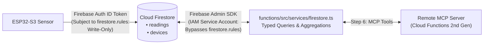

# Guide 04: Cloud Functions (2nd Gen), Firestore Query Service & Remote MCP Server

> **Built across Steps 5, 6, and 7 of [`IMPLEMENTATION_PLAN.md`](../IMPLEMENTATION_PLAN.md)** — Part 1 (Step 5) scaffolds the Node.js 22 + TypeScript Cloud Functions project and implements the typed Cloud Firestore data access & statistical aggregation layer ([`functions/src/services/firestore.ts`](../functions/src/services/firestore.ts)). Part 2 (Step 6) adds the MCP Server tools, prompts, and resources. Part 3 (Step 7) wires up WorkOS AuthKit OAuth 2.1, the owner allowlist, and deploys to Cloud Functions (2nd Gen).

---

## 1. Concept Briefing ("How It Works Under the Hood")

### Why Does the Sensor Write via REST While the Backend Reads via Admin SDK?
In Steps 3 and 4, we locked `firestore.rules` down with `allow read: if false;` on both `readings` and `devices`. That means **zero** client SDKs, browsers, or even the ESP32-S3 itself can read your home's historical air quality data.

So how does our Cloud Function read Firestore?



- **Firebase Admin SDK (`firebase-admin`)** authenticates with Google Cloud **IAM Service Account** credentials instead of an end-user Firebase Auth token.
- Because IAM service accounts are trusted server-side identities, Admin SDK reads bypass client `firestore.rules` automatically.
- Security for reads moves up one layer to our Cloud Function HTTP gateway (Step 7), where **WorkOS AuthKit OAuth 2.1** and an explicit owner allowlist verify *you* before any tool can invoke `firestore.ts`.

### Why Cloud Functions 2nd Gen Requires the Blaze Plan
Firebase's **Spark (free)** plan covers Firestore and Authentication, but deploying **Cloud Functions (2nd Gen)** requires upgrading the project to **Blaze (Pay-as-You-Go)** because 2nd Gen functions build container images via **Cloud Build**, store them in **Artifact Registry**, and run on **Cloud Run**.

For a personal air quality sensor queried by one user, usage stays well inside Google Cloud's generous monthly free tier (2 million Cloud Functions/Cloud Run invocations, 400,000 GB-seconds, and 1 GiB Firestore storage free per month), so your typical monthly bill is **\$0.00–\$0.10** (mostly tiny Artifact Registry image storage if old build images aren't pruned).

### How `functions/src/services/firestore.ts` Keeps Queries Fast & LLM-Friendly
Raw time-series data from a 5-minute sensor produces **288 readings per day** (~2,016 per week, ~8,640 per month). Dumping 2,000 raw JSON documents directly into an AI assistant's context window is slow, expensive, and inaccurate. Our Firestore service solves this with four design patterns:

1. **Composite Index Alignment**: Every query on `readings` uses the exact composite indexes we deployed in [`firestore.indexes.json`](../firestore.indexes.json):
   - `(device_id ASC, timestamp DESC)`
   - `(location ASC, timestamp DESC)`
   If a caller supplies *both* `device_id` and `location`, the service queries Firestore by `device_id` and filters `location` in memory so it never hits a missing 3-field composite index error.
2. **Evenly Spaced Downsampling (`downsampleReadings`)**: `getReadingsHistory()` fetches the time window chronologically and, if more readings match than the requested `limit` (default `100`), samples evenly across the timeline while always preserving the **first** and **last** observations.
3. **Server-Side Statistical Aggregation (`computeMetricStats`)**: `getAirQualitySummary()` computes `min`, `max`, `avg`, and **95th percentile (`p95`)** for CO<sub>2</sub>, PM<sub>2.5</sub>, PM<sub>10</sub>, temperature, humidity, and AQI in TypeScript so the AI assistant receives accurate math instead of guessing averages from raw samples.
4. **Spike Episode Grouping (`detectNotableSpikes`)**: Instead of returning dozens of repetitive timestamps when CO<sub>2</sub> stays above 1,000 ppm for two hours, contiguous elevated readings (CO<sub>2</sub> > 1,000 ppm or PM<sub>2.5</sub> > 9.0 &mu;g/m<sup>3</sup>) are grouped into concise episodes with `started_at`, `peak_timestamp`, `ended_at`, `peak_value`, and `reading_count`.

### Exported Service Functions
| Function | Backing Collection(s) | Purpose |
| :--- | :--- | :--- |
| `getLatestReading(options)` | `readings`, `devices` | Fetches the newest reading (optionally filtered by `device_id` or `location`), attaches device metadata, calculates `minutes_ago` / `is_stale`, and returns qualitative health context. |
| `getReadingsHistory(options)` | `readings` | Fetches chronological time-series readings over `hours` (1–168, default 24) or explicit `start_time`/`end_time` ISO timestamps, with automatic downsampling. |
| `getAirQualitySummary(options)` | `readings` | Aggregates `min`/`max`/`avg`/`p95`, threshold exceedance counts, and grouped spike episodes over `1h`, `6h`, `24h`, `7d`, or `30d`. |
| `getSensorStatus(options)` | `devices` | Lists registered sensors and flags each as `online` (&le;15 min), `stale` (16–60 min), or `offline` (&gt;60 min). |

---

## 2. Hands-On Setup (Part 1: Cloud Functions Scaffolding)

### Step 5A: Confirm Node.js 22 & Install Dependencies
Verify you are running **Node.js 22** (matching `"engines": { "node": "22" }` in [`functions/package.json`](../functions/package.json)):

```bash
node -v
```

Install the Cloud Functions dependencies inside `functions/`:

```bash
npm --prefix functions install
```

### Step 5B: Review `firebase.json` Functions Configuration
[`firebase.json`](../firebase.json) now includes a `functions` block pointing to `functions/` with a `predeploy` hook that compiles TypeScript automatically before deployment:

```json
"functions": [
  {
    "source": "functions",
    "codebase": "default",
    "ignore": [
      "node_modules",
      ".git",
      "firebase-debug.log",
      "firebase-debug.*.log",
      "*.local"
    ],
    "predeploy": [
      "npm --prefix \"$RESOURCE_DIR\" run build"
    ]
  }
]
```

### Step 5C: Compile TypeScript
Run the TypeScript compiler to verify strict type-checking and emit JavaScript to `functions/lib/` (which is gitignored):

```bash
npm --prefix functions run build
```

---

## 3. Single Focused Validation Checkpoint (Part 1)

### 1. Offline TypeScript Build & Unit Verification
Run the build + offline statistical/helper checks (tests `computeMetricStats`, `downsampleReadings`, `assessReadingHealth`, and `detectNotableSpikes`):

```bash
npm --prefix functions run verify:firestore
```

### 2. Live Firestore Query Verification
Run the live read verification against the synthetic reading you published in Step 4. Because `firebase-admin` uses Google Application Default Credentials (ADC) when running outside Cloud Functions, authenticate locally using one of two options:

- **Option A (Recommended if you have Google Cloud CLI installed)**:
  ```bash
  gcloud auth application-default login
  npm --prefix functions run verify:firestore -- --live
  ```
- **Option B (No `gcloud` required — temporary gitignored service account key)**:
  1. In **Firebase Console → Project Settings → Service accounts**, click **Generate new private key**.
  2. Save the file inside the repo root as `firebase-adminsdk.json` (or anywhere outside the repo—`*firebase-adminsdk*.json` and `*service-account*.json` are strictly ignored by [`.gitignore`](../.gitignore)).
  3. Run:
     ```bash
     GOOGLE_APPLICATION_CREDENTIALS=./firebase-adminsdk.json npm --prefix functions run verify:firestore -- --live
     ```
  4. Delete the local JSON key file when finished if you no longer need local live-DB testing.

Confirm all four live queries print `[PASS]`:
1. `getLatestReading()` returns your Step 4 synthetic reading (`CO2=642 ppm`, `PM2.5=6 ug/m3`, `AQI=33`).
2. `getReadingsHistory(24h)` returns at least 1 reading in chronological order.
3. `getAirQualitySummary(24h)` computes `min`/`max`/`avg`/`p95` across the window.
4. `getSensorStatus()` returns your `feather-s3-01` device document with its online/stale/offline status.

Finally, run the public-repo secret check:

```bash
./scripts/check-secrets.sh
```

---

## 4. Good to Know & Real-World Troubleshooting

- **ESM (`"type": "module"`) + `NodeNext` Imports**: `functions/package.json` uses native ES Modules (`"type": "module"`) with `"module": "NodeNext"` in `tsconfig.json`. Local relative imports in TypeScript files must use the `.js` extension (e.g., `import { ... } from "../services/firestore.js"`) because Node.js resolves the compiled `.js` output at runtime.
- **No `GOOGLE_APPLICATION_CREDENTIALS` Needed in Production**: When deployed to Firebase Cloud Functions (2nd Gen), Google Cloud automatically injects the runtime service account credentials and project ID into `initializeApp()`. You should **never** bundle or commit a service account JSON key for production.
- **Why `PM2_5_ELEVATED_UG_M3 = 9.0` Instead of `12.0`**: Consistent with [`firmware/aqi.py`](../firmware/aqi.py) from Step 4, spike detection uses the **revised May 2024 US EPA PM<sub>2.5</sub>** threshold where the "Good" band ends at `9.0` &mu;g/m<sup>3</sup> (formerly `12.0` &mu;g/m<sup>3</sup>).
- **`Could not load the default credentials` Locally**: Running `firebase login` authenticates the *Firebase CLI*, not the Node.js `firebase-admin` SDK. Locally, `firebase-admin` specifically looks for `gcloud` Application Default Credentials (`~/.config/gcloud/application_default_credentials.json`) or the `GOOGLE_APPLICATION_CREDENTIALS` environment variable.
- **`7 PERMISSION_DENIED` Locally When Working Across Multiple GCP Projects**: If `GOOGLE_APPLICATION_CREDENTIALS` is exported in your shell profile (`~/.zshrc` / `~/.bashrc`) for a *different* Google Cloud project, `firebase-admin` prioritizes that key file over your default ADC and fails with `7 PERMISSION_DENIED: Missing or insufficient permissions`. Clear it inline to use default ADC:
  ```bash
  GOOGLE_APPLICATION_CREDENTIALS= npm --prefix functions run verify:firestore -- --live
  ```
- **Benign `[DEP0040] punycode` Warning on Node.js 22**: You may see `DeprecationWarning: The 'punycode' module is deprecated` when running local Node 22 scripts that import `firebase-admin`. This comes from an upstream transitive dependency and does not affect compilation or runtime queries.
- **Keep Cloud Costs Near Zero on Blaze**: Set a \$1–\$5 monthly billing budget alert in **Google Cloud Console → Billing → Budgets & alerts** so you are notified immediately of any unexpected spikes.

---

*Part 2 (Step 6) will implement the Model Context Protocol (MCP) server, its 4 air quality tools, health analysis prompt, and EPA/ASHRAE reference resource.*
