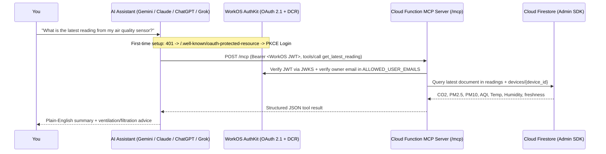

# Guide 05: Connecting AI Assistants (Gemini, Claude, ChatGPT & Grok)

> **Built in Step 8 of [`IMPLEMENTATION_PLAN.md`](../IMPLEMENTATION_PLAN.md)** — With your Remote MCP Server deployed to Firebase Cloud Functions (2nd Gen) and locked behind **WorkOS AuthKit (OAuth 2.1)** + your owner allowlist, this guide walks through connecting live AI assistants (**Gemini**, **Claude**, **ChatGPT**, and **Grok**) so you can query your indoor air quality in plain English.

---

## 1. Concept Briefing ("How It Works Under the Hood")

### What Happens When You Ask an AI Assistant *"How Is the Air in My Room?"*

Once you connect a remote MCP server to Gemini, Claude, ChatGPT, or Grok, the AI assistant does **not** receive your Firestore database credentials or hardcode any custom REST API calls. Instead, it follows the open **Model Context Protocol (MCP)** over Streamable HTTP (`/mcp`) in two phases:

1. **One-Time OAuth 2.1 Handshake (Authentication & Authorization)**:
   - The AI client sends an initial probe to your `/mcp` endpoint.
   - Your Cloud Function responds with `401 Unauthorized` and a `WWW-Authenticate` header pointing to `/.well-known/oauth-protected-resource` (RFC 9728).
   - The AI client discovers your **WorkOS AuthKit** domain, registers itself automatically via **Dynamic Client Registration (DCR)**, and opens a browser login prompt using **OAuth 2.1 + PKCE**.
   - After you sign in, WorkOS issues a short-lived signed RS256 JWT access token. On every subsequent tool call, your Cloud Function cryptographically verifies the JWT against WorkOS's JWKS keys and confirms your verified email (or WorkOS `user_...` ID) is in `ALLOWED_USER_EMAILS`.
2. **Dynamic Tool Discovery & Execution**:
   - The AI client calls `tools/list`, `prompts/list`, and `resources/list` to learn what your server can do.
   - When you ask a natural-language question, the model picks the right tool, fills in the typed Zod arguments (like `period: "24h"`), calls `tools/call`, receives structured JSON from Cloud Firestore, and synthesizes a human-friendly answer.



### Capabilities Discovered Automatically by Every AI Client

Because all tool schemas, descriptions, and annotations live on your Cloud Function, every MCP client automatically discovers the exact same capabilities:

| Primitive | Name | What the AI Assistant Uses It For |
| :--- | :--- | :--- |
| **Tool** | `get_latest_reading` | Fetches the newest reading (optionally filtered by `device_id` or `location`), freshness (`minutes_ago` / `is_stale`), CO<sub>2</sub>, PM<sub>1.0</sub>/PM<sub>2.5</sub>/PM<sub>10</sub>, US EPA AQI, temperature, humidity, particle counts, and health context. |
| **Tool** | `get_readings_history` | Fetches chronological time-series readings over `hours` (1–168, default 24) or explicit ISO-8601 `start_time`/`end_time`, with automatic downsampling so large windows never overflow the context window. |
| **Tool** | `get_air_quality_summary` | Returns server-computed `min`, `max`, `avg`, and `p95` statistics over `1h`, `6h`, `24h`, `7d`, or `30d`, plus threshold exceedance counts and grouped CO<sub>2</sub> (&gt;1,000 ppm) / PM<sub>2.5</sub> (&gt;9.0 &mu;g/m<sup>3</sup>) spike episodes. |
| **Tool** | `get_sensor_status` | Checks all sensors in the `devices` collection and reports whether each is `online` (&le;15 min), `stale` (16–60 min), or `offline` (&gt;60 min). |
| **Tool** | `get_outdoor_air_quality` | Latest outdoor weather and US EPA AQI for the configured home location, plus optional recent outdoor history. |
| **Tool** | `get_ventilation_forecast` | Current window energy tax (dew point and moist-air enthalpy) and the next clean, low-tax hour from the cached 24-hour forecast. |
| **Tool** | `list_experiments` | Recent logged and auto-detected house experiments, newest first, with optional status, room, device, and action filters. |
| **Tool** | `get_house_playbook` | Learned House Physics Playbook, ranked for the current room and energy-tax tier. Recommendations cite measured CO<sub>2</sub>, PM<sub>2.5</sub>, temperature, and humidity changes. |
| **Tool** | `log_experiment` | Owner-allowlisted write that starts or records a house experiment (`source: "mcp"`). Omit an end time to leave it `active`. |
| **Tool** | `update_experiment` | Owner-allowlisted write that finishes (`ended_at` or `duration_minutes`), labels an unlabeled event (`action_type`), or dismisses it (`status: "dismissed"`). It does not delete history. |
| **Prompt** | `analyze_indoor_air` | Structured analysis template. It calls `get_latest_reading`, `get_air_quality_summary`, `get_ventilation_forecast` when CO<sub>2</sub> or energy tax is elevated, and `get_house_playbook` so advice cites this house's measured outcomes. |
| **Resource** | `air-quality://thresholds/reference` | Reference table of revised May 2024 US EPA PM<sub>2.5</sub>/PM<sub>10</sub> AQI breakpoints, ASHRAE / Harvard CO<sub>2</sub> cognitive bands, and ideal humidity ranges. |

> [!NOTE]
> Read tools are registered with **`readOnlyHint: true`**. `log_experiment` and `update_experiment` are writes: **`readOnlyHint: false`**, **`destructiveHint: false`**, **`idempotentHint: false`**, **`openWorldHint: false`**. Many AI clients ask for confirmation before running a write. Both writes use the same WorkOS owner allowlist (or owner bearer fallback) as every other `/mcp` call. They show up in Gemini, Claude, ChatGPT, and Grok after the next Cloud Functions deploy (Step 25.6).

---

## 2. Pre-Flight Check: Register Your MCP URL in WorkOS Resource Indicators

Before connecting any AI assistant, grab the **Cloud Run Service URL** for your `mcp` function from Step 7:

```bash
firebase functions:list
```

Look for the `mcp` function in `us-east1`, or open **Google Cloud Console → Cloud Run → `mcp`** and copy the **`https://mcp-<hash>-ue.a.run.app`** URL. Append **`/mcp`** (with **no trailing slash**):

```text
https://mcp-<hash>-ue.a.run.app/mcp
```

Next, register that exact URL as a **Resource Indicator** in WorkOS (required for RFC 8707 OAuth 2.1):

1. Open the [WorkOS Dashboard](https://dashboard.workos.com/) (in your **Staging** environment).
2. Navigate to **Products → Connect → Configuration**.
3. Ensure **Dynamic Client Registration (DCR)** is enabled, then add `https://mcp-<hash>-ue.a.run.app/mcp` under **Resource Indicators** (or **Allowed Resources**) and click **Save**.

> [!IMPORTANT]
> Skipping the **Resource Indicator** entry causes WorkOS AuthKit to immediately reject `/oauth2/authorize` with `error=invalid_target` before even displaying the sign-in screen—which Gemini surfaces as *"Account linking is required to use this custom app"* and Grok surfaces as *"Unable to authorize app"*.

> [!TIP]
> **Prefer `https://mcp-<hash>-ue.a.run.app/mcp` over `cloudfunctions.net/mcp`:**
> Both URLs route to the exact same 2nd Gen Cloud Function container. However, some MCP clients probe `/.well-known/oauth-authorization-server` at the **origin root** rather than appending it under a path prefix. Using the Cloud Run `*.a.run.app/mcp` URL guarantees both RFC 9728 (`/.well-known/oauth-protected-resource`) and legacy origin-root (`/.well-known/oauth-authorization-server`) discovery work seamlessly across every AI client.

---

## 3. Hands-On Setup: Connecting Your AI Assistants

You only need to connect **one** client to pass Step 8's validation checkpoint, though your single WorkOS-protected endpoint works with all of them simultaneously.

### Option A: Gemini (Connected Apps — Web & Mobile)

Google Gemini natively supports remote Streamable HTTP MCP servers with OAuth 2.1 + DCR via **Connected Apps** (requires a personal Google Account with **Gemini Apps Activity** turned on):

1. Open [gemini.google.com](https://gemini.google.com/) and navigate to **Settings → Connected Apps** (under **Custom apps**).
2. Click to add a custom MCP server (**Connect to an MCP server**).
3. Enter your **MCP Server URL** (no trailing slash):
   ```text
   https://mcp-<hash>-ue.a.run.app/mcp
   ```
   Leave **Additional settings** collapsed/blank so Gemini uses RFC 9728 discovery + WorkOS DCR automatically.
4. Click **Next** and complete the **WorkOS AuthKit** sign-in popup using your allowlisted email.
5. Gemini scans your server and displays the **Save your custom app** confirmation listing the registered tools (sensor reads, outdoor/forecast reads, and the experiment tools `list_experiments`, `get_house_playbook`, `log_experiment`, and `update_experiment`). Click **Connect**. Write tools may show a confirmation badge because they are not marked read-only.
6. Start a new chat and ask about your air quality (optionally mentioning `@Custom Air Sensor Mcp`).

---

### Option B: Claude (Web, Desktop & Mobile)

Claude supports remote MCP servers via **Custom Connectors** (available on Claude Pro, Max, Team, and Enterprise plans; once added on the web, the connector syncs automatically to Claude Desktop and mobile apps):

1. Open [claude.ai](https://claude.ai/) and navigate to **Settings → Connectors**.
   *(On Team/Enterprise workspaces, an organization owner may need to enable custom connectors first.)*
2. Click **Add custom connector**.
3. Fill in the connection details:
   - **Name**: `Home Air Quality Sensor`
   - **Remote MCP server URL**: `https://mcp-<hash>-ue.a.run.app/mcp`
   - Leave optional OAuth Client ID / Client Secret fields **blank**—WorkOS AuthKit uses **Dynamic Client Registration (DCR)** and **PKCE** automatically.
4. Click **Add**, then click **Connect** next to `Home Air Quality Sensor`.
5. A browser popup opens your **WorkOS AuthKit** sign-in page (`https://<your-subdomain>.authkit.app`). Sign in using the email address you stored in `ALLOWED_USER_EMAILS`.
6. Once redirected back to Claude, the connector status changes to **Connected** and lists all 4 read-only tools.

#### Bonus: Claude Code CLI (Terminal)
If you use **Claude Code** in your terminal, you can register the same remote endpoint in one command:

```bash
claude mcp add --transport http home-air-sensor https://mcp-<hash>-ue.a.run.app/mcp
```

Then run `/mcp` inside Claude Code (or `claude mcp login home-air-sensor`) to complete the interactive WorkOS OAuth sign-in in your browser.

---

### Option C: ChatGPT (Web — Developer Mode)

ChatGPT connects to remote Streamable HTTP MCP servers with OAuth 2.1 when **Developer Mode** is enabled (available on Plus, Pro, Team, Enterprise, and Edu plans):

1. Open [chatgpt.com](https://chatgpt.com/) and navigate to **Settings → Apps & Connectors → Advanced settings** (or **Settings → Security** depending on current UI layout).
2. Toggle **Developer Mode** **ON**.
3. Return to **Settings → Apps & Connectors** and click **Create** (or **Add custom MCP server**).
4. Fill in the configuration fields:
   - **Name**: `Home Air Quality Sensor`
   - **Description**: `Read live and historical indoor air quality telemetry (CO2, PM2.5, PM10, US EPA AQI, temperature, humidity) from my custom ESP32-S3 sensor.`
     *(ChatGPT uses this description to decide when to invoke your connector.)*
   - **MCP Server URL**: `https://mcp-<hash>-ue.a.run.app/mcp`
   - **Authentication**: Select **OAuth** (leave manual client credentials blank so ChatGPT uses RFC 9728 discovery + WorkOS DCR).
5. Acknowledge the custom developer connector notice and click **Create**.
6. Complete the **WorkOS AuthKit** login popup using your allowlisted email. ChatGPT will scan your server and display the 4 tools.
7. Start a **new chat**, click the **`+`** menu (or type `@`) to enable **Home Air Quality Sensor** for the conversation, and ask your air quality question.

---

### Option D: Grok (Web Connectors, xAI CLI & API)

#### 1. Grok Web (`grok.com`)
1. Open [grok.com/connectors](https://grok.com/connectors).
2. Click **Connect Apps → Add MCP Server** (or **New Connector → Custom**).
3. Enter a name (e.g., `custom-air-sensor`) and paste your Remote MCP URL:
   ```text
   https://mcp-<hash>-ue.a.run.app/mcp
   ```
4. Complete the **WorkOS AuthKit** OAuth sign-in flow when prompted.
   *(Alternative: Grok's Add MCP Server form also includes **Headers** fields—if you prefer static Bearer auth instead of OAuth, set Key=`Authorization` and Value=`Bearer <YOUR_MCP_BEARER_FALLBACK_SECRET>`.)*

#### 2. Grok CLI & xAI Responses API (Using Your Fallback Bearer Secret)
For scripts, terminal workflows, or programmatic xAI API calls that authenticate via a static `Authorization` header instead of an interactive browser OAuth flow, use the **`MCP_BEARER_FALLBACK_SECRET`** you created in Step 7 (keep it in an environment variable—never commit it to Git):

```bash
# Example: Grok CLI registration (reads token from your shell environment)
grok mcp add --transport http home-air-sensor https://mcp-<hash>-ue.a.run.app/mcp \
  --header "Authorization: Bearer ${MCP_BEARER_FALLBACK_SECRET}"
```

Or via the xAI Responses API `tools` array:

```json
{
  "type": "mcp",
  "server_url": "https://mcp-<hash>-ue.a.run.app/mcp",
  "server_label": "home_air_sensor",
  "server_description": "Live and historical indoor air quality telemetry from my home ESP32-S3 sensor.",
  "authorization": "Bearer <YOUR_MCP_BEARER_FALLBACK_SECRET>"
}
```

---

### Option E: Optional OAuth Debugger — Official MCP Inspector

If you want to watch the exact OAuth 2.1 discovery, DCR registration, PKCE redirect, and JSON-RPC payloads step-by-step before (or while) debugging an AI client, launch the official **MCP Inspector** locally:

```bash
npx @modelcontextprotocol/inspector
```

1. Select Transport Type: **Streamable HTTP**.
2. Enter URL: `https://mcp-<hash>-ue.a.run.app/mcp`.
3. Click **Connect**—MCP Inspector will automatically run the full WorkOS OAuth 2.1 flow in your browser and let you test every tool, prompt, and resource interactively.

---

## 4. Single Focused Validation Checkpoint (Step 8)

Once your chosen AI assistant (Gemini, Claude, ChatGPT, or Grok) shows **Home Air Quality Sensor** as connected, start a fresh conversation and run these prompts:

### Test Prompt 1 — Latest Reading (`get_latest_reading`)
> *"What is the latest reading from my air quality sensor?"*

**What to verify:**
- The AI assistant invokes **`get_latest_reading`** (you may be prompted once to approve the read-only tool call).
- The answer reports your Step 4 synthetic reading from Cloud Firestore (e.g., `feather-s3-01`, `CO2: 642 ppm`, `PM2.5: 6 ug/m3`, `US EPA AQI: 33 (Good)`, temperature, and humidity).
- The assistant accurately mentions how long ago the reading was recorded (and notes it is **stale**, which is completely expected until we assemble and flash the physical ESP32-S3 hardware in Steps 9–10!).

### Test Prompt 2 — Sensor Fleet Health (`get_sensor_status`)
> *"Check the status of my air quality sensors."*

**What to verify:**
- The AI assistant invokes **`get_sensor_status`** and reports your `feather-s3-01` device metadata (`SCD-40`, `PMSA003I`, 300-second interval, and current `stale`/`offline` freshness).

### Test Prompt 3 — 24-Hour Statistical Summary (`get_air_quality_summary`)
> *"Give me a 24-hour summary of my indoor air quality and let me know if there were any CO2 or PM2.5 spikes."*

**What to verify:**
- The AI assistant invokes **`get_air_quality_summary`** with `period: "24h"` and summarizes the server-computed stats cleanly.

### Secret Guardrail Check
Before committing Step 8, verify no personal URLs, WorkOS domains, emails, or tokens crept into the repo:

```bash
./scripts/check-secrets.sh
```

---

## 5. Good to Know & Real-World Troubleshooting

- **WorkOS Rejects OAuth Before Login (`error=invalid_target` → Gemini *"Account linking is required"* / Grok *"Unable to authorize app"*)**:
  During live Step 8 testing with both Gemini and Grok, our server's `/.well-known/oauth-protected-resource` (`200 OK`) and WorkOS DCR (`POST /oauth2/register` → `201 Created`) both worked, yet both clients immediately failed before showing a login screen. Probing WorkOS's `/oauth2/authorize?...&resource=https://mcp-.../mcp` directly revealed `302 -> callback?error=invalid_target`.
  **Fix:** Under **WorkOS Dashboard → Products → Connect → Configuration**, add your exact MCP URL (`https://mcp-<hash>-ue.a.run.app/mcp`) to **Resource Indicators** and click **Save**. As soon as that URL is allowlisted, OAuth sign-in succeeds immediately.
- **Include `"offline_access"` in `scopes_supported` for Refresh Tokens**:
  Google Gemini's Connected Apps Account Linking (and long-lived OAuth sessions in other AI clients) expect a `refresh_token` alongside the `access_token`. [`functions/src/auth/workos.ts`](../functions/src/auth/workos.ts) advertises `scopes_supported: ["openid", "profile", "email", "offline_access"]` in `/.well-known/oauth-protected-resource` to match WorkOS AuthKit's authorization server metadata.
- **Gemini Returns `TOOL_AUTHORIZATION_STATUS_NOT_SET` (401) on the Very First Prompt**:
  Immediately after clicking **Connect** on the "Save your custom app" modal in Gemini, your very first prompt may occasionally fail with `401 Unauthorized (TOOL_AUTHORIZATION_STATUS_NOT_SET)` while Gemini's linked OAuth token propagates. Sending the prompt a second time a few seconds later immediately succeeds and returns your live Firestore reading.
- **Grok Shows the Service as Connected, But Says *"No Tools Are Currently Discoverable"***:
  If you first tried connecting Grok before registering your WorkOS Resource Indicator (or if Grok's initial OAuth handshake dropped), Grok can keep a stale connector entry without ever running an authenticated `tools/list` scan against `/mcp`. Delete/disconnect `custom-air-sensor` in `grok.com/connectors` and re-add it cleanly—or pass `Authorization: Bearer <YOUR_MCP_BEARER_FALLBACK_SECRET>` in Grok's **Headers** fields as a static Bearer fallback.
- **Why Does the Sensor Report as `stale` or `offline` Right Now?**
  In Step 8, the only reading in Firestore is the single synthetic document we published from your Mac in Step 4. Because our freshness check (`functions/src/services/firestore.ts`) expects a new reading every **5 minutes** (`online` &le;15 min, `stale` 16–60 min, `offline` &gt;60 min), seeing `is_stale: true` / `offline` right now confirms the freshness detector is working properly! Once the physical ESP32-S3 starts publishing in Step 10, it will flip to `online`.
- **No Trailing Slash on `/mcp`**:
  Enter `https://mcp-<hash>-ue.a.run.app/mcp`, **not** `.../mcp/`. OAuth 2.1 Resource Indicators (RFC 8707) compare the token's `aud` (audience) claim literally against the server's canonical resource URL, so a mismatched trailing slash can cause `error=invalid_target` or `401 Unauthorized`.
- **WorkOS Dashboard Admin Login Is Separate from Your AuthKit End-User Account**:
  Signing up for `dashboard.workos.com` creates a *developer/admin* login—it does **not** automatically create an end-user account in your Staging environment's **Users** directory (`https://<your-subdomain>.authkit.app`). When an AI assistant opens the AuthKit login popup for the first time, you'll either need to **Sign up** there (or create the user under **WorkOS Dashboard → Users**) with its own password/sign-in method. Whichever email you create in **WorkOS Dashboard → Users** is the one that must match `ALLOWED_USER_EMAILS` (with **Email Verified = true**).
- **Login Succeeds in WorkOS, Then Tool Calls Return `403 Forbidden`**:
  Your JWT verified cryptographically, but the **owner allowlist** rejected the account. Check two things:
  1. The email you signed in with matches `ALLOWED_USER_EMAILS` (case-insensitive) in Google Cloud Secret Manager.
  2. In **WorkOS Dashboard → Users**, your user record shows **Email Verified = true** (our allowlist deliberately refuses unverified emails to prevent account-claiming attacks).
  If you update `ALLOWED_USER_EMAILS` via `firebase functions:secrets:set ALLOWED_USER_EMAILS`, remember to run `firebase deploy --only functions` so Cloud Run loads the new secret version.
- **Inspecting Live Auth & Tool Logs**:
  If a client fails to connect or shows a generic error, inspect the Cloud Run HTTP request logs (including `requestMethod`, `status`, `responseSize`, and `userAgent`) to see whether the client stopped at OAuth discovery (`401` + `200 /.well-known/oauth-protected-resource`) or reached `/mcp` with a token:
  ```bash
  firebase functions:log --only mcp
  ```
- **Client UI Menus Evolve Quickly**:
  Gemini, Claude, ChatGPT, and Grok actively iterate on their MCP settings UI (for example, renaming *Integrations* to *Connectors* or *Connected Apps*). If a menu label moves slightly, look under **Settings** for **Connected Apps**, **Connectors**, **Apps**, or **MCP**, and always choose **Remote / Custom MCP Server (Streamable HTTP)** with **OAuth** authentication.

---

## 6. End-to-End Live Hardware Validation (Step 11)

Once your physical ESP32-S3 + SCD-40 + PMSA003I sensor node is running [`firmware/code.py`](../firmware/code.py) from Step 10 and publishing real readings every 5 minutes, complete the full end-to-end validation from physical sensors → Cloud Firestore → Cloud Function MCP Server → AI Assistant:

### Live End-to-End Prompt
Ask your connected AI assistant (Gemini, Claude, ChatGPT, or Grok):

> *"What is the current air quality in my room right now, and how do my CO2 and PM2.5 levels look?"*

**What to verify (comparing Step 8 vs. Step 11):**
1. **Fresh, Live Hardware Telemetry**: Unlike Step 8 (which queried the older synthetic reading from Step 4 and reported `is_stale: true`), the response now reports a reading from **within the last 5 minutes** (`is_stale: false`, sensor status `online`).
2. **Real Room Values**: CO<sub>2</sub> (ppm), PM<sub>1.0</sub>/PM<sub>2.5</sub>/PM<sub>10</sub> (&mu;g/m<sup>3</sup>), revised May 2024 US EPA AQI & category, temperature, and humidity match your live room telemetry in Firestore (and the serial console, if still connected).
3. **Actionable Context**: The assistant interprets CO<sub>2</sub> cognitive/ventilation impact and PM<sub>2.5</sub> particulate levels using the embedded reference thresholds (see [`docs/07-understanding-your-readings.md`](./07-understanding-your-readings.md) for the full human-readable guide to every metric and how to improve them).

> [!TIP]
> **Validated Live End-to-End**: Confirmed working across **Gemini** and **Grok** against live 5-minute hardware readings flowing from the Adafruit ESP32-S3 + SCD-40 + PMSA003I → Cloud Firestore → Cloud Functions (2nd Gen) MCP Server → WorkOS AuthKit OAuth 2.1.

### Optional Bonus Prompt — Multi-Hour / Overnight Trend Analysis
Once the sensor has been running continuously for a few hours (or overnight on USB wall power), try:

> *"Summarize my indoor air quality over the last 24 hours—when did CO2 or PM2.5 peak, and should I ventilate or run an air purifier?"*

This exercises `get_air_quality_summary` across real time-series data, surfacing server-computed `min`/`max`/`avg`/`p95` stats and any grouped spike episodes (`CO2 > 1,000 ppm` or `PM2.5 > 9.0 µg/m³`).
