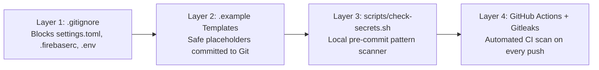

# Guide 06: Security, Privacy & Public GitHub Guardrails

> **Built in Step 1 of [`IMPLEMENTATION_PLAN.md`](../IMPLEMENTATION_PLAN.md)** — We establish our security and privacy guardrails **first**, before creating a single real Wi-Fi password, Firebase project ID, or WorkOS API key.

---

## 1. Concept Briefing ("How It Works Under the Hood")

When you build an IoT + Cloud + AI project in a **public GitHub repository**, secrets live across three very different environments:

1. **The Microcontroller (`firmware/settings.toml`)**:
   - An ESP32-S3 running CircuitPython doesn't have an operating system keychain. Instead, CircuitPython reads a plain-text file named `settings.toml` from the root of its `CIRCUITPY` USB flash drive using `os.getenv()`.
   - Because that file holds your home **2.4GHz Wi-Fi SSID & password** plus your **Firebase device account credentials**, accidentally committing `settings.toml` would publish your home network password to the world.
2. **The Cloud CLI Configuration (`.firebaserc` and `*service-account*.json`)**:
   - When you run `firebase init` or `firebase use`, the Firebase CLI writes your real Google Cloud / Firebase project ID into `.firebaserc`. While project IDs aren't strictly private keys, keeping your real project ID and device email out of a public repo prevents strangers from probing your endpoints.
3. **The Cloud Function & Authentication Layer (`functions/.env*` and WorkOS Secrets)**:
   - Your MCP server verifies users with WorkOS AuthKit (`WORKOS_API_KEY`, `WORKOS_CLIENT_ID`, `WORKOS_AUTHKIT_DOMAIN`), restricts access to your personal allowlist (`ALLOWED_USER_EMAILS`), and supports a separate high-entropy static Bearer fallback (`MCP_BEARER_FALLBACK_SECRET`) for CLI/scripted tests. All 5 secrets live in **Google Cloud Secret Manager** in production.

### Our 4-Layer Defense-in-Depth Strategy



---

## 2. Hands-On Setup: Prerequisites & Template Mapping

### Step 2A: Install `gitleaks` Locally (Recommended on macOS)
Our local secret scanner (`./scripts/check-secrets.sh`) runs three checks:
1. Forbidden tracked file paths (`.firebaserc`, `settings.toml`, `.env`).
2. Built-in regex checks for Firebase, WorkOS, and CircuitPython credentials.
3. The full **Gitleaks CLI** scanner using [`.gitleaks.toml`](../.gitleaks.toml).

Install `gitleaks` via Homebrew so Check 3 runs locally before you even push to GitHub:

```bash
brew install gitleaks
```

### Step 2B: How Templates Map to Local Files

You should **never** edit `.example` files with real credentials. Instead, whenever a later guide asks you to configure credentials, you will copy the `.example` file to its gitignored counterpart:

| Committed Template (Safe for GitHub) | Local Real File (Ignored by `.gitignore`) | Where It Is Used |
| :--- | :--- | :--- |
| `.firebaserc.example` | `.firebaserc` | Used by the Firebase CLI on your Mac to know which Firebase project to deploy to. |
| `firmware/settings.toml.example` | `firmware/settings.toml` & `/Volumes/CIRCUITPY/settings.toml` | Read by CircuitPython (`os.getenv()`) on the ESP32-S3 (and locally during Step 4 validation). |
| `functions/.env.example` | `functions/.env.local` | Used only for local MCP testing (`npm --prefix functions run mcp:local` or Firebase emulators). Production injects all 5 secrets via **Google Cloud Secret Manager**. |

---

## 3. Single Focused Validation Checkpoint

Before we commit Step 1, we validate that our secret guardrails actually catch mistakes—both ignored file rules and accidental secret strings inside tracked files.

### Step 3A: Verify a Clean Baseline Pass
Run the secret checker from the root of the repository:

```bash
./scripts/check-secrets.sh
```

**Expected Output:**
- `[PASS] Check 1: No forbidden config files (.firebaserc, settings.toml, .env) are tracked.`
- `[PASS] Check 2: No API keys, private keys, or hardcoded passwords found...`
- `[PASS] Check 3: Gitleaks CLI scan passed.` *(or `[INFO] Check 3: Gitleaks CLI not installed locally...` if you haven't run `brew install gitleaks` yet)*
- `✅ All secret and privacy guardrail checks passed! Safe to commit.`

### Step 3B: Simulate an Accidental Secret Leak (Negative Test)
Verify two things:
1. **Gitignore Verification**: Create a dummy `firmware/settings.toml` and confirm `git status --short` does **not** list it as an untracked file to be committed.
2. **Scanner Verification**: Temporarily generate a 39-character dummy `AIza...` key inside an unignored file, run `./scripts/check-secrets.sh`, and confirm it exits with `[FAIL]`:

```bash
# 1. Create a temporary unignored file with a 39-char dummy key pattern
printf 'FIREBASE_KEY="AIza%s"\n' "00000000000000000000000000000000000" > .test-leak.tmp

# 2. Run the scanner (should FAIL and point to .test-leak.tmp)
./scripts/check-secrets.sh

# 3. Clean up the temporary file and re-run (should PASS)
rm .test-leak.tmp
./scripts/check-secrets.sh
```

---

## 4. Good to Know & Real-World Troubleshooting

> [!WARNING]
> **Gitleaks uses Go's RE2 regex engine — Perl negative lookaheads `(?!...)` will crash it!**
> When we first installed `gitleaks` (`brew install gitleaks`) and ran Check 3, Gitleaks crashed with:
> `panic: regexp: Compile(...): error parsing regexp: invalid or unsupported Perl syntax: '(?!'`
> **Why this happens:** Gitleaks is written in Go, which uses the linear-time RE2 regular expression engine. Unlike PCRE/JavaScript/Python regexes, Go's RE2 deliberately omits lookarounds (`(?!...)` and `(?=...)`).
> **How to fix it in `.gitleaks.toml`:** Write a standard capture regex in `regex = '''...'''` and exclude safe placeholder prefixes (`your-`, `replace-`, `example-`, `CHANGE_ME`) using a rule-level `[rules.allowlist]` block instead of a negative lookahead.

> [!IMPORTANT]
> **Markdown files (`docs/*.md` and `README.md`) are scanned too!**
> During our very first run of `./scripts/check-secrets.sh`, the scanner flagged a literal 39-character `AIzaSyDummyKey...` example string that was written inside this very Markdown file! We intentionally do **not** exempt Markdown files from API-key scanning because it is very easy to accidentally paste terminal output containing a real `AIza...` or `sk_live_...` key when writing troubleshooting notes. Always truncate example keys in docs (e.g., `AIza...`).

> [!TIP]
> **`gitleaks detect` vs. `gitleaks detect --no-git`:**
> By default, `gitleaks detect` only scans committed Git history—meaning a brand-new secret sitting in an uncommitted working-tree file wouldn't be flagged until *after* you committed it. To catch leaks *before* you commit, `scripts/check-secrets.sh` runs `gitleaks detect` both with and without `--no-git` so both your Git history and your uncommitted working files are checked.

> [!NOTE]
> **What if I accidentally staged a forbidden file with `git add -f`?**
> Even if `.gitignore` is bypassed with `git add -f firmware/settings.toml`, **Check 1** in `./scripts/check-secrets.sh` inspects `git ls-files` against the forbidden file list and immediately fails before you commit.
