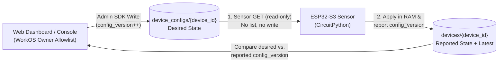

# Guide 09: Remote Configuration & Lightweight Web Dashboard

> **Built in Steps 12–15 of [`IMPLEMENTATION_PLAN.md`](../IMPLEMENTATION_PLAN.md)** — Introduces Layer 1 remote device management (`device_configs/{device_id}`), live firmware config polling, a WorkOS-protected Dashboard API, and a lightweight Firebase Hosting web UI so you can calibrate and tune enclosed sensors without plugging in USB.

---

## 1. Part 1: Control-Plane Data Model & Security Rules (Step 12)

### Why Separate Desired State (`device_configs`) from Reported State (`devices`)?

In IoT systems, putting desired settings and live telemetry in the same document creates race conditions and weakens security boundaries (the device would need write access to its own config). Splitting them into two collections follows the classic **Device Shadow** pattern:



1. **`device_configs/{device_id}` (Desired State — Control Plane):**
   - Written **only** by the Firebase Console or our WorkOS-authenticated Cloud Function (Admin SDK).
   - Allowlisted sensors have **`get`-only** access (`allow get: if isSensorDevice() && isDeviceId(deviceId);`), with `allow list: if false;` and `allow write: if false;`. A sensor can fetch its own config by exact document ID, cannot enumerate other devices, and cannot tamper with or delete configs.
2. **`devices/{device_id}` (Reported State — Telemetry Plane):**
   - Written by the sensor on every publish cycle.
   - Reports back the active `config_version`, `temperature_offset_c`, `altitude_m`, and `led_enabled` alongside `latest_reading`.
   - The dashboard compares `device_configs.config_version` against `devices.config_version` to display **Synced (`v3`)** vs. **Pending sync...** automatically.

---

### `device_configs/{device_id}` Schema Reference

| Field | Firestore Type | Allowed Range / Format | Default | Purpose |
| :--- | :--- | :--- | :--- | :--- |
| `device_id` | `string` | `^[A-Za-z0-9][A-Za-z0-9_-]{0,63}$` | `"feather-s3-01"` | Matches the document ID |
| `location` | `string` | `^[A-Za-z0-9][A-Za-z0-9_-]{0,63}$` | `"master-bedroom"` | Room label written to future `readings` and `devices` docs |
| `reporting_interval_seconds` | `integer` | `60` – `3600` | `300` | Seconds between Firestore publishes |
| `temperature_offset_c` | `double` | `0.0` – `20.0` | `4.0` | Sensirion SCD-40 hardware temperature offset (°C) |
| `altitude_m` | `integer` | `0` – `5000` | `0` | Site elevation in meters for SCD-40 CO₂ pressure compensation |
| `led_enabled` | `boolean` | `true` / `false` | `true` | Enables or mutes the Feather's onboard NeoPixel pulse |
| `config_version` | `integer` | `1` – `1000000` | `1` | Monotonically incremented on every change for sync tracking |
| `reboot_requested_at` | `timestamp \| null` | RFC 3339 timestamp or `null` | `null` | One-shot remote reboot trigger (see design note below) |
| `updated_at` | `timestamp` | RFC 3339 timestamp | — | Last modification timestamp |
| `updated_by` | `string` | Email or `"initial-seed"` | — | Audit label identifying who changed the config |

#### Why `reboot_requested_at` Uses a Timestamp Instead of a Boolean
Because the sensor has **read-only** access to `device_configs/{device_id}`, it cannot reset a `reboot: true` boolean back to `false`—doing so would cause an infinite reboot loop! Instead:
- On startup, the firmware syncs UTC time via NTP and records `boot_time_utc` in RAM.
- Clicking **Reboot** in the dashboard sets `reboot_requested_at = now()` on `device_configs/{device_id}`.
- On its next poll, if `reboot_requested_at > boot_time_utc` (and within a recent window), the board calls `microcontroller.reset()`.
- After rebooting, the board's new `boot_time_utc` is strictly newer than `reboot_requested_at`, so it will **never** reboot twice—with **zero flash writes** and **read-only** permissions.

---

### Backward-Compatible `devices/{device_id}` Reported Config Fields

To keep existing `v1.0.0` firmware running uninterrupted while rolling out Step 13 firmware, [`firestore.rules`](../firestore.rules) keeps the original 7 fields required in `hasAll(...)` and allows 4 **optional** config-echo fields in `hasOnly(...)`:

| Optional Field on `devices/{device_id}` | Rule | Meaning |
| :--- | :--- | :--- |
| `config_version` | `int`, `0`–`1000000` | `0` = local `settings.toml` fallback; `>= 1` = applied cloud `config_version` |
| `temperature_offset_c` | `number`, `0`–`20` | Active SCD-40 hardware offset currently loaded on the sensor |
| `altitude_m` | `number`, `0`–`5000` | Active SCD-40 altitude compensation in meters |
| `led_enabled` | `bool` | Whether NeoPixel publish pulses are currently enabled |

---

### How SCD-40 Thermal & Altitude Calibration Works

1. **Temperature Offset (`temperature_offset_c`):**
   - The Sensirion SCD-40's photoacoustic emitter and surrounding PCB components warm the sensor slightly above true room air. Its factory default offset is **`4.0 °C`** (which Sensirion subtracts internally from raw temperature **and** uses to automatically re-compensate relative humidity `%RH`—far more accurate than subtracting a number in software after the fact).
   - Once your boards are snapped inside the 3D-printed enclosure ([Guide 08](./08-enclosure-hardware-plan.md)), let the unit stabilize for **60 minutes**, compare against a trusted room thermometer, and compute:
     `new_offset_c = current_offset_c + (sensor_temp_c - reference_temp_c)`
   - Because `temperature_offset_c` is applied in RAM on the SCD-40 (`scd4x.temperature_offset = ...`) without calling `persist_settings()`, there is **zero EEPROM wear**—you can iterate as many times as you want from the dashboard!
2. **Altitude Compensation (`altitude_m`):**
   - Photoacoustic CO₂ sensing depends on ambient air density. Setting `altitude_m` to your city's elevation above sea level (e.g., `150` m, or `1609` m for Denver) corrects systematic CO₂ under-reading at higher elevations.

---

### Deploying & Running the Step 12 Focused Validation

1. **Deploy the updated rules:**
   ```bash
   npx -y firebase-tools@latest deploy --only firestore:rules
   ```
   Confirm `rules file firestore.rules compiled successfully` with zero warnings.
2. **Seed `device_configs/<device_id>`** (via Firebase Console or Admin SDK) with the fields from the schema table above (`config_version: 1`).
3. **Run the automated 5-point rules verification script:**
   ```bash
   python3 scripts/verify_device_configs_rules.py
   ```
   **Expected output:**
   - Unauthenticated `GET device_configs/<id>` → `403 PERMISSION_DENIED`
   - Sensor-authenticated `GET device_configs/<id>` → `200 OK`
   - Sensor-authenticated `LIST device_configs` → `403 PERMISSION_DENIED`
   - Sensor-authenticated `PATCH device_configs/<id>` → `403 PERMISSION_DENIED`
   - Sensor-authenticated `DELETE device_configs/<id>` → `403 PERMISSION_DENIED`

---

### Good to Know & Real-World Troubleshooting (Part 1)

> [!TIP]
> **Use `allow get` instead of `allow read` on `device_configs/{deviceId}`.**
> In Firestore Security Rules, `read` is shorthand for both `get` (single document by ID) and `list` (collection queries). Separating them into `allow get` + `allow list: if false;` lets a sensor pull its own config while blocking anyone with a device credential from listing every room/device in the collection.

> [!NOTE]
> **macOS built-in `python3` is often Python 3.9 (no `tomllib`).**
> Standard-library `tomllib` arrived in Python 3.11. Both [`scripts/test_firmware_local.py`](../scripts/test_firmware_local.py) and [`scripts/verify_device_configs_rules.py`](../scripts/verify_device_configs_rules.py) include a lightweight fallback TOML parser so they work out of the box with macOS's default `/usr/bin/python3` and require zero `pip install` steps.

> [!IMPORTANT]
> **Backward compatibility during phased rollouts.**
> Because `devices/{device_id}` uses `hasOnly(...)` in `firestore.rules`, adding any new telemetry field in firmware *before* updating the rules will cause `403 PERMISSION_DENIED` on every publish. Always deploy optional fields in `firestore.rules` first (Step 12), verify live `v1.0.0` devices keep publishing cleanly, and *then* update firmware (Step 13).

---

## 2. Part 2: Firmware Remote Configuration Polling (Step 13)

With `device_configs/{device_id}` locked down in Firestore, firmware `v1.1.0` teaches the ESP32-S3 to check its cloud mailbox once per publishing cycle—**before** sampling the sensors—so updated calibration or room names apply immediately on the very next reading.

### How the On-Device Control Loop Applies Config Safely

1. **Fetch & Decode (`firmware/firestore_client.py`):**
   - `FirestoreClient.fetch_device_config(device_id)` sends an authenticated `GET` to `device_configs/{device_id}` and decodes Firestore REST typed values (`stringValue`, `integerValue`, `doubleValue`, `booleanValue`, `timestampValue`, `nullValue`) into a plain Python dictionary.
   - If the document does not exist yet (**HTTP 404**), it returns `None` cleanly instead of raising an error.
   - If a transient Wi-Fi/TLS hiccup happens during the config fetch, `firmware/code.py` logs `[Config WARN]` and **keeps the last known-good config** so telemetry publishing is never interrupted.
2. **Validate & Clamp (`normalize_device_config`):**
   - Every field is type-checked and clamped to the exact same bounds enforced by `firestore.rules` (`reporting_interval_seconds`: `60–3600`, `temperature_offset_c`: `0.0–20.0`, `altitude_m`: `0–5000`, `location`: safe slug regex, `led_enabled`: strict `bool`).
   - A bad or unexpected value in Firestore can never crash the sensor or cause rejected publishes.
3. **One-Shot Remote Reboot (`should_trigger_reboot`):**
   - On the very first NTP sync after startup, the board records `boot_epoch` in RAM using pure-Python UTC calendar math (`parse_utc_timestamp_epoch`).
   - If `reboot_requested_at` is strictly **newer** than `boot_epoch` (and within 30 minutes of current UTC time), the board turns off its NeoPixel and calls `microcontroller.reset()`. After rebooting, the new `boot_epoch` is newer than `reboot_requested_at`, preventing infinite reboot loops with zero flash writes.
4. **SCD-40 RAM Calibration Without EEPROM Wear (`apply_scd40_calibration`):**
   - Per the Sensirion SCD-4x datasheet, `temperature_offset` and `altitude` can only be written while periodic measurement is stopped.
   - `firmware/code.py` tracks the currently applied offset/altitude in RAM and **only** pauses periodic measurement (`stop_periodic_measurement()` → `500 ms` → set registers → `start_periodic_measurement()`) on startup or when a value actually changes.
   - It intentionally **never** calls `scd4x.persist_settings()`, avoiding EEPROM write wear (unlimited RAM updates).
5. **Muteable Bedroom NeoPixel (`StatusLED.set_enabled`):**
   - When `led_enabled` is `false`, `StatusLED` keeps the onboard NeoPixel completely dark across publish pulses and error blinks—ideal for a pitch-black bedroom nightstand.
6. **Config Sync Echo (`devices/{device_id}`):**
   - Every publish reports `config_version`, `temperature_offset_c`, `altitude_m`, and `led_enabled` in `devices/{device_id}` so the dashboard (Steps 14–15) can confirm the physical sensor is in sync.

---

### Updating Your ESP32-S3 (`CIRCUITPY`) to Firmware `v1.1.0`

When you are ready to load `v1.1.0` onto the Feather (you only need to copy the two updated Python files—your `settings.toml` and `lib/` folder stay untouched):

```bash
cp firmware/firestore_client.py /Volumes/CIRCUITPY/firestore_client.py
cp firmware/code.py /Volumes/CIRCUITPY/code.py
sync
```

Watch the serial console (`screen /dev/cu.usbmodem* 115200`) on boot and confirm:
- `[Config] Active (cloud v1): location=master-bedroom, interval=300s, temp_offset=4.00C, altitude=0m, led=True`
- `[SCD-40] Applied RAM calibration: temperature_offset=4.00C, altitude=0m`
- `[OK ...] cfg=v1 | CO2=...`

---

### Single Focused Validation Checkpoint (Part 2)

1. **Mac Offline + Live Config Fetch Check (no hardware required):**
   ```bash
   python3 scripts/test_firmware_local.py --fetch-config
   ```
   Verifies EPA AQI math, v1.1 `devices` payload encoding, Firestore value decoding, out-of-range clamping, leap-year UTC epoch parsing, reboot loop prevention, `code.py` syntax compilation, live `GET device_configs/<id>`, and graceful `404` fallback.
2. **On-Device Live Config Test (once `v1.1.0` is copied to `CIRCUITPY`):**
   - Temporarily change `reporting_interval_seconds` from `300` → `60` (and bump `config_version` to `2`) in Firestore.
   - Watch the next reading arrive and verify `devices/feather-s3-01` updates to `firmware_version: "1.1.0"`, `config_version: 2`, and `reporting_interval_seconds: 60` without rebooting or touching USB—then change it back to `300`.

---

### Good to Know & Real-World Troubleshooting (Part 2)

> [!TIP]
> **Why `parse_utc_timestamp_epoch` uses pure Gregorian math instead of `time.mktime()`.**
> On macOS CPython, `time.mktime()` interprets a time tuple in your **local timezone** (e.g., EST/EDT, 4–5 hours off UTC), whereas CircuitPython's `time.mktime()` treats the same tuple as **UTC**. Using pure-Python calendar arithmetic (`_days_from_civil`) guarantees identical Unix epoch seconds on both Mac unit tests and the ESP32-S3 with zero `datetime` dependency.

> [!NOTE]
> **Remember `isinstance(True, int)` is `True` in Python!**
> In `normalize_device_config()`, numeric checks explicitly guard `not isinstance(val, bool)` so an accidental boolean in an integer field (`config_version`, `reporting_interval_seconds`, `altitude_m`) is cleanly rejected instead of silently turning into `1` or `0`.

