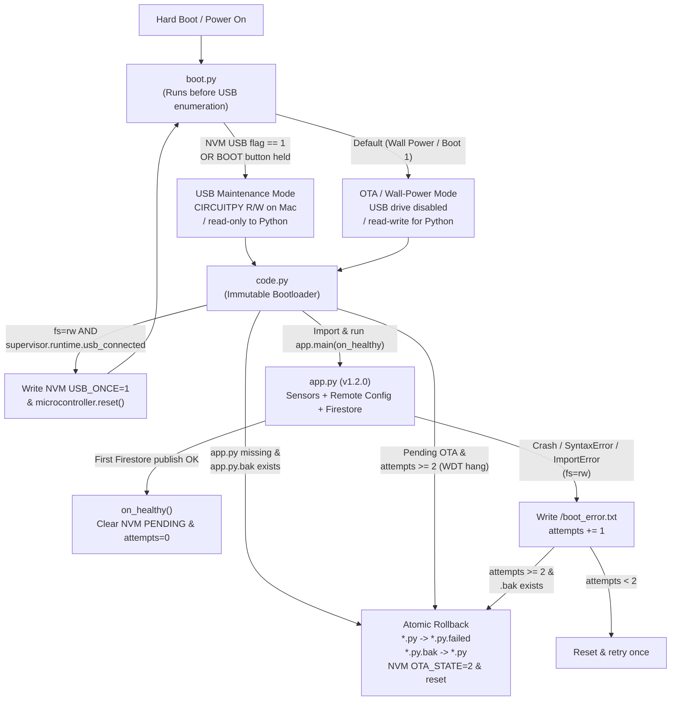
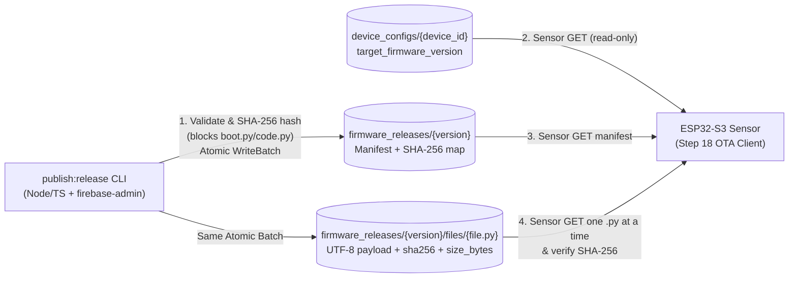
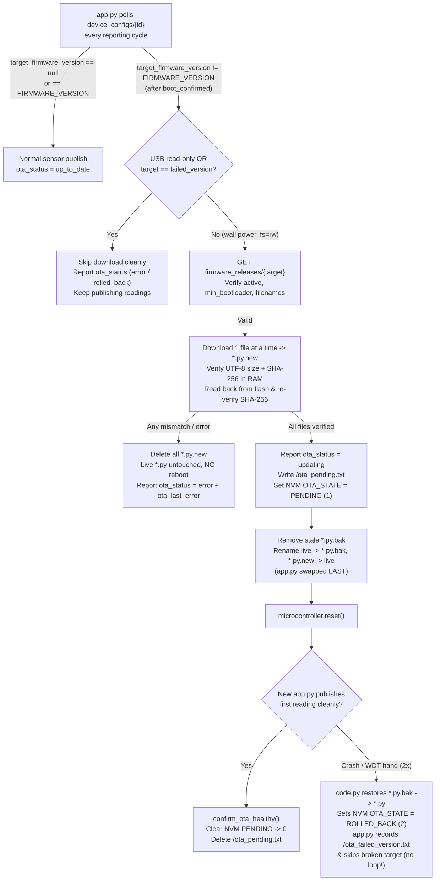

# Guide 10: Cloud Pull-Based OTA Updates & A/B Rollback

> **Built in Steps 16–19 of [`IMPLEMENTATION_PLAN.md`](../IMPLEMENTATION_PLAN.md)** — Introduces Layer 2 remote firmware management: a USB-aware `boot.py`, an immutable `code.py` auto-rollback bootloader, SHA-256 verified release manifests, an on-device pull-based OTA updater, and a Fleet & Firmware rollout panel in the web dashboard so you can update sensors sealed inside 3D-printed enclosures without touching USB.

---

## 1. Part 1: Safe Bootloader Split & A/B Rollback (Step 16)

### Why Split `boot.py`, `code.py`, and `app.py`?

When a sensor is mounted inside a 3D-printed enclosure on wall power across the house, pushing a broken Python file directly over `code.py` would stop the board from ever connecting to Wi-Fi again—forcing you to unscrew or pop open the enclosure and plug it into a Mac.

Splitting the firmware into three clear layers makes bricking an OTA update virtually impossible:

| File on `CIRCUITPY` | Updated Over OTA? | Responsibility |
| :--- | :---: | :--- |
| **`boot.py`** | **Never** (immutable) | Runs once at hard boot before USB initializes; decides whether flash `/` is writable by CircuitPython (wall power / OTA) or by your Mac (USB maintenance). |
| **`code.py`** | **Never** (immutable) | Minimal bootloader using **only** CircuitPython built-in modules. Handles automatic USB handoff, mid-swap self-healing, hardware watchdog guarding, boot-attempt counting, and automatic rollback of `*.py.bak` files if `app.py` crashes. |
| **`app.py`** (+ `aqi.py`, `firestore_client.py`) | **Yes** (Layer 2 OTA) | Full sensor polling loop (`v1.2.0`), US EPA AQI math, remote config polling, and Firestore publishing. Invokes `on_healthy()` after its first live publish to confirm the boot succeeded. |



---

### How CircuitPython Flash Locking Works (and the `boot.py` USB Timing Catch-22)

CircuitPython stores `CIRCUITPY` on a standard FAT filesystem in internal SPI flash. Because FAT does not support concurrent writers, **only one side can have write access at a time**:
- **Default CircuitPython behavior:** Your Mac gets read-write access over USB, and CircuitPython code gets `readonly=True` (attempting to open a file for writing raises `OSError: [Errno 30] Read-only filesystem`).
- **OTA / Rollback requirement:** When running standalone on a wall charger, CircuitPython needs `storage.remount("/", readonly=False)` so `code.py` can rename `.bak` files and `ota_updater.py` can download new `.py` files.

#### The `boot.py` Timing Catch-22
A common CircuitPython trap is writing `if not supervisor.runtime.usb_connected: storage.remount("/", readonly=False)` directly inside `boot.py`. **That does not work:** `boot.py` executes *before* the ESP32-S3 USB stack initializes and enumerates with your computer, so `supervisor.runtime.usb_connected` is **always `False`** inside `boot.py`!

#### Our Solution: 1-Shot NVM Handoff + Zero "Disk Not Ejected Properly" Warnings
We solve this cleanly by coordinating [`firmware/boot.py`](../firmware/boot.py) and [`firmware/code.py`](../firmware/code.py) through a 4-byte header in ESP32-S3 Non-Volatile Memory (`microcontroller.nvm[0:4]`):

1. **On wall power (production, 99.9% of the time):**
   - `boot.py` sees no USB flag, calls `storage.disable_usb_drive()` and `storage.remount("/", readonly=False)`.
   - `code.py` checks `supervisor.runtime.usb_connected` for `1.5s`. Wall chargers (including USB-C PD bricks) only provide power and never perform USB data enumeration, so `usb_connected` stays `False`.
   - `code.py` launches `app.py` directly with **zero extra reboots** and **zero NVM writes**.
2. **When plugged into your Mac via USB-C (development / flashing):**
   - **Boot 1:** `boot.py` disables the USB mass-storage drive (`CIRCUITPY` is not presented yet) while keeping USB serial (`usb_cdc`) active, and mounts `/` read-write for Python.
   - `code.py` runs, sees `supervisor.runtime.usb_connected == True` within a fraction of a second, writes a one-shot `BOOT_MODE_USB_ONCE = 1` flag to NVM, and calls `microcontroller.reset()`.
   - **Boot 2 (~1.5s later):** `boot.py` sees `BOOT_MODE_USB_ONCE`, immediately clears it back to `0` (one-shot), and leaves `CIRCUITPY` enabled and writable by your Mac.
   - Because Boot 1 never mounted a USB disk, macOS mounts `CIRCUITPY` cleanly with **zero "Disk Not Ejected Properly" notifications**, and subsequent file saves trigger CircuitPython soft reloads (which do not re-run `boot.py`), keeping `CIRCUITPY` read-write on your Mac indefinitely.
3. **When unplugged from your Mac and moved back to wall power:**
   - Because `boot.py` already cleared `BOOT_MODE_USB_ONCE` back to `0` on Boot 2, the next cold boot on wall power automatically enters Python read-write OTA mode!

#### Shared 4-Byte NVM Layout (`microcontroller.nvm[0:4]`)

| Byte Index | Name | Values | Purpose |
| :---: | :--- | :--- | :--- |
| `0` | `NVM_MAGIC` | `0xA5` | Distinguishes initialized bootloader state from factory `0xFF` flash bytes |
| `1` | `NVM_BOOT_MODE` | `0` = OTA/wall power, `1` = one-shot USB host R/W, `2` = one-shot force OTA over USB | Coordinates `boot.py` ↔ `code.py` mount mode |
| `2` | `NVM_OTA_STATE` | `0` = healthy, `1` = pending OTA verification, `2` = rolled back | Tracks whether the active `app.py` is awaiting its first healthy Firestore publish |
| `3` | `NVM_BOOT_ATTEMPTS` | `0`–`255` | Counts consecutive failed boots; triggers rollback at `MAX_BOOT_ATTEMPTS = 2` |

> [!TIP]
> **Three ways to mount `CIRCUITPY` read-write on your Mac:**
> 1. **Automatic (default):** Simply plug the Feather into your Mac via USB-C and wait ~2 seconds for the 1-shot NVM handoff.
> 2. **Physical `BOOT` button failsafe:** Tap `RESET`, release it, and hold the onboard `BOOT` button (`board.BUTTON`) for ~1 second while `boot.py` runs.
> 3. **CircuitPython Safe Mode:** Tap `RESET` once, then tap `RESET` again while the NeoPixel flashes yellow to skip `boot.py` and `code.py` completely.

---

### Power-Loss-Safe A/B Rollback Mechanics

Whenever `code.py` rolls back a broken firmware release (either after `2` consecutive Python exceptions or after `2` hardware watchdog resets during pending OTA verification), it scans `/` for every `*.py.bak` file whose target is not in `PROTECTED_FILES` (`boot.py`, `code.py`, `settings.toml`) and restores them together:

```python
if _exists(failed_path):
    os.remove(failed_path)
if _exists(target_path):
    os.rename(target_path, failed_path)  # Preserve broken file for post-mortem
os.rename(bak_path, target_path)         # Promote known-good backup
```

- **Why multi-file `*.py.bak` rollback matters:** When Step 18 updates `app.py` and `firestore_client.py` together, rolling back all `*.py.bak` files as a group prevents version skew between modules.
- **Why this sequence is power-loss safe:** Even if wall power drops in the exact millisecond between moving `app.py` → `app.py.failed` and promoting `app.py.bak` → `app.py`, the next boot detects `not _exists("/app.py") and _exists("/app.py.bak")` and immediately finishes promoting `app.py.bak` → `app.py`.
- **Crash forensics:** Before resetting on wall power, `code.py` writes the latest traceback to `/boot_error.txt` (single overwrite so flash never fills) and preserves the failing script as `/app.py.failed`. Plugging the board back into a Mac later lets you read exactly what went wrong.

---

### Running the Step 16 Focused Validation

#### Part A: Automated Offline Simulation (Mac)
Run the local firmware test suite to verify syntax compilation plus all 12 `boot.py` and `code.py` scenarios (wall-power mount, one-shot USB handoff, physical `BOOT` button override, forced OTA-over-USB, 2-attempt crash rollback, `SyntaxError` rollback, WDT-hang rollback, mid-swap self-heal, pending-OTA health confirmation, and USB read-only developer mode):

```bash
python3 scripts/test_firmware_local.py
```

Confirm you see:
- `[PASS] EPA AQI tests passed ...`
- `[PASS] Firestore REST payload encoding tests passed.`
- `[PASS] Remote config decoding, clamping, reboot gating, and syntax tests passed.`
- `[PASS] Bootloader tests passed (boot.py modes, USB handoff, A/B rollback, WDT hang, mid-swap self-heal).`

#### Part B: Live Wall-Power Rollback Test on the ESP32-S3 Feather
1. Plug the Feather ESP32-S3 into your Mac via USB-C and copy the split bootloader files to `CIRCUITPY`:
   ```bash
   cp -X firmware/boot.py firmware/code.py firmware/app.py firmware/firestore_client.py firmware/aqi.py /Volumes/CIRCUITPY/
   ```
2. Verify normal USB boot first: check `/Volumes/CIRCUITPY/boot_out.txt` and confirm the board publishes a fresh `v1.2.0` reading to Firestore (visible on the Web Dashboard).
3. Stage the intentional crash test on `CIRCUITPY`:
   ```bash
   # Back up the known-good app.py as app.py.bak
   cp -X /Volumes/CIRCUITPY/app.py /Volumes/CIRCUITPY/app.py.bak

   # Replace app.py with a deliberately broken file that crashes on boot
   printf 'raise RuntimeError("Step 16 simulated boot crash")\n' > /Volumes/CIRCUITPY/app.py
   ```
   *(Over USB, `CIRCUITPY` is read-only to Python, so `code.py` will print the crash traceback to serial and wait cleanly without rolling back.)*
4. Eject `CIRCUITPY`, unplug the USB-C cable from your Mac, and plug the Feather into **wall power** (USB power adapter).
5. Watch what happens with **zero USB intervention**:
   - Within ~6–10 seconds, `code.py` catches the crash twice, moves the broken `app.py` to `app.py.failed`, writes `/boot_error.txt`, promotes `app.py.bak` → `app.py`, sets `NVM_OTA_STATE = 2`, and reboots.
   - The NeoPixel turns solid blue while connecting to Wi-Fi/NTP, then pulses green once as the restored `app.py` (`v1.2.0`) publishes a fresh room reading to Firestore!
6. Optional post-mortem inspection: plug the Feather back into your Mac via USB-C. Within ~2 seconds, `code.py` automatically hands off to `boot.py` and mounts `CIRCUITPY` read-write. Inspect `/Volumes/CIRCUITPY/boot_error.txt` (shows `"Step 16 simulated boot crash"`) and `/Volumes/CIRCUITPY/app.py.failed`, then delete those two leftover test artifacts if desired:
   ```bash
   cat /Volumes/CIRCUITPY/boot_error.txt
   rm -f /Volumes/CIRCUITPY/boot_error.txt /Volumes/CIRCUITPY/app.py.failed
   ```

> [!NOTE]
> **Live Hardware Verification (Step 16 Passed):** Staged a deliberately broken `app.py` alongside `app.py.bak` on the Adafruit Feather ESP32-S3 and moved to wall power. The immutable `code.py` bootloader detected the boot crash, automatically restored `app.py.bak` → `app.py`, rebooted, and resumed publishing live `v1.2.0` sensor readings to Firestore with zero USB intervention.

---

### Good to Know & Real-World Troubleshooting (Part 1)

> [!IMPORTANT]
> **Never rely on `supervisor.runtime.usb_connected` inside `boot.py`.**
> Because `boot.py` executes before CircuitPython initializes TinyUSB, `supervisor.runtime.usb_connected` is always `False` there. Always detect USB enumeration in `code.py` and hand off via a one-shot `microcontroller.nvm` flag to `boot.py`.

> [!TIP]
> **If `CIRCUITPY` doesn't mount on a cold USB-C plug-in (`Not a directory`), tap `RESET` once.**
> On a cold plug-in to macOS, USB-C hub negotiation can occasionally take slightly longer than `code.py`'s 1.5-second `USB_DETECT_TIMEOUT_SECONDS` window—leaving the board in OTA mode (USB serial `/dev/tty.usbmodem*` active, `CIRCUITPY` hidden). Tapping `RESET` once while already plugged in lets `code.py` detect `usb_connected` immediately and mount `CIRCUITPY` read-write within ~2 seconds.

> [!WARNING]
> **CircuitPython FATFS `os.rename(src, dst)` fails with `Errno 17: File exists` if `dst` exists.**
> Unlike POSIX on macOS/Linux where `os.rename()` silently overwrites the destination, CircuitPython's FAT implementation refuses to overwrite an existing file. Always `os.rename(dst, dst + ".failed")` or `os.remove(dst)` before promoting a `.bak` or `.new` file.

> [!NOTE]
> **CircuitPython's `os` module does not include `os.path`.**
> Keep bootloader utilities free of `os.path.exists` / `os.path.join`—use `os.stat(path)` inside `try ... except OSError` and plain string path joining so the exact same code runs unmodified on both CircuitPython 10 and desktop CPython.

> [!CAUTION]
> **Do not hold the `BOOT` button *while* pressing `RESET`.**
> On ESP32-S3, holding GPIO0 (`BOOT`) low at the exact instant `RESET` is released puts the chip into Espressif ROM serial-download mode (appearing "dead" until you tap `RESET` again). To use the `BOOT` button failsafe, tap and **release** `RESET` first, then press `BOOT`—or simply let the automatic 2-second USB NVM handoff mount `CIRCUITPY` for you.

> [!TIP]
> **Testing OTA or rollback live over USB serial without unplugging (`BOOT_MODE_FORCE_OTA`).**
> If you ever want Python write access (`fs=rw`) *while* watching the USB serial console on your Mac, open the CircuitPython REPL (`Ctrl+C`) and run:
> ```python
> import microcontroller
> microcontroller.nvm[0:4] = bytes((0xA5, 2, 0, 0))
> microcontroller.reset()
> ```
> The board will reboot once with `CIRCUITPY` hidden and `/` writable by Python while keeping USB serial live. Because mode `2` is one-shot, the very next reset automatically returns to normal Mac-writable `CIRCUITPY` mode.

> [!NOTE]
> **Zero steady-state flash wear on `microcontroller.nvm`.**
> Both `boot.py` and `code.py` compare `bytes(nvm[0:4])` before writing and write all 4 bytes in a single atomic slice assignment (`nvm[0:4] = desired`). During normal 24/7 wall-power operation, `microcontroller.nvm` is **never written at all**.

---

## 2. Part 2: Checksummed Release Manifests, Artifact Hosting & Publish CLI (Step 17)

### Why Store `.py` Artifacts in a Firestore Subcollection?

Our complete CircuitPython application (`app.py`, `aqi.py`, `firestore_client.py`, plus `ota_updater.py` in Step 18) is roughly **55–75 KB** of plain UTF-8 Python source—well under Firestore's 1 MiB per-document limit. Hosting versioned payloads in a nested `firmware_releases/{version}/files/{filename}` subcollection keeps the entire OTA pipeline dead simple and low-memory on the ESP32-S3:

- **Zero extra Firebase services:** No Cloud Storage bucket to provision, no `storage.rules` to maintain, and no extra bucket URL in `settings.toml`.
- **Single TLS stack on the microcontroller:** The ESP32-S3 reuses the exact same `firestore.googleapis.com` REST API, pinned Google Trust Services (GTS) Root CA certificates, and Firebase Auth ID token already built into `firestore_client.py`.
- **Low ESP32-S3 RAM footprint:** The parent manifest (`firmware_releases/{version}`) is ~500 bytes, and each `.py` artifact lives in its own `files/{filename}` document (~3–35 KB), so the Feather downloads, hashes, and stages **one small file at a time**.
- **Atomic release publishing:** The publish CLI writes every `files/{filename}` document **and** the parent `firmware_releases/{version}` manifest in a single Firestore `WriteBatch`, so a polling sensor can never observe a half-published release.



---

### Cloud Data Model

#### A. Release Manifest: `firmware_releases/{version}`
Document ID `{version}` must match strict SemVer with an optional prerelease suffix (`^[0-9]+\.[0-9]+\.[0-9]+(-[A-Za-z0-9][A-Za-z0-9.-]{0,19})?$`, e.g., `1.2.0` or `1.2.0-rc1`).

| Field | Firestore Type | Example | Purpose |
| :--- | :--- | :--- | :--- |
| `version` | `string` | `"1.2.0-rc1"` | Release version (matches document ID) |
| `min_bootloader_version` | `string` | `"1.0.0"` | Minimum compatible immutable `code.py` bootloader version |
| `notes` | `string` | `"Step 17 test release"` | Human-readable release summary (max 2,000 chars) |
| `file_count` | `integer` | `3` | Number of `.py` files included in this release |
| `total_size_bytes` | `integer` | `54819` | Combined UTF-8 byte length across all release files |
| `files` | `map` | `{ "app.py": { doc_id, sha256, size_bytes }, ... }` | Per-file SHA-256 hex digest and exact UTF-8 byte size |
| `created_at` | `timestamp` | RFC 3339 timestamp | Publication timestamp |
| `created_by` | `string` | `"publish-cli"` | Audit label identifying publisher |
| `git_sha` | `string \| null` | `"38598a5"` | Short Git commit SHA captured at publish time |
| `status` | `string` | `"active"` \| `"yanked"` | Marks whether a release is active or yanked from rollout |

#### B. Per-File Payload: `firmware_releases/{version}/files/{filename}`
Document ID `{filename}` must match `^[a-z][a-z0-9_]{0,31}\.py$` and is strictly denied for `boot.py` and `code.py` at **both** the CLI and `firestore.rules` layers.

| Field | Firestore Type | Purpose |
| :--- | :--- | :--- |
| `filename` | `string` | Target module name on `CIRCUITPY` (e.g., `"app.py"`) |
| `version` | `string` | Parent release version |
| `sha256` | `string` | 64-character lowercase hex SHA-256 of `content` encoded as UTF-8 bytes |
| `size_bytes` | `integer` | Exact UTF-8 byte length of `content` (max 512 KiB) |
| `encoding` | `string` | Always `"utf-8"` |
| `content` | `string` | Raw UTF-8 Python source text |
| `created_at` | `timestamp` | Publication timestamp |

#### C. Device Rollout Target: `device_configs/{device_id}`
Step 17 adds one optional field to `device_configs/{device_id}`:
- **`target_firmware_version`** (`string | null`, default `null`): When `null`, the sensor stays on its currently flashed firmware. When set to a SemVer version (e.g., `"1.3.0"`), Step 18's OTA client compares it against `app.FIRMWARE_VERSION` and pulls `firmware_releases/{target_firmware_version}`.
- Both `updateDeviceConfig()` and `requestDeviceReboot()` in [`functions/src/services/firestore.ts`](../functions/src/services/firestore.ts) preserve `target_firmware_version` atomically inside Firestore transactions so saving Layer 1 settings in the web dashboard never clears a pinned firmware target.

---

### Hardened Security Rules (`firestore.rules`)

| Path | Unauthenticated | Allowlisted Sensor (`isSensorDevice()`) | Admin SDK / Console |
| :--- | :---: | :---: | :---: |
| `firmware_releases/{version}` (`get`) | `403 DENIED` | `200 OK` (valid SemVer `{version}` only) | Full access |
| `firmware_releases` (`list`) | `403 DENIED` | `403 DENIED` | Full access |
| `firmware_releases/{version}/files/{fileId}` (`get`) | `403 DENIED` | `200 OK` (valid `.py`, blocks `boot.py` & `code.py`) | Full access |
| `firmware_releases/{version}/files` (`list`) | `403 DENIED` | `403 DENIED` | Full access |
| `firmware_releases/**` (`write`) | `403 DENIED` | `403 DENIED` | Full access |

`isFirmwareVersion()` on `devices/{deviceId}` was also updated to accept optional SemVer prerelease suffixes (like `1.2.0-rc1`) so test releases can report their version cleanly to `devices/{device_id}` during Step 18 staging.

---

### Publishing Releases with `publish:release`

The publish CLI lives in [`functions/src/scripts/publishRelease.ts`](../functions/src/scripts/publishRelease.ts) and reuses Node 22 + `firebase-admin` (zero Python `pip` dependencies).

#### 1. Dry-Run Preview (Zero Cloud Writes)
Preview the exact file list, byte sizes, and SHA-256 digests before touching Firestore:
```bash
npm --prefix functions run publish:release -- --dry-run
```

#### 2. Publish a Real or Staged Test Release
Because `publish:release` writes to Firestore via the Admin SDK, authenticate using any standard Admin path (`GOOGLE_APPLICATION_CREDENTIALS=./firebase-adminsdk.json`, `gcloud auth application-default login`, or `FIRESTORE_ACCESS_TOKEN=...`):

```bash
# Publish a standard release matching FIRMWARE_VERSION in firmware/app.py
GOOGLE_APPLICATION_CREDENTIALS=./firebase-adminsdk.json \
  npm --prefix functions run publish:release -- --notes "Release description"

# Publish a staged release candidate (differs from app.py's FIRMWARE_VERSION)
GOOGLE_APPLICATION_CREDENTIALS=./firebase-adminsdk.json \
  npm --prefix functions run publish:release -- \
  --version 1.2.0-rc1 \
  --allow-version-mismatch \
  --notes "Step 17 release pipeline validation"
```

Useful optional flags:
- `--force`: Overwrite an already-published version (by default, releases are immutable to prevent accidental silent mutation).
- `--set-target <device_id>`: Optionally pin `device_configs/<device_id>.target_firmware_version` in the same run (omitted by default so publishing and rollout stay decoupled).
- `--delete --version <semver>`: Atomically delete a test release and its `files/` subcollection.

---

### Running the Step 17 Focused Validation

1. **Deploy the updated security rules:**
   ```bash
   firebase deploy --only firestore:rules
   ```
2. **Run offline unit tests (SemVer, filename guards, SHA-256 bundling, protected-file rejection):**
   ```bash
   npm --prefix functions run verify:release
   ```
3. **Publish a test release (`1.2.0-rc1`) and run the 9-point live security & SHA-256 verification:**
   ```bash
   npm --prefix functions run publish:release -- \
     --version 1.2.0-rc1 --allow-version-mismatch --notes "Step 17 validation"

   npm --prefix functions run verify:release -- --live --version 1.2.0-rc1
   ```
   Confirm all 9 live checks pass:
   1. Unauthenticated `GET firmware_releases/1.2.0-rc1` → `403 PERMISSION_DENIED`
   2. Unauthenticated `GET .../files/app.py` → `403 PERMISSION_DENIED`
   3. Sensor-authenticated `GET firmware_releases/1.2.0-rc1` → `200 OK`
   4. Sensor-authenticated `LIST firmware_releases` → `403 PERMISSION_DENIED`
   5. Sensor-authenticated `LIST .../files` → `403 PERMISSION_DENIED`
   6. Sensor-authenticated `GET .../files/boot.py` → `403 PERMISSION_DENIED`
   7. Sensor fetches every `.py` artifact and verifies exact UTF-8 byte length + SHA-256 match against both the manifest and the file doc
   8. Sensor-authenticated `PATCH` on manifest → `403 PERMISSION_DENIED`
   9. Sensor-authenticated `DELETE` on artifact file → `403 PERMISSION_DENIED`

> [!NOTE]
> **Live Validation (Step 17 Passed):** Deployed `firestore.rules` cleanly with zero warnings, published `firmware_releases/1.2.0-rc1` (3 files, `54,819` bytes total) via `publish:release`, and passed all 6 offline unit checks, all 9 live Firestore REST security + SHA-256 verification checks in `verify:release --live`, and all 7 Dashboard API regression checks in `verify:api`.

---

### Good to Know & Real-World Troubleshooting (Part 2)

> [!TIP]
> **Working across multiple GCP projects (`GOOGLE_APPLICATION_CREDENTIALS` override).**
> If your shell exports `GOOGLE_APPLICATION_CREDENTIALS` pointing to a service account key for another Google Cloud project, `firebase-admin` prioritizes that key over your default ADC and fails with `PERMISSION_DENIED`. Clear it inline when publishing:
> ```bash
> GOOGLE_APPLICATION_CREDENTIALS= npm --prefix functions run publish:release -- --version 1.2.0-rc1 --allow-version-mismatch
> ```

> [!IMPORTANT]
> **UTF-8 round-trip verification prevents cross-platform SHA-256 mismatches.**
> Because Firestore stores `.py` payloads as UTF-8 strings (`stringValue`) and the ESP32-S3 hashes `content.encode("utf-8")`, `publishRelease.ts` verifies `Buffer.from(rawBytes.toString("utf8"), "utf8").equals(rawBytes)` before hashing. That guarantees the exact byte sequence read on macOS matches the byte sequence decoded from JSON on CircuitPython.

> [!TIP]
> **Decouple publishing from rollout.**
> Running `publish:release` writes `firmware_releases/{version}` without touching `device_configs/{device_id}` unless you explicitly pass `--set-target <device_id>`. This lets you upload and inspect a release safely before promoting it to one test board or your full fleet.

> [!WARNING]
> **Releases are immutable by default.**
> Re-running `publish:release` for an existing version fails intentionally unless you pass `--force`. Never overwrite a version that live sensors have already installed—always bump `FIRMWARE_VERSION` (e.g., `1.2.0` → `1.2.1`) so your fleet telemetry unambiguously shows which code each board is running.

---

## 3. Part 3: On-Device Pull-Based OTA Updater (Step 18)

### End-to-End Pull-Based OTA Flow

With the immutable bootloader (`code.py`) and checksummed release pipeline (`firmware_releases/{version}`) in place, [`firmware/ota_updater.py`](../firmware/ota_updater.py) and [`firmware/app.py`](../firmware/app.py) (`v1.3.0`) close the loop on the ESP32-S3:



---

### Safety Guarantees Built Into `ota_updater.py`

1. **Double SHA-256 Verification (In-RAM + Flash Read-Back):**
   - Each `.py` file is downloaded one at a time (calling `gc.collect()` and feeding the hardware watchdog between files to keep ESP32-S3 RAM headroom high).
   - `ota_updater.py` verifies exact UTF-8 byte length and SHA-256 digest against the manifest **before** writing `<filename>.new`, then reads `<filename>.new` back from SPI flash and re-verifies SHA-256 to catch any flash-write corruption before touching live files.
   - If **any** file fails download, size, or SHA-256 verification, all `*.py.new` staging files are deleted immediately, live `*.py` files are untouched, the board does **not** reboot, and `devices/{device_id}` is updated with `ota_status: "error"` and a concise `ota_last_error`.
2. **Protected-File & Bootloader Compatibility Guards:**
   - `validate_release_manifest()` refuses any manifest that is `"yanked"`, missing `app.py`, includes `boot.py`/`code.py`/`settings.toml`, or requires a `min_bootloader_version` newer than the running `code.py` (`BOOTLOADER_VERSION = "1.0.0"`).
3. **Power-Loss-Safe Swap Order (`app.py` Last):**
   - Stale `*.py.bak` files from older updates are cleared, `/ota_pending.txt` is written, `NVM_OTA_STATE` is set to `OTA_STATE_PENDING (1)`, and live files are backed up and promoted with `app.py` swapped **last**. If power drops mid-swap, `code.py` immediately heals or rolls back on the next boot.
4. **Rollback-Loop Prevention (`/ota_pending.txt` → `/ota_failed_version.txt`):**
   - Because sensors have read-only access to `device_configs/{device_id}`, a rolled-back sensor cannot clear `target_firmware_version` in Firestore.
   - When `app.py` boots with `NVM_OTA_STATE == OTA_STATE_ROLLED_BACK (2)`, `check_post_boot_ota_state()` promotes `/ota_pending.txt` into `/ota_failed_version.txt`, extracts the last line of `/boot_error.txt`, reports `ota_status: "rolled_back"` to `devices/{device_id}`, and **skips** any `target_firmware_version` matching that failed version until you clear the target or publish a newer release (e.g., `1.3.2`).

---

### Device Telemetry Fields on `devices/{device_id}`

`firestore.rules` (`validDevice`) allows three optional OTA telemetry fields on `devices/{device_id}` so the dashboard (Step 19) can render real-time rollout state without breaking older `v1.0`–`v1.2` devices:

| Field | Type | Allowed Values / Bounds | Purpose |
| :--- | :--- | :--- | :--- |
| `ota_status` | `string` (optional) | `"up_to_date"`, `"updating"`, `"rolled_back"`, `"error"` | Current OTA lifecycle state reported by the sensor |
| `ota_target_version` | `string \| null` (optional) | Valid SemVer (e.g. `"1.3.1"`) or `null` | Target version observed in `device_configs/{device_id}` |
| `ota_last_error` | `string \| null` (optional) | Max 200 characters or `null` | Concise rejection or rollback reason (e.g. `"SHA-256 mismatch for app.py..."`) |

---

### Running the Step 18 Focused Validation

#### Part A: Automated Offline Verification (Mac)
Run the local firmware unit suite, release bundler checks, and secret scan:

```bash
python3 scripts/test_firmware_local.py
npm --prefix functions run verify:release
npm --prefix functions run publish:release -- --dry-run
./scripts/check-secrets.sh
```

Confirm you see:
- `[PASS] OTA updater tests passed (manifest guards, SHA-256 verification, atomic swap, hash-mismatch rejection, rollback-loop prevention).`
- `buildReleaseBundle() hashed 4 files (...) for v1.3.0` (`app.py`, `aqi.py`, `firestore_client.py`, `ota_updater.py`).

#### Part B: Live Wall-Power OTA Validation on the ESP32-S3 Feather

1. **Deploy the updated `firestore.rules`** (allows `ota_status`, `ota_target_version`, `ota_last_error` on `devices/{device_id}`):
   ```bash
   firebase deploy --only firestore:rules
   ```
2. **One-time USB flash of `v1.3.0`** (so the board has `ota_updater.py` on flash for all future wireless updates):
   ```bash
   cp -X firmware/boot.py firmware/code.py firmware/app.py firmware/firestore_client.py firmware/aqi.py firmware/ota_updater.py /Volumes/CIRCUITPY/
   ```
   Eject `CIRCUITPY`, unplug USB from your Mac, and plug the Feather into **wall power**. Confirm `devices/feather-s3-01` reports `firmware_version: "1.3.0"` and `ota_status: "up_to_date"`.
3. **Test live OTA promotion on wall power** (e.g., bump `FIRMWARE_VERSION` to `"1.3.1"` in a test branch or publish a staged `"1.3.1"` release):
   ```bash
   # Publish the new release and pin feather-s3-01 to it:
   GOOGLE_APPLICATION_CREDENTIALS= npm --prefix functions run publish:release -- \
     --version 1.3.1 --notes "Step 18 live OTA test" --set-target feather-s3-01
   ```
   On its next polling cycle (while sealed on wall power), watch the NeoPixel turn **solid cyan** while downloading & verifying SHA-256, `devices/feather-s3-01` briefly show `ota_status: "updating"`, then the Feather reboots and reports `firmware_version: "1.3.1"` and `ota_status: "up_to_date"`!
4. **Verify corrupted-hash rejection** (optional live test in addition to the offline unit test):
   - In the Firebase Console, edit a test release's `firmware_releases/<ver>/files/app.py` `content` by 1 character without updating `sha256` and pin `target_firmware_version` to `<ver>`.
   - Confirm the Feather logs `SHA-256 mismatch`, deletes `.new` files, does **not** reboot, keeps running its current firmware, and updates `devices/feather-s3-01` with `ota_status: "error"` and `ota_last_error: "SHA-256 mismatch for app.py..."`.

> [!NOTE]
> **Live Hardware Verification (Step 18 Passed):** Verified end-to-end on the Adafruit Feather ESP32-S3 running on wall power only:
> 1. **Wireless OTA upgrade (`1.3.0` → `1.3.2`):** The sensor downloaded all 4 files (`88,337` bytes), verified SHA-256 in RAM and on flash read-back, reported `ota_status: "updating"`, swapped files atomically, rebooted under the 60s watchdog guard, and checked back in with `firmware_version: "1.3.2"` and `ota_status: "up_to_date"`.
> 2. **Corrupted SHA-256 rejection (`1.3.3-badhash`):** Tampered `files/app.py` (preserving byte length) was safely rejected on-device with `ota_status: "error"` and `ota_last_error: "SHA-256 mismatch for app.py..."` without rebooting or touching live `1.3.2` files.

---

### Good to Know & Real-World Troubleshooting (Part 3)

> [!IMPORTANT]
> **CircuitPython's built-in `hashlib` exposes `hashlib.new("sha256")` + `.digest()`, not `hashlib.sha256()` or `.hexdigest()`.**
> Unlike desktop CPython, CircuitPython's C-accelerated `hashlib` module omits both `hashlib.sha256()` and `.hexdigest()`. Always construct with `h = hashlib.new("sha256"); h.update(data)` and format `h.digest()` to lowercase hex—it works identically on both CircuitPython 9/10 and CPython 3 with zero extra libraries in `CIRCUITPY/lib/`.

> [!TIP]
> **USB read-only mode safely skips OTA instead of crashing.**
> When the Feather is plugged into your Mac via USB-C (`CIRCUITPY` mounted read-write on macOS, `/` read-only to Python), `ota_updater.py` detects `storage.getmount("/").readonly == True`, skips downloading, and reports `ota_last_error: "USB read-only mode; move to wall power for OTA"` without throwing `Errno 30`.

> [!NOTE]
> **OTA checks only run after `boot_confirmed` is True.**
> `app.py` always completes its first sensor read, publishes to Firestore, and confirms boot health (`NVM_OTA_STATE = 0`) *before* evaluating `target_firmware_version`. That ensures a newly booted release is verified healthy before it can ever initiate another update.

> [!WARNING]
> **Do not re-arm `microcontroller.watchdog` if `code.py` already armed it.**
> During a pending OTA boot (`OTA_STATE_PENDING`), `code.py` enables the 60-second hardware watchdog before importing `app.py`. On ESP32-S3 (CircuitPython 10 / ESP-IDF), reassigning `wdt.timeout` or `wdt.mode = WatchDogMode.RESET` while the watchdog is already active raises `espidf.IDFError: Invalid argument`. Always check `if wdt.mode == WatchDogMode.RESET: wdt.feed(); return` inside `app.py`'s `init_watchdog()`.

> [!WARNING]
> **Redeploy Cloud Functions whenever `device_configs` schema fields are added.**
> `updateDeviceConfig()` writes the full `device_configs/{device_id}` document inside a Firestore transaction while preserving `target_firmware_version`. If you publish a release and pin `target_firmware_version`, then save Layer 1 settings (like changing the reporting interval) from the Web Dashboard *before* running `firebase deploy --only functions`, the older Cloud Function will overwrite the document without `target_firmware_version` and silently cancel the pending OTA.

---

## Part 4: Fleet & Firmware Rollout UI in the Web Dashboard (Step 19)

With the release pipeline (Step 17) and on-device SHA-256 OTA updater (Step 18) live, Step 19 brings firmware visibility and one-click promotion directly into the WorkOS-protected Firebase Hosting web dashboard.

### New WorkOS-Protected Dashboard API Endpoints

All routes live in [`functions/src/api/dashboard.ts`](../functions/src/api/dashboard.ts) and enforce the same WorkOS AuthKit JWT / Bearer fallback + `ALLOWED_USER_EMAILS` owner allowlist as the rest of `/api/*`:

| Method & Path | Purpose | Guardrails |
| :--- | :--- | :--- |
| `GET /api/firmware/releases` | Lists all manifests in `firmware_releases` sorted newest-first by `created_at`. | Owner-authenticated; returns `status` (`active` / `yanked`), notes, file count, total bytes, and git SHA. |
| `PUT /api/devices/:deviceId/firmware` | Sets or clears (`null`) `target_firmware_version` on a single sensor's `device_configs/{deviceId}`. | Strict Zod SemVer validation (`400`), verifies release exists (`404`), blocks `yanked` releases (`409`), preserves all Layer 1 settings & `reboot_requested_at` inside a Firestore transaction. |
| `POST /api/firmware/rollout` | Sets or clears `target_firmware_version` across all registered sensors (or an optional `device_ids` subset). | Same SemVer (`400`), existence (`404`), and `yanked` (`409`) checks before updating all targets. |

Additionally, `GET /api/dashboard/overview` now maps `ota_status`, `ota_target_version`, and `ota_last_error` from `devices/{deviceId}` and computes `ota_rollout_status`:

- **`up_to_date`** — Sensor is running the desired firmware (or no target is pinned).
- **`pending`** — A new `target_firmware_version` is queued in `device_configs/{deviceId}` and will be pulled on the sensor's next wall-power check-in.
- **`updating`** — Sensor is actively downloading, SHA-256 verifying, and swapping files (NeoPixel solid cyan).
- **`rolled_back`** — Bootloader automatically restored `.py.bak` after a crash or watchdog timeout; `ota_last_error` surfaces the failure reason.
- **`error`** — On-device OTA check failed before touching live files (e.g., SHA-256 mismatch or USB read-only mode); `ota_last_error` explains why.

### Fleet & Firmware Tab (`web/`)

The zero-build web dashboard (`web/index.html`, `web/app.js`, `web/api.js`, `web/styles.css`) now organizes the authenticated view into two accessible tabs:

1. **Live & Trends** — Live room cards (with a status pill whenever a sensor is `updating`, `pending`, `rolled_back`, or `error`), 6h/24h/7d interactive SVG charts, and the Layer 1 Device Settings drawer.
2. **Fleet & Firmware** — Displays:
   - **Fleet-Wide Promotion Bar**: Pick any `active` release, inspect its notes/size/git SHA, and promote across all rooms (or clear targets) behind a native `<dialog>` confirmation modal.
   - **Responsive Fleet Table**: Shows each sensor's room, online/stale status, running version badge, target version badge, OTA status + inline `ota_last_error` warnings, and per-device `Promote` / `Clear` controls (automatically transforms into stacked cards on narrow screens via CSS `@container` queries).
   - **Published Releases**: Compact cards for every manifest in `firmware_releases`, clearly labeling `Active` vs. `Yanked` builds.

### Running the Step 19 Focused Validation

#### Part A: Offline Verification
```bash
npm --prefix functions run verify:api
npm --prefix functions run verify:auth
node scripts/verify_web_dashboard.mjs
./scripts/check-secrets.sh
```

#### Part B: Deploy & Live Wall-Power Rollout from the Dashboard
1. **Deploy both Cloud Functions and Firebase Hosting** so the new `/api/firmware/*` routes and Fleet & Firmware tab are live together:
   ```bash
   firebase deploy --only functions,hosting
   ```
2. **Publish a new patch release** (for example, bumping `FIRMWARE_VERSION` in `firmware/app.py` to `1.3.3`) *without* `--set-target` so you trigger the rollout from the web UI:
   ```bash
   GOOGLE_APPLICATION_CREDENTIALS= npm --prefix functions run publish:release -- \
     --version 1.3.3 --notes "Step 19 dashboard rollout test"
   ```
3. **Promote from the live Web Dashboard** (with the sensor sealed in its enclosure on wall power):
   - Open your Firebase Hosting URL, sign in with WorkOS, and switch to the **Fleet & Firmware** tab.
   - Select `v1.3.3` and click **Promote** (or **Promote All Rooms**), then confirm in the modal dialog.
   - Click **Refresh** over the next polling cycle and watch the row transition:
     `Update pending` → `Updating…` → `Up to date` with Running `v1.3.3` live.

> [!TIP]
> **Canary first, fleet second:** When you add more room sensors in Phase 4, use the per-device **Promote** button in the Fleet table to upgrade one room first and confirm `Up to date` before clicking **Promote All Rooms**.

> [!NOTE]
> **Live Hardware Verification (Step 19 Passed):** Published `firmware_releases/1.3.3` (4 files, `88,337` bytes, git `5e5e0a5`), then triggered the rollout directly from the deployed Firebase Hosting **Fleet & Firmware** tab while `feather-s3-01` (**Master Bedroom**) ran on wall power. Confirmed the board pulled `v1.3.3`, verified SHA-256 checksums, rebooted cleanly, and reported `RUNNING v1.3.3` / `TARGET v1.3.3` / `Up to date` in the dashboard.

> [!WARNING]
> **CSS gotcha — `hidden="until-found"` in a shared Grid cell creates a stacking context:**
> When stacking tab panels in the same CSS Grid cell (`grid-area: 2 / 1`) with `hidden="until-found"`, the hidden panel's `content-visibility: hidden` creates a stacking context and stretches over the active panel—silently swallowing pointer clicks on later tabs. Always pair it with `.tabpanel { position: relative; z-index: 1; }` and `.tabpanel[hidden="until-found"] { pointer-events: none; align-self: start; z-index: 0; }`.
