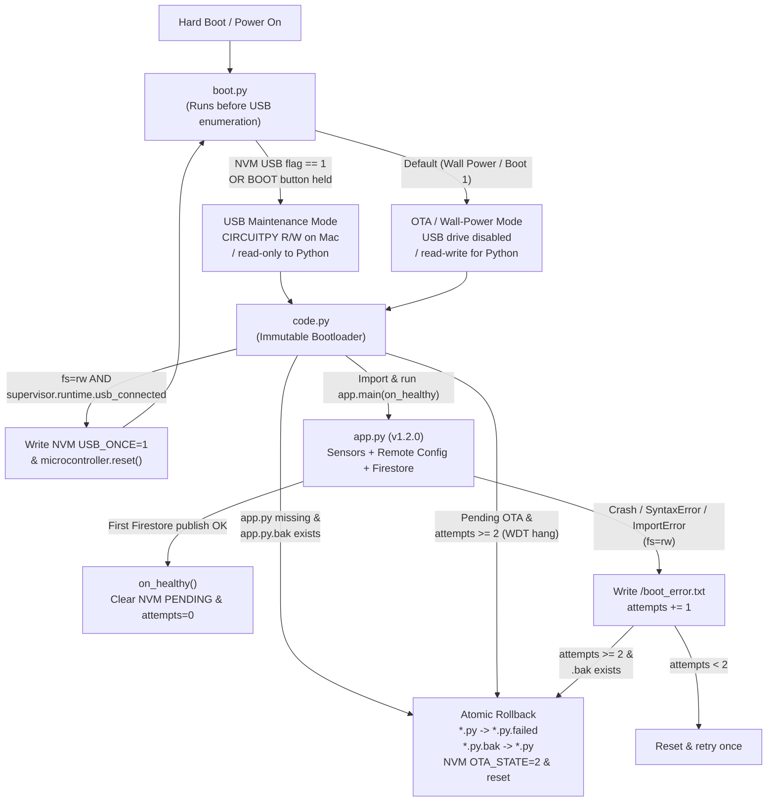

# Guide 10: Cloud Pull-Based OTA Updates & A/B Rollback

> **Built in Steps 16–19 of [`IMPLEMENTATION_PLAN.md`](../IMPLEMENTATION_PLAN.md)** — Introduces Layer 2 remote firmware management: a USB-aware `boot.py`, an immutable `code.py` auto-rollback bootloader, SHA-256 verified release manifests, an on-device pull-based OTA updater, and a Fleet & Firmware rollout panel in the web dashboard so you can update sensors sealed inside 3D-printed enclosures without touching USB.

---

## 1. Part 1: Safe Bootloader Split & A/B Rollback (Step 16)

### Why Split `boot.py`, `code.py`, and `app.py`?

When a sensor is mounted inside a 3D-printed enclosure on wall power across the house, pushing a broken Python file directly over `code.py` would stop the board from ever connecting to Wi-Fi again—forcing you to unscrew or pop open the enclosure and plug it into a Mac.

Splitting the firmware into three clear layers makes bricking an OTA update virtually impossible:

| File on `CIRCUITPY` | Updated Over OTA? | Responsibility |
| :--- | :---: | :--- |
| **`boot.py`** | **Never** (immutable) | Runs once at hard boot before USB initializes; decides whether flash `/` is writable by CircuitPython (wall power / OTA) or by your Mac (USB maintenance). |
| **`code.py`** | **Never** (immutable) | Minimal bootloader using **only** CircuitPython built-in modules. Handles automatic USB handoff, mid-swap self-healing, hardware watchdog guarding, boot-attempt counting, and automatic rollback of `*.py.bak` files if `app.py` crashes. |
| **`app.py`** (+ `aqi.py`, `firestore_client.py`) | **Yes** (Layer 2 OTA) | Full sensor polling loop (`v1.2.0`), US EPA AQI math, remote config polling, and Firestore publishing. Invokes `on_healthy()` after its first live publish to confirm the boot succeeded. |



---

### How CircuitPython Flash Locking Works (and the `boot.py` USB Timing Catch-22)

CircuitPython stores `CIRCUITPY` on a standard FAT filesystem in internal SPI flash. Because FAT does not support concurrent writers, **only one side can have write access at a time**:
- **Default CircuitPython behavior:** Your Mac gets read-write access over USB, and CircuitPython code gets `readonly=True` (attempting to open a file for writing raises `OSError: [Errno 30] Read-only filesystem`).
- **OTA / Rollback requirement:** When running standalone on a wall charger, CircuitPython needs `storage.remount("/", readonly=False)` so `code.py` can rename `.bak` files and `ota_updater.py` can download new `.py` files.

#### The `boot.py` Timing Catch-22
A common CircuitPython trap is writing `if not supervisor.runtime.usb_connected: storage.remount("/", readonly=False)` directly inside `boot.py`. **That does not work:** `boot.py` executes *before* the ESP32-S3 USB stack initializes and enumerates with your computer, so `supervisor.runtime.usb_connected` is **always `False`** inside `boot.py`!

#### Our Solution: 1-Shot NVM Handoff + Zero "Disk Not Ejected Properly" Warnings
We solve this cleanly by coordinating [`firmware/boot.py`](../firmware/boot.py) and [`firmware/code.py`](../firmware/code.py) through a 4-byte header in ESP32-S3 Non-Volatile Memory (`microcontroller.nvm[0:4]`):

1. **On wall power (production, 99.9% of the time):**
   - `boot.py` sees no USB flag, calls `storage.disable_usb_drive()` and `storage.remount("/", readonly=False)`.
   - `code.py` checks `supervisor.runtime.usb_connected` for `1.5s`. Wall chargers (including USB-C PD bricks) only provide power and never perform USB data enumeration, so `usb_connected` stays `False`.
   - `code.py` launches `app.py` directly with **zero extra reboots** and **zero NVM writes**.
2. **When plugged into your Mac via USB-C (development / flashing):**
   - **Boot 1:** `boot.py` disables the USB mass-storage drive (`CIRCUITPY` is not presented yet) while keeping USB serial (`usb_cdc`) active, and mounts `/` read-write for Python.
   - `code.py` runs, sees `supervisor.runtime.usb_connected == True` within a fraction of a second, writes a one-shot `BOOT_MODE_USB_ONCE = 1` flag to NVM, and calls `microcontroller.reset()`.
   - **Boot 2 (~1.5s later):** `boot.py` sees `BOOT_MODE_USB_ONCE`, immediately clears it back to `0` (one-shot), and leaves `CIRCUITPY` enabled and writable by your Mac.
   - Because Boot 1 never mounted a USB disk, macOS mounts `CIRCUITPY` cleanly with **zero "Disk Not Ejected Properly" notifications**, and subsequent file saves trigger CircuitPython soft reloads (which do not re-run `boot.py`), keeping `CIRCUITPY` read-write on your Mac indefinitely.
3. **When unplugged from your Mac and moved back to wall power:**
   - Because `boot.py` already cleared `BOOT_MODE_USB_ONCE` back to `0` on Boot 2, the next cold boot on wall power automatically enters Python read-write OTA mode!

#### Shared 4-Byte NVM Layout (`microcontroller.nvm[0:4]`)

| Byte Index | Name | Values | Purpose |
| :---: | :--- | :--- | :--- |
| `0` | `NVM_MAGIC` | `0xA5` | Distinguishes initialized bootloader state from factory `0xFF` flash bytes |
| `1` | `NVM_BOOT_MODE` | `0` = OTA/wall power, `1` = one-shot USB host R/W, `2` = one-shot force OTA over USB | Coordinates `boot.py` ↔ `code.py` mount mode |
| `2` | `NVM_OTA_STATE` | `0` = healthy, `1` = pending OTA verification, `2` = rolled back | Tracks whether the active `app.py` is awaiting its first healthy Firestore publish |
| `3` | `NVM_BOOT_ATTEMPTS` | `0`–`255` | Counts consecutive failed boots; triggers rollback at `MAX_BOOT_ATTEMPTS = 2` |

> [!TIP]
> **Three ways to mount `CIRCUITPY` read-write on your Mac:**
> 1. **Automatic (default):** Simply plug the Feather into your Mac via USB-C and wait ~2 seconds for the 1-shot NVM handoff.
> 2. **Physical `BOOT` button failsafe:** Tap `RESET`, release it, and hold the onboard `BOOT` button (`board.BUTTON`) for ~1 second while `boot.py` runs.
> 3. **CircuitPython Safe Mode:** Tap `RESET` once, then tap `RESET` again while the NeoPixel flashes yellow to skip `boot.py` and `code.py` completely.

---

### Power-Loss-Safe A/B Rollback Mechanics

Whenever `code.py` rolls back a broken firmware release (either after `2` consecutive Python exceptions or after `2` hardware watchdog resets during pending OTA verification), it scans `/` for every `*.py.bak` file whose target is not in `PROTECTED_FILES` (`boot.py`, `code.py`, `settings.toml`) and restores them together:

```python
if _exists(failed_path):
    os.remove(failed_path)
if _exists(target_path):
    os.rename(target_path, failed_path)  # Preserve broken file for post-mortem
os.rename(bak_path, target_path)         # Promote known-good backup
```

- **Why multi-file `*.py.bak` rollback matters:** When Step 18 updates `app.py` and `firestore_client.py` together, rolling back all `*.py.bak` files as a group prevents version skew between modules.
- **Why this sequence is power-loss safe:** Even if wall power drops in the exact millisecond between moving `app.py` → `app.py.failed` and promoting `app.py.bak` → `app.py`, the next boot detects `not _exists("/app.py") and _exists("/app.py.bak")` and immediately finishes promoting `app.py.bak` → `app.py`.
- **Crash forensics:** Before resetting on wall power, `code.py` writes the latest traceback to `/boot_error.txt` (single overwrite so flash never fills) and preserves the failing script as `/app.py.failed`. Plugging the board back into a Mac later lets you read exactly what went wrong.

---

### Running the Step 16 Focused Validation

#### Part A: Automated Offline Simulation (Mac)
Run the local firmware test suite to verify syntax compilation plus all 12 `boot.py` and `code.py` scenarios (wall-power mount, one-shot USB handoff, physical `BOOT` button override, forced OTA-over-USB, 2-attempt crash rollback, `SyntaxError` rollback, WDT-hang rollback, mid-swap self-heal, pending-OTA health confirmation, and USB read-only developer mode):

```bash
python3 scripts/test_firmware_local.py
```

Confirm you see:
- `[PASS] EPA AQI tests passed ...`
- `[PASS] Firestore REST payload encoding tests passed.`
- `[PASS] Remote config decoding, clamping, reboot gating, and syntax tests passed.`
- `[PASS] Bootloader tests passed (boot.py modes, USB handoff, A/B rollback, WDT hang, mid-swap self-heal).`

#### Part B: Live Wall-Power Rollback Test on the ESP32-S3 Feather
1. Plug the Feather ESP32-S3 into your Mac via USB-C and copy the split bootloader files to `CIRCUITPY`:
   ```bash
   cp -X firmware/boot.py firmware/code.py firmware/app.py firmware/firestore_client.py firmware/aqi.py /Volumes/CIRCUITPY/
   ```
2. Verify normal USB boot first: check `/Volumes/CIRCUITPY/boot_out.txt` and confirm the board publishes a fresh `v1.2.0` reading to Firestore (visible on the Web Dashboard).
3. Stage the intentional crash test on `CIRCUITPY`:
   ```bash
   # Back up the known-good app.py as app.py.bak
   cp -X /Volumes/CIRCUITPY/app.py /Volumes/CIRCUITPY/app.py.bak

   # Replace app.py with a deliberately broken file that crashes on boot
   printf 'raise RuntimeError("Step 16 simulated boot crash")\n' > /Volumes/CIRCUITPY/app.py
   ```
   *(Over USB, `CIRCUITPY` is read-only to Python, so `code.py` will print the crash traceback to serial and wait cleanly without rolling back.)*
4. Eject `CIRCUITPY`, unplug the USB-C cable from your Mac, and plug the Feather into **wall power** (USB power adapter).
5. Watch what happens with **zero USB intervention**:
   - Within ~6–10 seconds, `code.py` catches the crash twice, moves the broken `app.py` to `app.py.failed`, writes `/boot_error.txt`, promotes `app.py.bak` → `app.py`, sets `NVM_OTA_STATE = 2`, and reboots.
   - The NeoPixel turns solid blue while connecting to Wi-Fi/NTP, then pulses green once as the restored `app.py` (`v1.2.0`) publishes a fresh room reading to Firestore!
6. Optional post-mortem inspection: plug the Feather back into your Mac via USB-C. Within ~2 seconds, `code.py` automatically hands off to `boot.py` and mounts `CIRCUITPY` read-write. Inspect `/Volumes/CIRCUITPY/boot_error.txt` (shows `"Step 16 simulated boot crash"`) and `/Volumes/CIRCUITPY/app.py.failed`, then delete those two leftover test artifacts if desired:
   ```bash
   cat /Volumes/CIRCUITPY/boot_error.txt
   rm -f /Volumes/CIRCUITPY/boot_error.txt /Volumes/CIRCUITPY/app.py.failed
   ```

> [!NOTE]
> **Live Hardware Verification (Step 16 Passed):** Staged a deliberately broken `app.py` alongside `app.py.bak` on the Adafruit Feather ESP32-S3 and moved to wall power. The immutable `code.py` bootloader detected the boot crash, automatically restored `app.py.bak` → `app.py`, rebooted, and resumed publishing live `v1.2.0` sensor readings to Firestore with zero USB intervention.

---

### Good to Know & Real-World Troubleshooting (Part 1)

> [!IMPORTANT]
> **Never rely on `supervisor.runtime.usb_connected` inside `boot.py`.**
> Because `boot.py` executes before CircuitPython initializes TinyUSB, `supervisor.runtime.usb_connected` is always `False` there. Always detect USB enumeration in `code.py` and hand off via a one-shot `microcontroller.nvm` flag to `boot.py`.

> [!WARNING]
> **CircuitPython FATFS `os.rename(src, dst)` fails with `Errno 17: File exists` if `dst` exists.**
> Unlike POSIX on macOS/Linux where `os.rename()` silently overwrites the destination, CircuitPython's FAT implementation refuses to overwrite an existing file. Always `os.rename(dst, dst + ".failed")` or `os.remove(dst)` before promoting a `.bak` or `.new` file.

> [!NOTE]
> **CircuitPython's `os` module does not include `os.path`.**
> Keep bootloader utilities free of `os.path.exists` / `os.path.join`—use `os.stat(path)` inside `try ... except OSError` and plain string path joining so the exact same code runs unmodified on both CircuitPython 10 and desktop CPython.

> [!CAUTION]
> **Do not hold the `BOOT` button *while* pressing `RESET`.**
> On ESP32-S3, holding GPIO0 (`BOOT`) low at the exact instant `RESET` is released puts the chip into Espressif ROM serial-download mode (appearing "dead" until you tap `RESET` again). To use the `BOOT` button failsafe, tap and **release** `RESET` first, then press `BOOT`—or simply let the automatic 2-second USB NVM handoff mount `CIRCUITPY` for you.

> [!TIP]
> **Testing OTA or rollback live over USB serial without unplugging (`BOOT_MODE_FORCE_OTA`).**
> If you ever want Python write access (`fs=rw`) *while* watching the USB serial console on your Mac, open the CircuitPython REPL (`Ctrl+C`) and run:
> ```python
> import microcontroller
> microcontroller.nvm[0:4] = bytes((0xA5, 2, 0, 0))
> microcontroller.reset()
> ```
> The board will reboot once with `CIRCUITPY` hidden and `/` writable by Python while keeping USB serial live. Because mode `2` is one-shot, the very next reset automatically returns to normal Mac-writable `CIRCUITPY` mode.

> [!NOTE]
> **Zero steady-state flash wear on `microcontroller.nvm`.**
> Both `boot.py` and `code.py` compare `bytes(nvm[0:4])` before writing and write all 4 bytes in a single atomic slice assignment (`nvm[0:4] = desired`). During normal 24/7 wall-power operation, `microcontroller.nvm` is **never written at all**.
