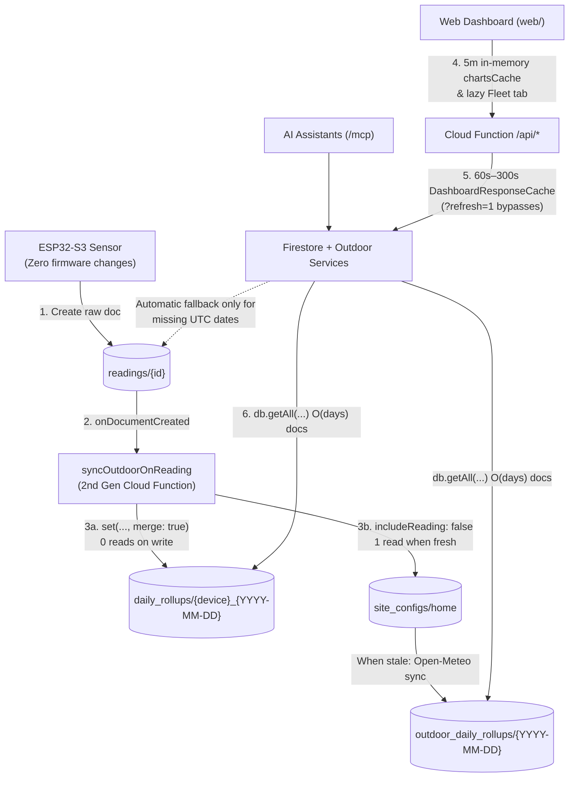

# Guide 13: Reducing Firestore Reads by >99% (Daily Rollups & Multi-Layer Caching)

> **Architecture & Performance Optimization** — Cuts Web Dashboard and Remote MCP history/summary Firestore reads by **>99%** (turning ~384–3,500 reads per chart load into ~4–16 reads—or **0 reads** on warm cache hits) and halves background trigger reads, with **zero firmware changes**.

---

## 1. Problem Diagnosis: Why Firestore Reads Spiked

Before this optimization, every 5-minute sensor reading wrote one immutable document to `readings`, and every 15-minute outdoor snapshot wrote one document to `outdoor_readings`. When the Web Dashboard (`web/`) or an AI assistant via MCP queried time-series history or summary statistics, the Cloud Function scanned every raw sample document in the window:

1. **Full-Window Raw Scans on Every Chart Load (`GET /api/readings/history`):**
   - **24h view (default on page open):** ~288 `readings` docs (at 5-minute cadence; up to **1,440** at 1-minute cadence) + ~96 `outdoor_readings` docs = **~384–1,536 reads per load**.
   - **7d view:** up to `MAX_HISTORY_SCAN_DOCS` (**2,500**) `readings` docs + up to **1,000** `outdoor_readings` docs = **~2,700–3,500 reads in a single click**.
   - **30d MCP summaries (`get_air_quality_summary`):** up to `MAX_SUMMARY_SCAN_DOCS` (**10,000**) reads.
2. **Zero Caching Across Window Toggles & Mutations:**
   - Toggling `24h ↔ 7d ↔ 6h` or switching rooms re-queried Firestore from scratch every time.
   - Saving Device Settings, requesting a remote reboot, or promoting OTA firmware called `refreshDashboard()` in [`web/app.js`](../web/app.js), re-scanning the full 24h/7d chart history even though only device metadata changed.
   - `fetchFirmwareReleases()` ran eagerly on every dashboard load even when the user never opened the **Fleet & Firmware** tab.
3. **Redundant Background Read in `syncOutdoorOnReading`:**
   - The `onDocumentCreated("readings/{readingId}")` trigger fired on every sensor publish and called `syncOutdoorReadingIfStale()` ([`functions/src/services/outdoor.ts`](../functions/src/services/outdoor.ts)), which read `site_configs/home` and then **also** ran `getLatestOutdoorReading()` even when the outdoor cache was still fresh and the trigger discarded the returned `reading`.

### Before vs. After Read-Count Impact

| Action | Before | After (Cold) | After (Warm Cache) | Reduction |
| :--- | :---: | :---: | :---: | :---: |
| Dashboard initial load (`24h`) | ~384–1,536 reads | ~6–8 reads | **0 reads** (60s server / 5m client) | **~98–100%** |
| Switch to `7d` chart window | ~2,700–3,500 reads | ~16 reads | **0 reads** | **>99.4%** |
| Toggle `24h ↔ 7d ↔ 6h` within 5m | ~384–3,500 reads | **0 reads** *(browser cache)* | **0 reads** | **100%** |
| Save Device Settings / Reboot | ~390+ reads | ~2–4 reads *(overview only)* | ~2–4 reads | **~99%** |
| MCP `get_air_quality_summary(30d)` | up to 10,000 reads | ~31 reads | ~31 reads | **99.7%** |
| Background `syncOutdoorOnReading` (fresh) | 2 reads / reading | 1 read / reading *(rollup write = 0 reads)* | 1 read / reading | **50%** |

---

## 2. Architecture: Write-Time Daily Rollups + 3-Layer Read Path

Instead of reading hundreds or thousands of individual documents per chart, Cloud Functions now maintain **UTC-day rollup documents** incrementally as readings arrive, behind two fast TTL caches:



---

## 3. Data Model & Key Engineering Decisions

### 1. Compact Lossless Per-Reading Samples (`daily_rollups` & `outdoor_daily_rollups`)
- **Document IDs:**
  - Indoor: `daily_rollups/{device_id}_{YYYY-MM-DD}` (UTC calendar day)
  - Outdoor: `outdoor_daily_rollups/{YYYY-MM-DD}` (UTC calendar day)
- **Why store compact per-reading samples instead of hourly/15-min pre-averages?**
  1. **0 Firestore reads on write & idempotent retries:** Each sample is stored under `samples.<epochSeconds>` and written with `set(..., { merge: true })`. Unlike pre-aggregated counters/averages, merging a map key requires **no read-modify-write transaction** and is naturally idempotent if Eventarc retries a trigger.
  2. **Exact statistics & spike detection:** `decodeIndoorRollupDoc()` and `decodeOutdoorRollupDoc()` reconstruct the full `AirQualityReading` and `OutdoorReading` shapes losslessly (including all 6 PMSA003I particle bins), preserving exact `p95` percentiles, threshold exceedance counts, and contiguous `notable_spikes`.
  3. **Tiny document footprint:** At 5-minute cadence (288 samples/day), a full day's map is ~45 KB (~4.5% of Firestore's 1 MiB document limit; even at 1-minute cadence it stays ~215 KB).
- **Automatic Raw Fallback (Missing Days + Today Tail-Gap Check):** `readIndoorReadingsFromRollups()` and `readOutdoorReadingsFromRollups()` return `{ readings, missingDates }`. If any UTC day in the requested window lacks a rollup doc, [`readings.ts`](../functions/src/services/firestore/readings.ts) and [`outdoor.ts`](../functions/src/services/outdoor.ts) group consecutive missing days via `groupContiguousDateRanges()` and query raw `readings` / `outdoor_readings` only for those gaps, deduplicating cleanly at day boundaries. Additionally, when a query spans today's UTC day and today's newest rolled-up sample lags behind `now` (`>15m` indoor / `>45m` outdoor) or `?refresh=1` (`forceTailCheck`) is passed, the reader performs a bounded raw tail query starting after the latest rollup timestamp so charts never stall if a background trigger lags.
- **Zero `firestore.rules` Changes Required:** Both `daily_rollups` and `outdoor_daily_rollups` are Admin-SDK-only collections and remain locked down to all clients/sensors by the existing catch-all `match /{document=**} { allow read, write: if false; }` rule.

### 2. Critical Firestore Safeguard: Unindexed `samples` Field Overrides
Firestore automatically indexes every field—including nested map fields—up to a hard limit of **40,000 index entries per document**. A single daily rollup map with hundreds of samples × 13+ fields per sample would quickly approach or exceed 40,000 index entries without an exemption.

[`firestore.indexes.json`](../firestore.indexes.json) explicitly disables automatic indexing on both `samples` maps via `fieldOverrides`:

```json
"fieldOverrides": [
  {
    "collectionGroup": "daily_rollups",
    "fieldPath": "samples",
    "indexes": []
  },
  {
    "collectionGroup": "outdoor_daily_rollups",
    "fieldPath": "samples",
    "indexes": []
  }
]
```

> [!IMPORTANT]
> Always deploy `firestore:indexes` **before** writing any `daily_rollups` or `outdoor_daily_rollups` documents so Firestore applies the `fieldOverrides` exemptions from day one.

### 3. Multi-Layer Caching & Targeted Refresh Behavior
- **Server-Side TTL Cache ([`functions/src/api/cache.ts`](../functions/src/api/cache.ts)):**
  - Bounded 64-entry LRU/TTL cache (`DashboardResponseCache`) scoped per `createMcpHttpHandler()` instance:
    - `GET /api/dashboard/overview` → **60s TTL** (`"overview"`)
    - `GET /api/readings/history` → **60s TTL** (`"history:<hours>|<limit>|<period>|<device>|<location>"`)
    - `GET /api/firmware/releases` → **300s TTL** (`"firmware_releases"`)
  - All authenticated `/api/*` responses carry `Cache-Control: private, no-store` so shared proxies never cache private telemetry.
  - **Write Invalidation:** Saving device config, requesting a reboot, or promoting/clearing OTA firmware invalidates `"overview"`; saving home site config or refreshing outdoor weather invalidates both `"overview"` and `"history:"`.
  - **Manual Bypass:** Passing `?refresh=1` (wired to the dashboard **Refresh** button) bypasses the server cache and refreshes the entry.
- **Browser-Side Optimizations ([`web/api.js`](../web/api.js) & [`web/app.js`](../web/app.js)):**
  - **5-Minute Chart Cache (`chartsCache`):** Switching between `6h`, `24h`, and `7d` (or between rooms) reuses cached payloads for 5 minutes with **0 API calls**.
  - **Lazy Fleet Loading (`loadFirmwareReleases`):** Firmware release manifests are fetched only when the user opens the **Fleet & Firmware** tab (cached for 5 minutes).
  - **Targeted Refreshes (`refreshOverviewOnly`):** Saving Device Settings, queueing a reboot, or promoting firmware refreshes only `/api/dashboard/overview?refresh=1`, skipping chart and release reloads. Clicking the top-bar **Refresh** button clears `chartsCache` and sends `?refresh=1` to reload live data immediately.

---

## 4. Deployment, Backfill & Verification Runbook

### 1. Offline Verification Suite
```bash
# Rollup encode/decode, 7d/30d parity, O(days) read count, and backfill helpers
npm --prefix functions run verify:rollups

# Full backend suite (typecheck, build, and all 7 verification scripts)
npm --prefix functions test

# Web dashboard offline checks (includes ?refresh=1 URL builder and caching checks)
node scripts/verify_web_dashboard.mjs

# Public-repo secret scan
./scripts/check-secrets.sh
```

### 2. Live Rollout Order & One-Time Backfill
```bash
# 1. Deploy Firestore index fieldOverrides FIRST (before writing rollup docs)
npx -y firebase-tools@latest deploy --only firestore:indexes

# 2. Deploy Cloud Functions (mcp + syncOutdoorOnReading) and Firebase Hosting
npx -y firebase-tools@latest deploy --only functions,hosting

# 3. Dry-run and live backfill of existing history (last 30 days)
GOOGLE_APPLICATION_CREDENTIALS= npm --prefix functions run backfill:rollups -- --days 30 --dry-run
GOOGLE_APPLICATION_CREDENTIALS= npm --prefix functions run backfill:rollups -- --days 30

# 4. Verify live Cloud Firestore queries against the backfilled rollups
GOOGLE_APPLICATION_CREDENTIALS= npm --prefix functions run verify:firestore -- --live
```

In our initial 30-day live backfill, `backfill:rollups` condensed **486** raw `readings` documents into **4** `daily_rollups` documents and **1** raw `outdoor_readings` document into **1** `outdoor_daily_rollups` document.

---

## 5. Good to Know & Real-World Troubleshooting

- **Clearing `GOOGLE_APPLICATION_CREDENTIALS` for Local Backfill:** If your shell exports `GOOGLE_APPLICATION_CREDENTIALS` for a different Google Cloud project, `firebase-admin` prioritizes that file over your default `gcloud` ADC and fails with `7 PERMISSION_DENIED`. Prefixing `GOOGLE_APPLICATION_CREDENTIALS=` (or setting `FIRESTORE_ACCESS_TOKEN`) lets `backfill:rollups` and `verify:firestore -- --live` use your active `gcloud` ADC cleanly.
- **`Cache-Control` Header Precedence in `sendJson()`:** [`functions/src/api/http.ts`](../functions/src/api/http.ts) sets `Cache-Control: no-store` only if a `Cache-Control` header has not already been set on `res`, allowing authenticated `/api/*` routes in [`dashboard.ts`](../functions/src/api/dashboard.ts) to enforce `Cache-Control: private, no-store`.
- **Explicit `"[DEFAULT]"` App Check in `getDb()` (`firebase-functions` v7):** In `firebase-functions` v7, `onDocumentCreated` triggers (such as `syncOutdoorOnReading`) deserialize the Firestore snapshot before running the handler by creating a named Firebase Admin app (`"__FIREBASE_FUNCTIONS_SDK__"`). Checking `getApps().length === 0` would mistakenly skip `initializeApp()`, causing `getFirestore()` to throw `Error: The default Firebase app does not exist`. [`getDb()`](../functions/src/services/firestore/db.ts) (and our Admin CLI scripts) explicitly look for `app.name === "[DEFAULT]"` instead.
- **Single-Invoke `db.getAll()` vs. Range Queries:** When `device_id` is specified (the standard dashboard chart path), `readIndoorReadingsFromRollups()` fetches exact document references via `db.getAll(...)` for `O(days)` reads. When `device_id` is omitted (fleet-wide MCP queries), it runs a single range query on `daily_rollups.date`.
